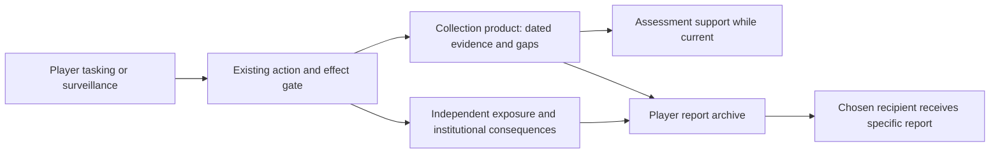
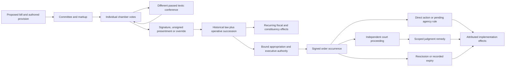
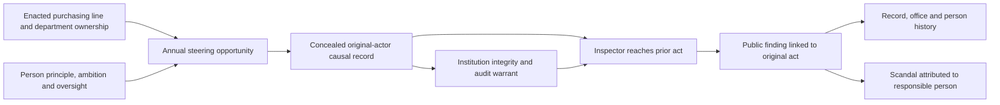
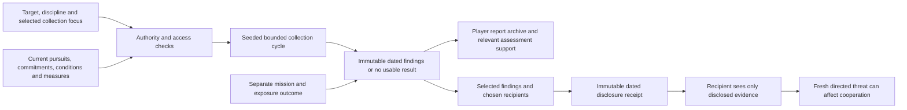

# Institutions, consequences and intelligence — working execution record

Status: in progress, not a completed audit or verified delivery. The owner explicitly authorized carrying out `INSTITUTIONS-EXECUTION-BRIEF.txt` in full and added useful intelligence obtained by surveillance of states and foreign governments, including benefits for allies. This extends BL-112; it does not replace the prior program or its unfinished phases. No publishing, deployment, paid corpus generation, destructive Git operations or push is authorized.

## Baseline and ownership

Observed checkout: `feat/map-first`, HEAD `537603adf`, with 717 changed/untracked paths at intake. Preserve prior work. The attachment's `73ecda316` baseline is historical. Existing `PROGRAM.md` covers a different earlier brief; neither document certifies the current tree. Operations workspace and phone/desktop parity remain accepted. Sol was used for two bounded source audits; Terra was requested as available but is not exposed by the subagent tool. No model-switch savings are claimed.

`pnpm run build` completed successfully before edits (log `/private/tmp/admin-depth-build.log`). Full baseline tests are running. No baseline proof-gate or browser pass is claimed yet.

## Mandatory mechanism/slice matrix

Every pending cell remains required. Counts below are minimum distinct behavioral proofs, not a claim of content coverage; the corpus inventory must set authored coverage targets before expansion. Existing counts from the attachment remain unverified until measured on this checkout.

| Cell / brief sections | Source owner and current evidence | Minimum distinct decisions and critical proof | Status |
|---|---|---|---|
| Legal routes (§3–6) | `orders.ts`, `legislation.ts`, `rulemaking.ts`, `state-judiciary.ts` | Same goal through bill, order, rule; authority and funding distinct; wrong target/emergency/funding refused | Partial: selected foreign threat/state request/construction funding predicates implemented; catalog-wide authority coverage still pending |
| Judicial process (§4) | `judicial-review.ts`, `court-votes.ts`, `court-opinions.ts` | Threshold dismissal, interim relief, merits, appeal/remand, limited remedy; eligible votes, quorum/tie, normal vacancy and historical bench | Partial: staged order/statutory/agency/federal-state matters, individual votes, quorum/tie, remand, limited relief and ordinary Supreme vacancies implemented; election, visa, housing, wage and interception subjects have earlier browser proof. Adverse-order acceptance, further review, independent stay and shared hard deadline implemented; final changed-surface proof pending; an ordinary seeded vacancy-to-seating trace preserves the prior opinion through reload |
| Congress (§5) | `bill-stages.ts`, `congress-votes.ts`, `law-offsets.ts` | Two substantive amendment alternatives; committee/calendar/cloture/final-passage differences; signing, unsigned and override exactly once | Partial: housing/health/clean-grid base/targeted provisions, chamber disagreement and conference re-vote, member voting and bill-bound reconciliation instructions implemented; housing repeal/renewal/replacement source tested; legacy/program census integration and final lifecycle journey pending |
| Executive implementation (§6,11) | `orders.ts`, `policy-program.ts` | Direct and delayed implementation; limited cancellation at bounds and after unrelated intervention; retries and stale previews | Partial: contribution lineage and prospective-authority consumers preserve saturation, unrelated interventions and sunk outcomes. Lease/clean-power transactions, munitions priority backlog, visa refusals and blocked-property restrictions are implemented. Cumulative cash retains unknown legacy history; final delivery/stay/save UI matrix pending |
| Corpus / occurrences (§7) | core pack, baked corpus, runtime factories and case lifecycle | Two materially different decisions per supported critical mechanism; recurring occurrences and family bindings; explicit inaction and pending attention | Inventory measured: 339 mounted definitions; 81 mounted audit errors. Recurrence and report/live-bill/vacancy/court binding implemented. Thirty-nine independent review artifacts cover thirty-eight unique definitions, including paired bridge/hospital/theater and Treasury-account callbacks plus high-impact authority/accounting repairs. All remain unmounted; broader corpus repair and distinct court/conference content remain pending |
| People / influence (§8,12) | existing ties, lobbying, person network and cabinet behavior; BL-120–124 | Matched chair/junior, constructive/oppositional ambition, loss of office, bounded propagation and accessible scoped graph | Partial: directed issue outreach, independent preferences, shared attention, scoped navigation and multi-step graph implemented; cabinet reach/ambition and concealed purchasing-opportunity graft tested. Retained-term graph construction measured; stable-expansion proof passes six widths with inspected captures; final disclosure UI inspection pending |
| Trust / betrayal (§9) | strike outcomes, resolution ripples, treaty counterpart | No-civilian first strike, accident, attribution uncertainty, shared enemy; actual compact; later treaty and intel cooperation | Partial: deliberate first strike costs victim trust without civilian deaths, and third-party defense reaction requires an actual common defense compact; wider attribution/repair matrix pending |
| Uncertainty / retention (§10) | RNG, assessments, forecasts, saves | Same-seed replay; no browse rerolls; old saves retain known facts; forecasts measured across seeds | Existing mechanisms partial; integrated proof pending |
| Effects / distribution (§11) | impact model, domestic/cohort routing, effect application | Overlapping channels charged once; debt vs losses vs outlays; irreversible harm retained | Partial: live national/state casualty accounting and delayed authored tolls implemented; financial band/corpus repair and overlapping channel proofs pending |
| Intelligence addition (§10,12 + owner) | `intelligence.ts`, `security-effects.ts`, `instruments.ts`, `locale-acts.ts`, collection UI | Foreign and domestic report; useful collection with exposure; no result without invented reassurance; stale report; selected ally sharing; refused domestic politics; no hidden truth through graphs | Partial: dated findings/gaps/confidence/exposure/archive, selected recipient snapshot, narrow economic-support recipient use, and DHS public-state analysis implemented; four report-specific decisions independently reviewed; selective per-finding disclosure and diplomatic recipient willingness implemented; broader access audit pending |
| Explanation and access (§12–13) | existing UI, help and dossier selectors | Committee, appeal, betrayed-partner examples; phone/desktop/keyboard; visible unknowns and no derived privacy leaks | Partial: contextual examples and unknown states implemented; final multi-width and new-player proof pending |
| Full campaigns (§16–17) | existing tests, verify gates, balance and browser harness | Ordinary seeded journeys, full-term diversity/calibration, dense graph performance, save/reload across commitments | Partial: two actual Continue seeds reached election defeat with save/restores and immutable cases; retained-term graph construction passes the unchanged performance gate. Two identical current Hill captures satisfy roster/vote/favor invariants. Final balance, broader distribution and full acceptance remain unresolved |

## Intelligence slice contract and challenge

User-visible outcome: after directing collection or surveillance, the President can read a dated report of what was obtained, what remains uncertain, whether the operation was exposed, and what a selected foreign recipient received; useful information and operational failure can coexist.

Reuse search: repository engine/player-core/UI intelligence, assessments, covert instruments, domestic coercion, save and effect writers; sibling project filenames; installed skill filenames. Existing collection products and assessments are the authoritative home. No new dependency or parallel knowledge system is justified.

Blast radius: intelligence product/state/effect contracts, collection issuance, surveillance resolvers, save version, assessment support, player-core reading/actions and Security surface. Existing domestic authority claims need separate legal review; obtaining information must not retroactively legalize an act.

Strongest failure mode: turning collection into an omniscience switch or laundering a low-confidence allegation into a fact shared with an ally. Best alternative is report-level evidence with dated observations, explicit uncertainty and recipient records. Decision: accepted with controls. Collection/exposure draw separately on namespaced streams; reports snapshot supported runtime facts; sharing copies a particular issued product and does not unlock all target data. Missing legacy observations remain missing. Closed taskings cease contributing live assessment support while their issued reports remain history.

## Primary legal sources opened 2026-10-12

- [Supreme Court rules, effective March 16, 2026](https://www.supremecourt.gov/filingandrules/2026rulesofthecourt_web.pdf), Rule 4: six participating members constitute a quorum; without it the Court may wait to meet. This supports refusing a fabricated merits decision from an empty or nonquorate bench. It does not by itself establish every appeal's equal-division disposition; that posture needs its own record and source.
- [Senate Intelligence Committee's amended Executive Order 12333 text](https://www.intelligence.senate.gov/2008/02/29/laws-executive-order-12333-1981-amended-executive-orders-13284-2003-13355-2004-and-13470-2008/): United States person collection, retention and dissemination depend on approved procedures and applicable authority. The current game's state-wide surveillance action cannot honestly describe a general presidential signature as sufficient authority. Existing political costs are not a substitute for modeling those limits. Useful reports preserve this unresolved legal distinction, and domestic reports are not automatically eligible for foreign dissemination.
- Attempts to open the House preliminary-code pages for 28 USC 1 and 2109 failed (maintenance/server error). They are not treated as verified sources.

## Baseline qualification

The first `pnpm run test` ended with two failing packages. Engine: one Hill-ledger golden mismatch, 4218 tests passed. Web: the pre-existing metric-link test assumes every release link still routes through `/brief/metric`; five additional bill-screen failures were caused by this pass's source edits being read before regenerated player-core output. Because other work and commits continued while the command ran, it is an initial measurement of a moving tree, not a clean frozen baseline. A rebuilt integration run is required. No snapshots were updated to silence the failure.

## Verification record (open)

- Project inspected: answered above, "Existing collection products and assessments are the authoritative home."
- Reuse checked: answered above, "No new dependency or parallel knowledge system is justified."
- Validation path run: checkpoint commands and failures recorded below; later substantive changes require a fresh integration run.
- Outcome observed: report reading/sharing/reload and pending/final court files exercised through the real web player at all six supported sizes (12 browser journeys passed). Other cells remain pending.
- Surface inspected: not done at this checkpoint: captures were erased by a concurrent Playwright output cleanup before visual inspection; rerun and preserve captures before closing.
- Diff reviewed: partial, implementation and cross-system integration ongoing.
- Residual risk: all pending matrix cells remain open under BL-112, with intelligence tracked as BL-135.

## Integration checkpoint — 2026-10-12

The other chat that committed in this checkout was paused by the owner. HEAD observed after that confirmation: `337e080bd`. No Git mutations were used to isolate or suppress failures. This record separates the validated checkpoint from later changes still underway.

Check:    clean workspace compilation
Command:  `find . -name tsconfig.tsbuildinfo -not -path '*/node_modules/*' -delete` followed by `pnpm run build`
Result:   pass
Observed: workspace build completed; log `/private/tmp/admin-depth-verified-build.log`.

Check:    workspace types and lint at the built checkpoint
Command:  `pnpm run typecheck`; `pnpm run lint`
Result:   pass
Observed: both commands exited successfully; logs `/private/tmp/admin-depth-current-typecheck.log` and `/private/tmp/admin-depth-current-lint.log`.

Check:    full package tests
Command:  `pnpm run test`
Result:   fail
Observed: nine packages passed and three failed (engine, content, player-core); web passed all 358 tests. Log `/private/tmp/admin-depth-current-test.log`.

The failing engine run had 4236 passing tests and six failures. Four stale save-version assertions and the war-join fixture's incidental dependence on private access were repaired; the focused five-file rerun passed 97 tests. Content's two oversight assertions were repaired by finding a seeded board that reaches a struck-down rule through actual judicial phases (`rule-board-35`), and its 22 focused tests passed. Player-core's eight obsolete membership-access assertions were replaced with capability-based positive fixtures and membership-negative proofs; its two focused files passed 24 tests. These repairs do not substitute for rerunning the full suite. The Hill-ledger golden digest remains unresolved: all 120 captured weeks match their explicit Hill fields, while their whole-campaign hashes differ. No snapshot was repinned.

Check:    all existing proof scripts at the checkpoint
Command:  sequential `node <path>` for every `scripts/verify-*.mjs` (81 scripts)
Result:   fail
Observed: 60 passed, 21 failed; `/private/tmp/admin-depth-verify-results.json` and `/private/tmp/admin-depth-verify.log` retain per-command results.

That run included `verify-dist-freshness-proof.mjs`, which attempted its own Git checkout and was refused by the filesystem sandbox. Do not rerun this mutating proof in a dirty shared checkout. `verify-dist-freshness.mjs` itself refuses dirty generated output. Neither result is evidence of stale compilation, and neither justifies discarding or committing user work. The other failing families include CSS, spelling, file size, reachability, foreign privacy, retired-history references, calendar conversions, opinion causes, content publication, rule seams, and unused primitives. They remain separate findings until source changes or a measured baseline explain them.

Check:    player action reachability after registry reconciliation
Command:  `node scripts/verify-engine-reachability.mjs --write-md`
Result:   pass
Observed: 169 rows over 95 functions; 168 reached, one explicitly retired, zero unreached. Added report sharing, domestic-state tasking, and housing text/conference actions. Retired the displayed aggregate strike-down multiplier because staged proceedings and recorded individual votes replace it.

Check:    foreign privacy rule and adversarial fixtures
Command:  `node scripts/verify-foreign-truth-proof.mjs`
Result:   pass
Observed: membership-only changes grant no private access; 56 of 160 outside-body governments and 508 of 8157 third-party ties unread at founding; all four named adversaries hidden; no new scalar prints. The old requirement that every shared-body government be privately readable was replaced by a membership-invariance check, with planted failure and missing-comparison tests. Existing fog floor and ratchets remain.

Outcome:  A President reads a dated foreign or DHS public-state report, reviews and sends a particular foreign report to Canada, sees the receipt, and retains its recipient through reload; court files distinguish a pending procedural stage from a recorded final disposition.
Surface:  Security intelligence and Washington court docket/case routes through Playwright.
Data:     actual engine-generated `collection-intelligence` and `court-procedure` saves (approximately 10 MB), no stubbed request or UI-only records.
Observed: `E2E_PORT=4198 E2E_FIXTURES=collection-intelligence,court-procedure pnpm --filter @admin/web exec playwright test tests/intelligence-reports.spec.ts tests/court-procedure.spec.ts --workers=2` passed all 12 journeys at the six configured widths, with no page errors or horizontal overflow.
Verdict:  proven for those interactions at that checkpoint; rendered screenshots still require inspection, and later engine changes require rerun.

## Remaining load-bearing limitations

- Selected-state relief, foreign emergency predicates and enacted construction funding now have implementation and focused tests. Final direct-resolver/browser integration and fiscal reconciliation remain in progress.
- Courts have order and statutory-priority matters plus seeded annual vacancies. Scoped party relief, recorded prior-review recusal and relative lineage remedies are behavioral. Independent litigation, remaining dispute families and broader differentiated legal reasoning remain mandatory.
- Persistent member voting and separate cloture/passage now exist. Public support readers show unresolved evidence rather than exact future private votes. Real outreach propagation and member office eligibility are implemented; broader procedural coverage and final UI proof remain in progress.
- The 339-definition mounted pool is measured through the actual store running-clock path. It still needs coverage classification and diversity work; the repaired harness does not prove Continue's attention stop.
- Four report-bound scenarios are independently approved after revision: three findings/shared/state-response decisions and one active-tasking no-result decision. The latter initially failed because a surveillance report need not own an open tasking; the new gate and late liveness check prevent that false claim. These are local reviewed artifacts; none has been published or mounted into the shipped pool. Broader required content cells remain pending.
- Full per-fact privacy, overlapping demographic accounting, forecast calibration, trust/attribution/repair coverage and the wider relationship cloud remain mandatory open cells under BL-112.

### Hill golden diagnosis follow-up

A read-only `git archive` of `1213445ca` was extracted under `/private/tmp` and built in isolation. Its source does not compile: it imports `lobbying-person.ts`, `credit-share.ts`, `lobbying-copy.ts` and related files absent from that commit. A separate archive of observed HEAD `337e080bd`, with its own world and engine compilation, built successfully. Running the first `ledger-0`/prudent week from that archive produces digest `10213cda1749fb9b`, while the checked-in golden expects `ff9d3dae35e1e15d`. This reproduces the mismatch without this pass's uncommitted changes. It supports a stale or unreproducible golden baseline, not a claim that all new state behavior is identical. The generating source state is not recoverable from the snapshot commit alone; no golden update was made.

## Integrated checkpoint: members, reports, housing and recurrence

Check:    actual player journeys at six configured viewport sizes
Command:  `E2E_PORT=4207 E2E_FIXTURES=congress-members,collection-intelligence,housing-conference,housing-enrolled,scenario-recurrence pnpm --filter @admin/web exec playwright test tests/congress-members.spec.ts tests/intelligence-reports.spec.ts tests/housing-conference.spec.ts tests/scenario-recurrence.spec.ts --workers=1`
Result:   pass
Observed: 30/30 journeys passed; log `/private/tmp/admin-depth-combined-browser.log`, preserved captures `/private/tmp/admin-depth-combined-proof/`. This precedes later public-forecast/help/CSS changes and is checkpoint evidence, not their proof. Parent inspected the 320px member filter, 390px enrolled housing pipeline and report archive, and 1920px named roll call. Remaining surfaces need inspection after integration.

Outcome:  The player can search real seated members, inspect only votes actually taken, settle a housing conference, read/share a dated report and retain recurring case history across reload.
Surface:  Congress, bill, Security and scenario routes in the Vite player.
Data:     engine-generated campaign saves; no stubbed fetches or UI-only fixture records.
Observed: named roll-call rows and cloture-only history, selected recipient receipt and stable recurrence history were exercised. The six-stage housing rail no longer overlaps at narrow width.
Verdict:  proven at the stated checkpoint; latest source changes require rerun.

Check:    recorded-vote rendering boundary
Command:  `pnpm --filter @admin/web exec vitest run src/washington/congress/congress.test.tsx`
Result:   pass
Observed: 15 tests passed, including rejection of introduction forecasts as historical votes and separation of recorded cloture from final passage.

## Full-term running-clock measurement

The existing `scripts/sim` runner now mounts the actual core/delivered/baked pool (core precedence), uses `createCampaignStore`, commits pending conversations and advances seven daily clock steps per sampled policy week. It awaits the asynchronous store path. The retired mandate metric is replaced with approval and occurrence identity is recorded. The existing player-core Node resolver was extracted for reuse by fixture and simulation scripts; no dependency was added.

Check:    same-seed runner smoke
Command:  two identical three-week smoke runs using the repaired `scripts/sim-failure-trajectories.ts` path, followed by byte comparison of run records
Result:   pass
Observed: run records matched exactly and floor values were finite. This is a short determinism check, not full-term replay proof.

Check:    four full-term policy runs with the mounted pool
Command:  `node scripts/sim-failure-trajectories.ts --pool bundled --seeds 4 --horizon 208 --archetype steady --workers 2 --json /private/tmp/admin-depth-clock-full-term.json`
Result:   pass (execution), unresolved (product quality)
Observed: four runs completed in approximately 345 seconds. All ended defeated; each answered 198 scenarios and reached all 18 classes. Distinct templates: 126, 123, 124, 126; repeated-template answers: 72, 75, 74, 72. Median minimum approval .373, stability .121, standing 0, treasury ratio .822. These show remaining repetition and balance concerns. Running-clock policy is not Continue/attention-stop behavior; concurrent source work makes this a launch-time module checkpoint. Logs: `/private/tmp/admin-depth-clock-full-term.log`.

## Content and explanation checkpoint

Independent parent review read the three authored report decisions and rejected all three using the existing `scenarios review` command: prose promised assessments, conditional aid and logistics without executing them; arbitrary costs and unread flags compounded the problem. No validator was weakened and nothing was published. Revisions invoke actual collection, closing, locale response or order commands at commit time, subject to stale/legal refusal. A remaining domestic draft incorrectly described selected-state relief as nationwide; that is a second explicit review finding, not an accepted scenario.

The maintained glossary now distinguishes cloture from passage, threshold review from merits, review denial from an adverse merits ruling, equal division from automatic presidential victory, and report confidence from mission success. Contextual expandable help is being attached to Congress, Courts and Intelligence. Shared body membership is explicitly insufficient for private-government access. Model projections now offer today's judgment causes separately from future differences; electorate polarization reuses the existing recorded-cause reader.

Check:    glossary and model readers
Command:  `pnpm --filter @admin/player-core exec vitest run src/glossary/glossary.test.ts src/modeling/modeling.test.ts`
Result:   pass
Observed: 17 tests passed; later new intelligence glossary item separately passed the nine glossary tests. Browser proof of the new help remains pending.

Check:    static ownership/calendar/language repairs
Command:  `node scripts/verify-opinion-causes.mjs`; `node scripts/verify-rule-seams.mjs`; `node scripts/verify-no-history-references.mjs`; `node scripts/verify-one-day-counter.mjs`
Result:   pass
Observed: no uncaused opinion displays, all newly scanned rule sites classified with reasons, no retired tracker references, and one day-counter conversion contract. The weather headline parser now reads all emitted basin nouns from the existing authoritative table; no spelling exception was added.

Check:    weather headline regression tests
Command:  `pnpm --filter @admin/engine exec vitest run src/article-coherence.test.ts src/condition-incidents.test.ts`
Result:   pass
Observed: 30 tests passed; log `/private/tmp/admin-depth-weather-copy.log`.

## Continuing integration checkpoint

The original three report decisions were approved after executable-command and state-scope revisions. The empty-return item was separately rejected because a direct surveillance report could lack an open tasking, then approved after `activeTasking` binding and missing/closed/taskless-source negative tests. The first rejection remains in its review directory. CLI `scenarios review` results are 3 approved and 1 approved respectively; its local “shipped.json” is a review artifact, not corpus publication.

Check:    capability and icon inventory
Command:  `node scripts/verify-engine-reachability.mjs --write-md`; `node scripts/verify-icon-registry.mjs --update-baseline`
Result:   pass
Observed: the armed-forces declaration is registered at its actual order screen; 171 ledger rows, 170 reached and one explicitly dropped at this checkpoint. The icon allowance shrank; no baseline was widened.

Check:    unused design components
Command:  `pnpm --filter @admin/ui-web test`; `pnpm --filter @admin/ui-web lint`; `node scripts/verify-css-architecture.mjs`
Result:   pass
Observed: 69 tests passed after removing obsolete Lines/Ring components, exports and styles. Production comparisons use SeriesChart; the briefing clock uses an icon and explicit time. CSS has zero findings. Regenerated output and final browser checks remain pending.

Outcome:  A player opens a statutory-priority court file and reads contextual judicial help with the keyboard at supported sizes.
Surface:  Court docket and case routes in the real web player.
Data:     enacted defense authorization and production-order fixture, with live procedural records.
Observed: `E2E_FIXTURES=statutory-court E2E_PORT=4207 pnpm --filter @admin/web exec playwright test tests/statutory-court.spec.ts --reporter=line` passed all six configured widths. Parent opened the 320px and 1440px captures under `/private/tmp/admin-statutory-court-*.png`: text reflows on the phone; parties, authority, injury and next step are readable at desktop width.
Verdict:  proven for this checkpoint. Subsequent agency timing and remedy-lineage changes need a new run.

Check:    trust explanation vocabulary
Command:  `pnpm --filter @admin/player-core exec vitest run src/glossary/glossary.test.ts`; `pnpm exec eslint packages/player-core/src/glossary/world.ts apps/web/src/world/nation/NationScreen.tsx`
Result:   pass
Observed: glossary checks and lint passed. A betrayed-partner example now describes directed trust, refusal and partial repair without erasing history; a contextual help control is added to the diplomacy tab. Its browser proof is pending.

A paired forecast diagnostic held later choices constant: among the four forecasts issued from identical starting states, one covered the observed result in each arm. Holding choices reduced three misses but did not eliminate them. Later forecasts are not matched because the policies changed the campaign. Daily projection settlement is now being checked against the actual clock; no population-level calibration is claimed.

Newly confirmed accounting defects remain on the critical path: later saturation defeats reversal from a single landed delta; authored human tolls need the same national/state accounting as incident casualties; and at least four mounted financial declarations contradict their prose (including a repayment choice that adds borrowing). Each has an active owner. Pending mandatory cells remain incomplete rather than being reclassified as optional.

## Second integration freeze (2026-10-12)

Source was serialized before rebuilding. A new integrity review identified that the Senate tiebreak changed a senator's aggregate vote and that an old saved port-fire cast could retain the new relative casualty effect after being marked already reported. Both are being corrected against behavioral invariants, without changing expected outcomes merely to pass tests. The first clean build attempt stopped at a new legislative-content test fixture missing its required rejoinder; that fixture was repaired and its focused tests passed. This is not yet a clean full-workspace result.

The long-running balance command has reported a population-suite failure: its sampled player population contains no removal, while another balance sample does contain reckless removals. Its complete verdict and diagnosis are still pending. No thresholds have been changed to satisfy that sample.

### Captured integration result and next source pass

Check:    clean full workspace build
Command:  `find . -name tsconfig.tsbuildinfo -not -path '*/node_modules/*' -delete`, then `pnpm run build`
Result:   pass
Observed: retry completed every workspace package; `/private/tmp/admin-depth-integrated-build-2.log`. Removed generated Lines/Ring modules after confirming their source had been deleted.

Check:    workspace lint and typecheck
Command:  `pnpm run lint`; `pnpm run typecheck`
Result:   lint pass; typecheck fail
Observed: lint passed; typecheck found a newly added map-test foreign NationId missing its brand. The fixture has since been corrected and web typecheck passed, but that narrower rerun does not replace the full checkpoint result. Logs `/private/tmp/admin-depth-integrated-{lint,typecheck}.log`.

Check:    full package tests on the built checkpoint
Command:  `pnpm run test`
Result:   fail
Observed: eight packages passed and four failed. Engine 4282 passed/6 failed (cabinet distribution pin, three graph goldens, graph timing under concurrent load, known Hill whole-state golden). Content 950 passed/5 failed because a preview rule board did not meet the newly enforced relief authority. Player-core 1324 passed/3 failed plus a fixture-loading suite failure: obsolete domestic-emergency powers, late party relief fixture, and two stale generated Senate saves. Studio CLI 332 passed/5 brief snapshot failures. Web passed 361. Full log `/private/tmp/admin-depth-integrated-test.log`. Source edits resumed only after the relevant package completed; downstream packages continued reading the frozen built dependencies.

Check:    gate regressions and adversarial gate proofs
Command:  `node scripts/verify-<name>.mjs` for the five prior failing safe gates; `node scripts/verify-<name>-proof.mjs` for all proof twins except dist freshness
Result:   four of five rechecks passed; all 33 safe proof twins passed
Observed: the compact flag static marker gate still failed at the captured recheck and was corrected afterward with its proof passing. Per-command records `/private/tmp/admin-depth-recheck-gates.json` and `/private/tmp/admin-depth-safe-proofs.json`. The dist-freshness twin remains excluded because it uses Git checkout against the dirty tree; this does not waive compiled-output review at an authorized commit.

Outcome:  A player gives an issued-report answer, obtains a collection tasking receipt, retains the source report after reload, requests real member outreach and sees its later response, and opens/closes trust help with the keyboard.
Surface:  Built player, all six configured widths.
Data:     actual engine-generated issued-report, collection and member campaign saves.
Observed: `E2E_PORT=4189 E2E_FIXTURES=member-outreach,issued-report-decision,collection-intelligence pnpm --filter @admin/web exec playwright test tests/issued-report-decision.spec.ts tests/member-outreach.spec.ts tests/trust-help.spec.ts` passed 18/18. Parent inspected report320, trust320 and member1440 captures; the captured inner pane did not yet show all target evidence. Capture code now scrolls the target into view for renewed inspection.
Verdict:  interaction proven at checkpoint; full target-surface inspection remains open.

A separate actual bill-page journey adopted a concurrent budget instruction (House 258–177, Senate 56–44), then preserved the result through reload. Parent inspected `/private/tmp/admin-reconciliation-bill.png`: readable narrow layout and recorded results; the visible internal bill ID prompted its removal from the ordinary bill view. That removal requires a fresh capture.

The new source pass is addressing the diagnosed week-rollover approval bug, evidence-based autonomous cabinet reach, autonomous state election-access litigation, and three grounded financial-content repairs. Those changes are later than this checkpoint and are not certified by it.

### Completed balance run and next integration

Check:    required full-term balance harness
Command:  `pnpm --filter @admin/engine run test:balance`
Result:   fail
Observed: 136 passed, two failed, four skipped across 13 files in 5917.93 seconds; `/private/tmp/admin-depth-balance.log`. The five-seed player-population sample had no removals. Other samples did reach removal, so reachability is not disproved. The Democrat investment/careful paired sample had a median approval advantage of 0.0260384 against its 0.02 upper bound; Republican and Independent samples passed. No coefficients or thresholds were changed to satisfy these samples. This run predates the latest source changes.

The disposable Continue probe first exposed a harness serialization comparison (an absent JSON key versus an in-memory undefined key), then a missing harness configuration: `createCampaignStore` defaults to no attention sources, while the app injects desk and scenario sources. The early smoke therefore proves neither attention-stop preservation nor full-term behavior. The probe now uses the app's sources and JSON-normalized reload equality; its outcome remains under test.

The new independent HAVA matter is an integration draft. Review found immediate filing without a recorded state-response interval, contradictory appeal-enforcement metadata, and guaranteed installation on a timer. Those are named defects to repair, not accepted abstractions or completed judicial-family coverage.

### Third integration checkpoint and visual inspection

Check:    clean build and full workspace typecheck
Command:  `find . -name tsconfig.tsbuildinfo -not -path '*/node_modules/*' -delete`; `pnpm run build`; `pnpm run typecheck`
Result:   pass after fixing a new union narrowing and a widened test literal
Observed: logs `/private/tmp/admin-depth-build-3-retry.log` and `/private/tmp/admin-depth-typecheck-3.log`.

Check:    full package tests
Command:  `pnpm run test`
Result:   fail
Observed: 11 packages passed; engine 4298 passed and two failed (the known stale Hill whole-campaign snapshot and graph timing 3764.9ms against unchanged 3000ms budget). Content 964, player-core 1334, studio-cli 337 and web 361 passed. Log `/private/tmp/admin-depth-test-3.log`. Sources were released after their package completed; later changes are not certified by this run. The two Senate fixture generators were corrected to use actual member rosters, separate cloture/final votes and a real bill-specific adopted budget instruction before regeneration.

Outcome:  Issued-report answer, member outreach and keyboard trust help work at six supported widths.
Surface:  Real web player with production-shaped engine saves.
Observed: `E2E_PORT=4189 E2E_FIXTURES=member-outreach,issued-report-decision,collection-intelligence pnpm --filter @admin/web exec playwright test tests/issued-report-decision.spec.ts tests/member-outreach.spec.ts tests/trust-help.spec.ts` passed 18/18 again. Parent opened the target report, graph and trust captures at 320,390,768,1280,1440,1920 widths. Report findings and trust text are readable; narrow panes scroll behind the fixed action bar. The graph clips its bottom secondary label and scope still affects only a list/subject selector. Those are defects under correction, not visual acceptance. Report evidence wording also exposed an internal “pursuit activity record” label for replacement.
Verdict:  interactions proven at this checkpoint; graph surface not accepted.

A fresh bill journey against Vite preview at port4187 retained the recorded FY2029 budget instruction (House258–177, Senate56–44). The inspected `/private/tmp/admin-reconciliation-bill-current.png` shows the bill identity and instruction with no raw ID in its status section; the browser snapshot also checked article metadata.

Three grounded financial repair outputs cleared the full CLI gate, then were independently rejected via `scenarios review grounded-financial-repairs-2026-10-12` (zero approved, three rejected). Exact notes remain in the existing review artifact; `/private/tmp/admin-grounded-financial-review-rejected.log` records the result. Health scope, private IG disclosure, raw sector/report IDs, unread flags and unsupported historical/transmission claims require revision. Automated acceptance is not content approval.

### Forecast control correction

The 24/40 held-sample result was not a clean control: the harness permitted choices on the forecast due turn before settlement and failed to count those choices as follow-ups. `scripts/sim/play.ts` now holds through that boundary and counts due-turn actions. A targeted regression passed via `pnpm exec vitest run scripts/sim/play.test.ts`. The revised same20-seed held sample settles40 forecasts with31 inside their five-member min–max range, eight below and one above, no follow-ups, mean signed error−0.000346 and mean absolute error0.002944. The continuing-policy control has20/40 inside,17below/3above and40/40 follow-ups, mean signed error−0.002861. Records: `/private/tmp/admin-forecast-hold-20-strict.json` and `/private/tmp/admin-forecast-continue-20-strict.json`. These correlated samples and a min–max ensemble range do not establish nominal probability calibration.

### Condition incident toll reconciliation

The mounted core plus corpus shards contain 12 replies with a declared human death band under four condition-backed scenarios. The engine's condition impact event can also own population deaths. This is an overlap inventory, not a finding that all 12 replies double-count the same people. The classification below follows each reply's current wording; `review` means the prose does not establish whether its deaths are already in the incident total or occur later.

| Scenario | Reply | Classification and evidence |
|---|---|---|
| Ridge above the reservoir (core) | Sign the federal share | Review: ridge holds; no reply-specific deaths are stated. |
| Ridge above the reservoir (core) | Hold them to the filed plan | Review: ridge fails two days later; subsequent casualties may be new. |
| Ridge above the reservoir (core) | Federalize the response | Review: political backlash is stated; no reply-specific deaths are stated. |
| Stock that covers one district | Protect the uplands | Review: river district's later season is described; deaths may follow the choice. |
| Stock that covers one district | Protect the river district | Review: uplands bury more than modeled; the relation to the condition event's recorded total is unstated. |
| River over the levee | Everything to the rescue | Review: a second crest damages the water plant; the stated death band is not tied to a named count. |
| River over the levee | Hold the levee line | **Confirmed overlap:** the rejoinder identifies four of the seven dead already confirmed in the opening. |
| River over the levee | Call for outside help | Review: pumps and publicity are described; the stated death band has no count in the rejoinder. |
| Grid that cannot promise the morning peak | Sign the emergency order | Review: frozen gas supply prevents full generation; the declared deaths are not dated. |
| Grid that cannot promise the morning peak | Generators to care homes | Review: people on oxygen at home remain exposed; the declared deaths are not dated. |
| Grid that cannot promise the morning peak | Generators now, hold the order ready | Review: idle units are kept warm for later; the declared deaths are not dated. |
| Grid that cannot promise the morning peak | Approve declaration, leave grid to state | Review: another cut follows; the declared deaths may be later harm. |

The content owner's session-driver repair for the confirmed river overlap was accepted at `content/jobs/work/river-reported-toll-pilot-2026-10-12/river-reported-toll-pilot-2026-10-12-the-river-over-the-levee.out.json`. It marks the one reply's human toll `already-reported`; no shard or baked corpus was changed. `pnpm --filter @admin/content exec vitest run src/impact-accounting.test.ts` passed four integration tests: an event books seven deaths once, the repaired reply leaves nation and state populations unchanged while retaining its opinion and domestic mark effects, a named-cohort variant retains negative cohort memory, and the financial channels are separated as described below. `pnpm --filter @admin/content run typecheck` passed. The other 11 rows need semantic review before any accounting flag is assigned. The root replay regression is explicit-only: root `pnpm run test` delegates to recursive package tests and does not include `scripts/sim/play.test.ts`.

Financial accounting was also exercised through two actual scenario consumers in the same targeted test (now four tests passed, with content typecheck passed). The condition-backed river impact event records $5m of lost output while its `economy: parent` ownership produces zero independent growth pressure and does not immediately alter GDP. The accepted river reply books a separate `choiceBorrowing` debt increase and no budget-authority draw. The core ridge fire's `sign-the-federal-share` reply draws exactly $2,200m from the President's authority and separately increases national debt and `choiceDebt` by its modeled borrowing. These checks establish distinct state channels, not Congressional passage: the current `choiceBorrowing` effect applies directly to debt, while the `impact-model.ts` comment describes a supplemental that Congress votes. That legal authorization claim remains unproved by these consumers. The river pilot retains a nationwide financial scope; whether its relief should instead be priced to a city or region is a content-accounting decision outside this toll-only repair. The strongest failure mode is treating a modeled debt increment as proof of an enacted appropriation; a future relief commitment or bill-based funding path would model that distinction more faithfully. Current verdict: **accepted with controls** for channel separation, **needs validation** for appropriation authority and geographic financial scope.

### Office-day parity and Hill golden diagnosis

The Build5 engine run failed reckless office-day parity at a final stability difference of 0.0057 against the unchanged 0.005 test band. A targeted `pnpm --filter @admin/engine exec vitest run src/week-play.test.ts -t reckless` reproduced the same value. The first metric difference occurs in week 22. Both paths ended week 21 at stability 0.40372493038550006 and issued the same successful rung-5 covert operation against PRK in week 22. The office-day path had four additional scheduled incident-update ledger entries before that act, so its old global ledger occurrence key was 1590 and its exposure draw 0.215658, below the 0.247001 exposure chance. The flat path keyed at 1586 and drew 0.742605. One operation was therefore publicly exposed with a −0.0275 stability cost; the other remained intelligence-only with −0.0105. This explains the initial 0.017 divergence and its later decay to 0.0057. The strongest failure mode was a player's covert outcome changing because unrelated daily bookkeeping inserted records; the alternative is an action-specific occurrence. The higher-rung stream now counts only matching same-turn covert commitments for the same actor, target and rung. Rung-one surveillance retains its prior key for compatibility. New tests cover unrelated entries, distinct repeated operations and save/reload. Verdict: **accepted with controls**; no threshold or coefficient changed. `pnpm --filter @admin/engine exec vitest run src/week-play.test.ts src/stability-attribution.test.ts src/approval-attribution.test.ts` passed 13 tests; `pnpm --filter @admin/engine exec vitest run src/covert-exposure.test.ts src/resolution.test.ts` passed 50; targeted ESLint passed. Engine typecheck currently fails only in concurrent `orders.ts` grant-subject work, after this fixture's type error was corrected.

The Hill golden remains **unrepinned**. The checked-in capture has 120 weeks. A clean HEAD baseline capture differed from it only in the whole-campaign digest for all 120 weeks; every explicit Hill field matched. Two Build5 captures were byte-identical, but versus the golden the Build5 capture changed the digest, probes, removal, figures and chamber fields in all 120 weeks, room in 95, votes in 76, lobbying in 60 and promises in four. The first week seated a new named congressional leader and changed House neutral-probe yeas from 227 to 230 in the administration and 13 to two in the opposition. Current founding and Hill code seats persistent members and filters leaders through those rosters, an intended behavior change that can explain explicit ledger differences; full attribution of every 16-character digest across all weeks is not established. `pnpm --filter @admin/engine exec vitest run src/covert-exposure.test.ts src/congress-members.test.ts src/hill.test.ts src/hill-tie.test.ts` passed 29 tests, and focused lobbying tests passed 46. Re-pin only after the member and law lifecycle source stabilizes, preserving every explicit assertion and reviewing a fresh capture rather than changing hashes alone. Capture records: `/private/tmp/administration-hill-head-full-capture.json`, `/private/tmp/administration-hill-build5-capture.json`, and its byte-identical repeat.

## Build4, Continue and selective-sharing checkpoint

Check:    fourth clean workspace compilation
Command:  `find . -name tsconfig.tsbuildinfo -not -path '*/node_modules/*' -delete`, then `pnpm run build`
Result:   pass
Observed: `/private/tmp/admin-depth-build-4-retry.log` records all workspace packages built after the internal-feed type correction. Later source changes are not certified by this build.

Check:    ordinary actual Continue path through one complete seeded term
Command:  `node /private/tmp/admin-depth-continue.mjs 208 > /private/tmp/admin-depth-continue-full.log 2>&1`
Result:   pass
Observed: seed `depth-continue-0` ended defeated at turn 198 after 597 steps, 195 answers, 1028 explicit deferrals, 29 blocked Continue presses, 24 save/restores and 215 completed-case immutability checks. `/private/tmp/admin-depth-continue-depth-continue-0.json` retains the steps.

The disposable harness uses actual app desk/scenario matter sources, checks zero advance when presented matters already block Continue, and JSON-normalizes save/reload comparisons. This process loaded Build3; it proves an ordinary term ending rather than survival to week 208, multiple-seed balance or newest-source behavior. It did not retain the final campaign for graph measurement.

Check:    selective disclosure and additive receipts
Command:  `E2E_PORT=4190 E2E_FIXTURES=collection-intelligence pnpm --filter @admin/web exec playwright test tests/collection-sharing.spec.ts`
Result:   pass
Observed: six supported viewport projects passed one-finding disclosure, reload, exact-retry lock, later additional finding, another reload and two dated receipts.

Parent inspected all four saved captures under `/private/tmp/admin-share-six-width-captures/`. Desktop findings, comparison and action were readable. The two 320px captures showed only the first finding; they were insufficient to visually prove the second selected finding or receipt. A scrolled phone capture and remaining widths were requested; the visual acceptance remains partial.

Independent content review read every R2 scenario and resolver: `scenarios review grounded-financial-repairs-r2-2026-10-12` approved health and IG, rejected tariff (wrong duty payer and an unimplemented claimed diplomatic request). `scenarios review river-reported-toll-pilot-2026-10-12` approved one accounting-only flood repair: four of the already-counted seven deaths are not charged again. The command's `shipped.json` is a local review manifest, not publication. No shard or baked corpus was changed.

### Attribution review and retained term

Review rejected the proposed reuse of the old NPC transparency threshold as certain public attribution: an open government can retain a secret, and a new bypass would change the saved surveillance draw. `covert-exposure.ts` now keeps the original rung-one draw and uses a separate seeded draw for higher rungs at the existing target-counterintelligence rate. The resolver's actual visibility owns ripples, aftermath and feed; the old feed-only automatic-public bypass is removed. Conditional exposure now propagates to scenario projections and the existing action/decision comparison (awaiting integrated build/UI proof).

Check:    attribution and resolution regression
Command:  `pnpm --filter @admin/engine exec vitest run src/resolution.test.ts src/npc-turn.test.ts src/consequences.test.ts src/instruments.test.ts`
Result:   pass
Observed: 117 tests passed, including observed/unobserved success and open-government privacy. Changed-file ESLint passed separately. `pnpm --filter @admin/engine exec vitest run src/conversations.test.ts` passed 62 tests after projection propagation.

Check:    full-term retained campaign for graph proof
Command:  `node /private/tmp/admin-depth-continue-retain.mjs 208 depth-continue-graph > /private/tmp/admin-depth-continue-graph.log 2>&1`
Result:   pass
Observed: Build4 seed `depth-continue-graph` reached election defeat at turn198 after440steps,190answers,677deferrals,12blocked Continue presses,18save/restores and95immutable completed cases. The campaign is retained at `/private/tmp/admin-depth-campaign-depth-continue-graph.json`. This is the second actual Continue seed, not a new balance claim.

Parent inspected six graph crops `/private/tmp/member-relationship-scope-{mobile-320,mobile-390,tablet-768,desktop-1280,desktop-1440,desktop-1920}.png`: inferred edges are visible and the lower captions fit without clipping. These prove the corrected scoped graph geometry. The later issue-ID-to-title source correction still awaits compiled browser proof.

Construction review after the notice/cap correction found another fiscal seam: canceling the full source while redirecting only the capped amount leaves unused balances, but `law-offsets.pricedOffset` still prices the entire appropriation indefinitely. The construction owner is reconciling the actual obligation/outlay horizon and repeat processing before this slice can be accepted as complete.

### Fifth integration checkpoint

Check:    clean workspace build, full types and lint
Command:  `find . -name tsconfig.tsbuildinfo -not -path '*/node_modules/*' -delete`; `pnpm run build`; `pnpm run typecheck`; `pnpm run lint`
Result:   pass
Observed: `/private/tmp/admin-depth-{build,typecheck,lint}-5.log` record completion.

Check:    full package tests on Build5
Command:  `pnpm run test`
Result:   fail
Observed: nine packages passed; engine 4,314 passed/3 failed (Hill golden, graph 3035.03ms against unchanged 3000ms budget, reckless office-day/flat stability difference .0057 against .005). Content 970 passed; player-core 1,336 passed/1 failed (new exposure test fixture offered only one reply); studio-cli 337 passed; web 362 passed/1 failed (new FHA docket test expected a raw identifier). Full log `/private/tmp/admin-depth-test-5.log`. Owners are diagnosing failures; subsequent source changes are not certified by this checkpoint.

Check:    corrected exposure comparison fixture and action assessment
Command:  `pnpm --filter @admin/player-core exec vitest run src/act/workspace.test.ts src/conversation/decision-comparison.test.ts`
Result:   pass
Observed: 49 tests passed after reusing an existing valid second reply. Independent success exposure propagates from real covert action projection into action and conversation comparisons. UI proof remains requested.

Outcome:  A President selects one report finding, later adds another, reloads both disclosures and sees their dated receipts.
Surface:  Real player at all six configured widths.
Data:     Engine-generated collection campaign and immutable finding snapshots.
Observed: `E2E_PORT=4192 pnpm --filter @admin/web exec playwright test tests/collection-sharing.spec.ts` passed 6/6. Parent opened saved captures at all six widths under `/private/tmp/admin-share-six-width-captures/`; the 320 additional-finding screenshot shows the second checked finding and desktop/tablet show both receipts. An additional 320-only recapture passed, but visual review exposed identical same-day receipt labels that do not identify the disclosed findings.
Verdict:  interaction proven; receipt clarity correction and its renewed visual inspection remain open.

The R4 tariff scenario’s actual preview/commit regression passed against an engine-produced board via `pnpm --filter @admin/content exec vitest run src/scenario-repair-preview.test.ts -t "projects every answer from an engine-produced board for 'the-tariff-in-response'"` (one test). Its private warning attempt was rebuffed on the seeded failure branch and recorded the actual diplomatic commitment/cost; no successful negotiation was inferred. All content remains unpublished and unmounted.

The operations-workspace decision is now reflected at the top of DESIGN, NORTH_STAR and CLAUDE: earlier universal map-shell rules are superseded by DECISIONS §8.8. This documentation correction does not change the accepted player design.

### Source-backed content review and sixth-build integration

Check:    independent full-output review of the first ten clock repairs
Command:  `node studio-cli/dist/cli.js scenarios review corpus-clock-first10-2026-10-12`
Result:   pass as a review workflow; one approved, nine rejected
Observed: the bridge's narrow inaction retime was approved. Nine full outputs still contain completed seasons/years, contradictions between a corrected rejoinder and its unchanged remembered line, or unsupported federal authority. Exact reasons are in the review manifest. The retime preservation rule remains intact; full-rewrite jobs are required. The local `shipped.json` is not publication, and the mounted corpus remains unchanged.

Check:    sixth coordinated clean workspace build
Command:  `find . -name tsconfig.tsbuildinfo -not -path '*/node_modules/*' -delete`; `pnpm run build`
Result:   fail
Observed: `/private/tmp/admin-depth-build-6.log` shows content `scenario-cast.ts` still constructing a relief subject without the new declaration/appropriation references. The owner is correcting the real report-binding path; a type assertion is not a remedy. Independent review also found that computing available relief authority from current GDP can expand a past appropriation and ignore its horizon. Both findings remain on the active integration path.

The forecast display now explicitly describes staff confidence as a reading of the adviser and available information, not odds assigned to the shaded range. The range remains the observed min–max of five belief-based simulations. Existing strict 20-seed records stratify as follows; these are descriptive correlated samples, not calibrated confidence probabilities:

| Control | Staff confidence | Settled | Inside displayed range | Mean absolute approval miss |
|---|---|---:|---:|---:|
| Held | Low | 24 | 19 | 0.003528 |
| Held | Moderate | 14 | 10 | 0.002314 |
| Held | High | 2 | 2 | 0.000333 |
| Continuing decisions | Low | 23 | 14 | 0.004925 |
| Continuing decisions | Moderate | 15 | 6 | 0.004100 |
| Continuing decisions | High | 2 | 0 | 0.004946 |

Records `/private/tmp/admin-forecast-hold-20-strict.json` and `/private/tmp/admin-forecast-continue-20-strict.json` were grouped by their stored `confidence`; only settled outcomes were included. Two high-confidence observations cannot establish an ordering or a nominal coverage claim. A broader frozen-build batch remains required; no coefficients or interval widths were tuned to these results.

### Graph timing diagnosis (open)

Reproduction
- Command: `pnpm run test` (sixth coordinated build); isolated control `pnpm --filter @admin/engine test -- person-network-graph.test.ts`.
- Environment: Node v22.23.1, shared macOS workspace; full suite concurrent versus isolated test.
- Data: seeded founded cast, 8,054 people in the budget case.
- Frequency: intermittent by workload; fifth and sixth full runs failed; this isolated control passed all four checks.
- Observed: full suite `expected 3789.2077499999996 to be less than 3000`; isolated budget test including founding took 1,524 ms.
- Expected: graph construction below the unchanged 3,000 ms limit.

Existing repository performance/turn profilers, engine graph tests, and sibling performance/network files were searched. The existing graph implementation and pinned hashes remain the contract; no new reusable graph utility is needed. Source changes since HEAD add public-only filtering and cache separation; the default hidden-inclusive graph still matches all three pins. A retained full-term 8,049-person campaign also produces a stable 22,136-edge default graph.

Hypothesis: comparator string construction dominates the graph stall.
Refuted by: CPU samples placing comparator cost below other graph work.
Test: Node CPU profile over five retained-campaign graph builds; comparator self time 158 ms versus 1,093 ms in the provenance lookup callback, 815 ms in sharedWorld and 1,087 ms in garbage collection.
Verdict: refuted as the principal cause.

Hypothesis: provenance checks run unnecessarily for saturated people.
Refuted by: few worldFull calls having either endpoint already at the total cap.
Test: scratch-only instrumentation of built output counted 738,943 worldFull calls, of which 661,451 already had a saturated endpoint; result hash remained `5397eac74e8c557a54aa01137321963ff4516ca384e5af45aeded7b70f52253f`.
Verdict: supported. Full-workload scheduling amplifies an avoidable allocation/lookup cost; isolated timing does not reproduce the exact full-suite failure.

Load-bearing choice: move the existing total-degree rejection before the existing provenance rejection. Strongest failure mode is altered greedy seating; both predicates are read-only and the fallback is selected first, so their order must not change eligibility. The alternative is merely serializing the performance check; rejected because it would retain the avoidable work. Accepted with controls: exact graph pins, before/after retained-world hashes and timings, and final full-suite budget check. No threshold, score, cap, candidate ordering or relationship rule changes.

The first change passes `pnpm --filter @admin/engine test -- person-network-graph.test.ts person-network.test.ts` (18 tests). Alternating scratch before/after implementations over the retained world preserve the exact hash in all ten runs. Before times were 1,429/1,530/1,373/1,201/1,141 ms; after 1,409/1,529/1,216/1,051/1,009 ms. The gain is modest and does not yet settle the full-workload gate.

A second observed repeated computation is in `bestCandidate`: plainReading and serviceMentor each call sharedWorld for the same pair, and surname splits the same immutable person's name in each candidate. The CPU profile names these routines (815 ms sharedWorld, 197 ms surname plus 110 ms regexp over five builds). Reuse the existing derived-person record for surname and pass one shared-world result to both readings. The risk is altered cross-national or public-only behavior; the same seeded graph pins and public graph privacy tests must remain unchanged. No new cache keyed to mutable campaign data is introduced.

### Seventh-build preparation and cross-system paths

Build6's relief-subject fix was followed by a successful clean build, full typecheck and full lint (`/private/tmp/admin-depth-build-6-retry.log`, `admin-depth-typecheck-6.log`, `admin-depth-lint-6.log`). Its completed full test run has engine 4,322 pass/8 fail and content 970 pass/5 fail; player-core 1,339, studio-cli 338, web 365 and other packages passed. Subsequent source fixes are focused evidence only until rebuilt. The graph's second reuse change passes the same 18 tests with unchanged pins; scoped ESLint also passes. Full-workload timing remains open.

Independent lifecycle review caught the weekly expiry ordering and post-rescission visa producer. The source now expires exactly at the day boundary during normal daily advance, ends orders before returning a weekly batch, and excludes ended entry orders from service production. The direct weekly helper retains its opening-date, whole-week abstraction. `pnpm --filter @admin/engine exec vitest run src/order-lifecycle.test.ts src/services.test.ts src/orders.test.ts` passed 87 tests per the owning agent; integrated/browser proof follows Build7. The court reader's historical upheld-but-ended label is under correction.

The arrows into attributed effects represent bounded contribution removal, not blanket negation of the current national value. Both law history and court history remain; old payments, debt and unrelated improvements do not disappear.

These are implemented source paths, not a claim that all required authority families or content cells are complete. Graft exposure is a purchasing proxy; no dollar theft amount is claimed.

The coherent housing browser fixture branches the retained turn-198 campaign into a favorable Congress (45 House and 15 Senate seats reassigned; disposition set to one), then executes real transmit, stages, recorded votes and signature. Active law is at turn 201 and repeal at turn 212. It proves the lifecycle screen with a full-size save and coherent tallies; it is explicitly **not natural campaign passage**. Provenance: `/private/tmp/admin-lifecycle-fixture-provenance.txt`. The original retained save remains unchanged.

### Seventh coordinated checkpoint

Check:    clean compilation, workspace types and lint
Command:  `find . -name tsconfig.tsbuildinfo -not -path '*/node_modules/*' -delete`; `pnpm run build`; `pnpm run typecheck`; `pnpm run lint`
Result:   pass after two source corrections
Observed: the first build found the preview charter argument used an object instead of its ID; the second found a missing `rescinded` history mapping. Corrected source then built successfully. Logs: `/private/tmp/admin-depth-build-7-retry2.log`, `/private/tmp/admin-depth-typecheck-7.log`, `/private/tmp/admin-depth-lint-7.log`.

Check:    full package validation
Command:  `pnpm run test`
Result:   fail
Observed: engine 4,338 passed/2 failed; player-core 1,340 passed/1 failed. World 533, content 978, UI 70, contracts 1, design 20, API 32, studio-cli 338, desktop 1, studio 92 and web 367 passed. The engine failures are the known Hill whole-campaign golden and phase-order assertion missing order expiry. The player-core failure is a privacy fixture passing an institution ID to `officeFile`, which requires an office ID. Log: `/private/tmp/admin-depth-test-7.log`. Later source corrections are not certified by this run.

Check:    graph performance and unchanged semantics under full test load
Command:  `pnpm run test`; `node /private/tmp/admin-depth-profile-graph.mjs`
Result:   pass for the graph gate and retained-world measurement
Observed: the unchanged 3,000 ms gate passed in the full suite. Five retained-world builds took 1,169/1,111/1,103/1,048/963 ms and produced 22,136 edges with identical hash `5397eac74e8c557a54aa01137321963ff4516ca384e5af45aeded7b70f52253f`. All three seeded graph pins remain unchanged. This closes the measured construction hotspot; expanded interactive graph proof remains pending.

Outcome:  A player distinguishes successive selected-finding disclosures by finding and date after sharing and reload.
Surface:  Security receipt archive at all six configured widths.
Data:     engine-generated `collection-intelligence` campaign and immutable recipient snapshots.
Observed: `E2E_PORT=4190 E2E_FIXTURES=collection-intelligence pnpm --filter @admin/web exec playwright test collection-sharing.spec.ts --config=playwright.prebuilt.config.ts --workers=1 --reporter=line` passed six journeys. Eighteen captures are retained under `/private/tmp/admin-share-build7-six-width/`; the parent inspected the 320px receipts showing distinct military-readiness and reserve-cover findings. The covert comparison proof separately exposed a missing accessible odds label, now corrected in source but awaiting rebuilt browser proof.
Verdict:  sharing interaction proven at Build7; covert-label and expanded-report changes remain unverified in the built UI.

Authority challenge: a lease-planning review is insufficient to deliver a drilling/pipeline pledge. The aggregate import outcome alone is also insufficient when the platform promises actual federal action. An indefinitely open verdict would conceal the absent implementation. Keep the real delivery requirement and implement the bounded agency transaction before claiming the pledge route is complete; preserve already settled pledge history.

### Eighth build and remaining acceptance work

Check:    coordinated build, typecheck and lint
Command:  `find . -name tsconfig.tsbuildinfo -not -path '*/node_modules/*' -delete`; `pnpm run build`; `pnpm run typecheck`; `pnpm run lint`
Result:   pass after a test-fixture correction
Observed: the first build rejected a graph test's `LobbyRecord` without its required account. The corrected fixture then compiled; all workspace types and lint passed. Logs: `/private/tmp/admin-depth-build-8-retry.log`, `/private/tmp/admin-depth-typecheck-8.log`, `/private/tmp/admin-depth-lint-8.log`. Build8 is an intermediate checkpoint: energy-pledge delivery, authority transaction records and graph layout are still changing, so this is not a final validation claim.

Check:    proof-gate sweep and targeted repairs
Command:  `node scripts/verify-*.mjs` individually, excluding both dist-freshness scripts; then individual rechecks listed in `/private/tmp/administration-build8-gate-rechecks.json`
Result:   sweep failed; all eight targeted rechecks passed
Observed: 79 safe gates ran at the Build7 checkpoint; 68 passed and 11 failed. Source repairs cover capability registry/generalized bill actions, the conversation helper's turn-stamped peace flag, its moved seam classification, the fiscal gate's stale mutation fixture, file-size extraction, and the explicit construction-source place classification. Engine reachability now reports 174 rows, 173 reached and one retired. The remaining content-publication gate still rejects the unchanged core corpus. The destructive dist-freshness proof is not run; committed-output freshness cannot pass on this deliberately uncommitted tree.

The following is the acceptance crosswalk, not a second backlog. Numbers refer to §16 of the execution brief. “Partial” means the listed evidence is narrower than the complete requirement. BL-112 remains the overall owner; specialist backlog IDs remain in PLAN/BACKLOG.

| Criterion | Current evidence | Remaining proof or implementation |
|---|---|---|
| 1. Consequential field lifecycle | Shared effect/save contracts and canonical registries; focused defense-contract, clean-power cash and demographic-toll producer→consumer tests | Partial: consolidate a field-by-field units, persistence and reachable-player-use inventory; integrated save/UI proof remains narrower than the full contract |
| 2. Judicial breadth | Visa, housing, wage and interception service/court browser journeys at six widths; election/statutory families | Partial: broader ordinary-play frequencies, environmental/procurement delivery and counsel choices |
| 3. Individual judicial reasoning | `court-votes`, `judiciary`, specialized merits and recorded-vote tests | Partial: final matched-case matrix against latest facts and new procedures |
| 4. Judicial stages/remedies | District threshold and merits, circuit panel/appeal, Supreme term scheduling, recusal/quorum/tie and scoped remedy source/tests; government review choice and court-controlled stay | Current case/calendar and stay/default browser logic passed 24/24 across six widths; wider dispute-family matrix remains partial |
| 5. Ordinary vacancies | One ordinary seeded vacancy opens at turn 104, typed candidate reply begins vetting, seating completes at 137; reload preserves the prior opinion | Engine/binder path proven; full UI nomination journey and population frequency remain partial |
| 6. Substantive bill effects | Housing/health/grid text alternatives and no pre-enactment benefit tests | Partial: integrated scenario conference pilots and full relevant constituency effects |
| 7. Congressional procedure | Member votes, separate cloture/passage, committee/calendar, reconciliation and conference | Partial: consolidate mandatory procedural matrix and final browser evidence |
| 8. Law entry/succession | Signed/unsigned/override paths; housing repeal/renewal/replacement tests and coherent lifecycle browser fixture | Partial: final current-source replay and broader expiration/overlapping-law matrix |
| 9. Executive authority | Resolver negatives across the order catalog; focused positive/limit paths for port, entry, federal-site, rule review, grants, lease plan, clean power, defense, construction, price freeze, blocked assets and Stafford relief | Partial: refusal parity on every running screen and full integrated authority/delivery matrix remain unproved |
| 10. Exactly-once lifecycle | Focused signature/reissue, delayed rule, court remedy, rescission, signed disapproval, veto/override, save/load and stale-basis/save-only retry cases | Partial: one store-level transaction matrix spanning all institutions and final browser replay remain unproved |
| 11. Fiscal agreement/units | LAW_OFFSETS reader correction; named construction appropriation→obligation→cash→ten-year view regression; finite-horizon law-book tests and focused clean-power cash case | Real infrastructure proposal→recorded committee/chamber votes→presidential review→signature→budget/fiscal phase→Record→reload test added; final integrated rerun pending; broader family coverage remains partial |
| 12. Reversal and retained effects | Partial relief, overlapping proceedings, unrelated movement, saturation and debt-preservation tests; construction and defense retain vested work after authority ends | Partial: consolidate final cross-family reversal matrix and observe current-source player surface |
| 13. Deliberate betrayal | Casualty-free first strike damages victim-to-US trust and changes treaty/visit behavior across five seeds | Implemented/tested slice; final full-suite rerun required |
| 14. Attribution/cooperation/coercion | Existing directional trust, covert exposure and cooperation tests | Partial: consolidate all named counterfactuals; do not infer trust from compliance |
| 15. Third-party agreements | Actual common defense compact replaces broad shared membership | Implemented/tested slice; final integrated rerun required |
| 16. Accumulation/recovery | Bounded trust/grievance readers and partial visit repair retain history | Partial: final repeated-action/saturation matrix |
| 17. Actor reach and role | Persistent members, issue outreach, cabinet reach and loss-of-office tests | Partial: latest scoped graph/reach presentation and full matrix |
| 18. Ambition and corruption | Cabinet initiative/opposition; purchasing opportunity, oversight and original-actor graft pipeline | Partial: live before/after-discovery UI proof exposed a missing reported-finding line, now under correction |
| 19. Influence propagation | Directed issue contacts, bounded propagation and shared attention | Partial: final strategy comparisons and duplicate-path/cycle proof crosswalk |
| 20. Demographic accounting | Generated domestic strike routes exposure to state/cohort and population once; focused overlapping report test keeps political marks separate and reads filed ranges | Partial: older content still has financial-authority gaps; no corpus-wide or full browser accounting claim |
| 21. Runtime casts | Report/bill/vacancy/court exact-entity binding and stale refusal | Partial: mounted 339-definition corpus still has measured audit errors |
| 22. Occurrences/families | Recurring scenario browser tests, preserved completed history, report/vacancy/bill instance keys | Partial: orphan/dead family repairs and final diversity sweep |
| 23. Continue/inaction | Two real Continue terms, pending attention/default tests and recurring-case journeys | Court deadline/deferral/default tests and actual defaulted-judgment Continue browser journey pass; wider inaction matrix remains partial |
| 24. Replay/no rerolls | Seeded streams, same-seed smoke, report snapshot tests and graph hash invariance | Partial: final complete campaign replay, browsing/navigation and new transactions |
| 25. Diversity | Four full-term running-clock runs measured template/class repetition; two Continue seeds | Partial: larger final-binary distribution and outstanding balance failures |
| 26. Forecast meaning/measurement | Explicit staff-confidence/range distinction; initial hold/continue comparisons | Partial: completed Build8 40-seed hold/continue measurements are descriptive; confidence calibration remains unproven |
| 27. Supported saves | Version/absent-field migration, original report/actor/law history and focused entry-target and circuit-ruling reload cases | Genuine v57 fixture from coherent historical commit exercises identities, known reports, closed occurrence, commitments, directed relationships and exact ledger/causes together; focused test passes, root integration pending. Other supported revisions and later-only fields remain partial |
| 28. Causal history | Original actor/cause snapshots, court benches, law succession, issued findings, applied-graph orphan/depth tests and historical Record readings | Partial: term-scale cross-system orphan/double-count audit and historical person/law mutation control remain unproved |
| 29. Knowledge boundaries | Membership-invariance gate; access-filtered graph; selective immutable disclosure; graft concealment | Partial: final derived-view review and newly added concealed-pursuit discipline test |
| 30. Relationship cloud | Public induced graph, direct/two-hop links and searchable lists; retained-term construction gate passes; Build12 six-width graph proof passes and captures inspected | Stable 8→12→15-node expansion, no measured overlap or overflow; wider issue/institution scope and accessibility remain bounded by existing proof |
| 31. Multi-width/accessibility | Selected court/Congress/report/help journeys at six widths; covert odds labels at all six | Partial: all final changed surfaces, keyboard/focus/contrast/reduced motion and clipping inspection |
| 32. New-player understanding | Contextual bill/court/trust help and explicit forecast explanation | Partial: final task-based comprehension check; no human usability session has occurred |

### Build8 measurement completion and post-build source

Both frozen-Build8 measurement processes exited successfully. Persisted invocation settings in `/private/tmp/administration-forecast-{hold,continue}-build8-40.json` are 40 distinct seeds, steady policy, bundled pool, 52-week horizon, one forecast every 13 weeks, five members and a four-week projection, with two workers. All 160 forecasts in each batch settled. Held actions: 120/160 within the displayed range, mean absolute approval error 0.007532, mean range width 0.020998 and no follow-up actions. Continuing actions: 102/160 within, mean absolute error 0.007648, mean width 0.018188 and 1,440 follow-up actions. High-confidence cells contain only six and thirteen observations respectively. Forecasts within a campaign are correlated, the campaign paths diverge, and these figures neither calibrate staff confidence nor identify a causal effect of one subsequent action. No coefficients or thresholds were tuned.

Check:    explicit forecast explanation through actual worker projections
Command:  `pnpm --filter @admin/web exec playwright test forecast-explanation.spec.ts --config=playwright.prebuilt.config.ts` in the recorded two-width and four-width runs
Result:   pass
Observed: all six configured viewport journeys completed; each activated a four-week projection through keyboard controls, waited for five worker runs, read range meaning and current staff judgments separately, and turned the projection off. Logs `/private/tmp/administration-forecast-browser-build8.log` and `/private/tmp/administration-forecast-browser-build8-four.log`.

Outcome:  The player can distinguish the projected spread from the staff's current confidence.
Surface:  Mexico covert-surveillance comparison and forecast, from the real engagement-week fixture.
Data:     production-shaped saved campaign and real worker modeling, without stubbed simulation results.
Observed: parent inspected representative rendered captures at all six sizes under `/private/tmp/administration-forecast-build8-results/` and `/private/tmp/administration-forecast-build8-four-results/`; explanatory text, keyboard focus and plots were readable without observed horizontal clipping. Mobile content scrolls above the fixed action footer.
Verdict:  proven for this Build8 flow; no human comprehension interview occurred.

Check:    independent revised vacancy pilot review
Command:  `node studio-cli/dist/cli.js scenarios review judicial-vacancy-pilot-r2-2026-10-12`
Result:   pass
Observed: one approved definition, zero rejected. The parent read the full output and traced `openNomination`; the two alternatives initiate White House vetting for actual candidates and do not claim Senate submission or confirmation. The original misleading pilot remains rejected. The CLI's local “shipped” review file does not mount or publish this content.

The Build8 Hill capture completed. Compared with Build5, 114 weekly state digests differ, along with removal in 26 weeks, room/chamber in nine, figures in fourteen, probes in three and votes in eight. These differences require causal review before any deliberate pin update. The existing baseline already failed the older pin; that fact alone does not justify accepting all later changes.

### Ninth-build preparation: semantic review

Independent source review rejected three shortcuts before integration. A single-site nominal purchase was too small and too loosely measured to represent the energy route; it is replaced by a labeled two-year federal portfolio contract with USD-million obligation, MWh delivery, live supply headroom, retained contract rights and persisted per-turn delivery identity. Newly narrowed site/rule/planning signatures no longer charge the old blanket GDP-scaled implementation amounts. Asset blocking now has a distinct modeled account and linked trade restriction, with target-specific authority, duplicate refusal and release that leaves unrelated measures intact. Defense supplier/contract delivery remains required after this checkpoint.

The conference content review found that the engine froze conferees indefinitely until the President recommended a text. The proposed correction preserves a presidential response window while allowing Congress to act independently afterward; it must still require real House and Senate return votes. Until that source and proof are complete, conference inaction prose is not approved.

A read-only criteria 13–20 crosswalk identified a separate trust defect: an unnegotiated coalition formed from shared alarm increased both alignment and trust. Shared alarm is evidence of converging interests, not delivered cooperation; its correction preserves alignment while reserving trust changes for the existing actual-cooperation paths. This is a semantic correction with matched tests, not balance tuning.

Interim intelligence-owned `pnpm --filter @admin/engine run test` completed while source was changing: 4,371 passed, three failed (Hill golden, order test awaiting the new court response, and phase expectation lacking asset release). This is not a stable checkpoint. Parent integrated build and suite remain pending.

The local authored review count is ten approved scenario **definitions**: four report-bound, four financial/accounting repairs, one bridge retime, and one revised vacancy decision. The conference output contains two definitions in one file and awaits gate/review. The mandatory minimum remains multiple materially different examples per supported critical mechanism: reports currently have four, vacancy one, conference zero approved and court response zero approved. Consequence coverage of 45/45 cells at target three does not satisfy this scenario gap. None of these local revisions has been mounted or published; corpus build/publish controls remain intact.

The trust/influence/distribution comparison pass reports `pnpm --filter @admin/engine exec vitest run src/blocs.test.ts src/person-network-influence.test.ts src/impact-event.test.ts src/engagement.test.ts` passing 66 tests, plus engine typecheck. Shared-alarm formation now increases alignment while preserving mutual and feared-target trust; received cooperative engagement retains its own tested path. Equal-standing-cost direct versus brokered outreach tests compare actual reached actors while preserving independent willingness. The material-impact fixture separates casualty accounting from later political attribution and asserts no duplicate population or metric charge. These are focused source checks; the next full checkpoint remains required.

Collection focus filters what the discipline can report. A free-text note is retained but not interpreted as an instruction. Useful reporting can coexist with exposure or mission failure; no result does not mean the target is clear. A generic or stale report cannot unlock the recipient's directed-threat benefit. The diagram describes the implemented bounded paths and does not claim supported private domestic investigation or omniscient personal dossiers.

Parent's follow-up presentation edit exposes the existing offshore review obligation, qualified bids, modeled fair-value minimum, bonus receipt and later exploration state before/after the decision. It reuses the engine's exported obligation constant instead of copying a price into the screen. `pnpm exec eslint apps/web/src/nation/policy/OrderScreen.tsx packages/engine/src/offshore-leasing.ts` and `git diff --check` passed. Actual rendered proof awaits the next build.

### Ninth-build integrated checkpoint (in progress)

Check:    workspace build, types and lint
Command:  `pnpm run build`; `pnpm run typecheck`; `pnpm run lint`
Result:   pass
Observed: all three exited zero; logs `/private/tmp/admin-depth-build-9.log`, `/private/tmp/admin-depth-typecheck-9.log`, `/private/tmp/admin-depth-lint-9.log`. Vite retains its large-chunk warning. Full `pnpm run test` is still running in `/private/tmp/admin-depth-test-9.log`.

Checkpoint limitation: after the build, `packages/player-core/src/desk/family-sources.ts` gained an `isOpenCase(record.status)` filter to prevent defaulted court-response cases remaining in the Desk queue. The focused source test passed 22/22; the Build9 browser assets do not contain that correction. A coordinated subsequent build remains required.

Check:    conference authoring gate and independent review
Command:  `node studio-cli/dist/cli.js scenarios run bill-conference-choices-2026-10-12`; `node studio-cli/dist/cli.js scenarios review bill-conference-choices-2026-10-12`
Result:   gate done with warnings; review rejected
Observed: one output item contains two definitions. Both retain an all-downside warning. The parent read both definitions and traced the actual recommendation and autonomous conference behavior, then rejected both: no existing audit-recognized gain honestly represents the procedural benefit without prematurely applying enacted benefits. Bare House/Senate reply labels also need the bound provision. No arbitrary positive metric was added, validator rule changed, or publication performed. Ten earlier locally approved definitions remain the count; these two do not increase it.

Reproduction
- Command: `pnpm run test`
- Environment: coordinated Build9 with simultaneous browser jobs, including initially nine-worker and six-worker runs importing large saved campaigns.
- Data: `person-network-graph.test.ts` founded cast; unchanged 3,000 ms gate.
- Frequency: intermittent: this checkpoint failed while the preceding integrated checkpoint passed.
- Observed: `expected 3157.788625000001 to be less than 3000`.
- Expected: graph construction below the existing threshold.

Hypothesis: concurrent browser/save-import load pushed an otherwise unchanged graph build over the performance limit.
Refuted by: repeat failure on the same source after browser jobs finish.
Test: pending controlled-load rerun; browser jobs reduced to one worker each.
Verdict: inconclusive. No threshold or graph algorithm changed to erase this result.

Design challenge: a defense priority direction must not invent a GDP-scaled purchase, treat contract liability as immediate debt, or automatically mint undelivered stock when a calendar expires. The next bounded slice will designate an actual outstanding federal munition order with current procurement funding; modeled supplier identity and stock-index units stay explicit. Delivery must consume bounded line capacity, preserve unmet demand, and stop only prospective priority when authority ends. A measured count/price dataset is required before extending this into a newly priced cash purchase. Accepted with these controls; implementation remains pending.

Check:    ninth-build full workspace suite
Command:  `pnpm run test`
Result:   fail
Observed: engine 4,379 passed / 2 failed (Hill golden and graph timing 3,157.79 ms against unchanged 3,000 ms); content 977 passed / 7 failed (entry-target preview and missing operative rule-review target); player-core 1,346 passed / 2 failed (removed entry restriction nationwide signature); CLI 337 passed / 1 failed (updated conference brief wording); web 367 passed / 1 failed (static court render lacks the new authorization hook provider). World 533, UI 70, contracts 1, design 20, API 32, desktop 1 and studio 92 passed. Log `/private/tmp/admin-depth-test-9.log`. The earlier phase-order and graft-office assertions now pass. The source is released for the diagnosed repairs and remaining defense/court work; Build9 is not the final source checkpoint.

Browser progress against frozen Build9 assets: collection focus passed 12 cases across six sizes; court acceptance at 390px and further-review request at 1440px passed from an actual lower-merits save. Offshore sale/permit passed 12 cases and clean-power award/delivery six cases across the configured sizes, using real phase-produced records with labeled starting authority/capacity assumptions. Agents are preserving and inspecting dedicated capture sets; these are bounded integrated fixtures, not evidence of ordinary campaign frequency or human comprehension. Graph scope/search/back/list parity worked, but node boxes overlapped at every measured size and layout repair is in progress. These outcomes must be rechecked where subsequent source changes affect them.

Check:    static election-access case rendering after authorization hook introduction
Command:  `pnpm --filter @admin/web exec vitest run src/washington/courts/CaseScreen.test.tsx`
Result:   pass
Observed: one test passed after reusing the court render suite's existing `useAct` boundary mock; real court decisions remain generated by engine phases. This is a static rendering test, not a substitute for the live authorization browser proof. Log `/private/tmp/admin-depth-casescreen-recheck-9.log`.

Check:    typed intelligence focus and recorded note browser behavior
Command:  `E2E_PORT=4194 E2E_FIXTURES=security-desk,collection-intelligence pnpm --filter @admin/web exec playwright test --config playwright.prebuilt.config.ts tests/collection-focus.spec.ts --workers=1`
Result:   pass
Observed: twelve cases passed across 320, 390, 768, 1280, 1440 and 1920 px. The parent opened all six focus captures under `/private/tmp/admin-focus-build9-results/`; labels and focus outlines were readable without horizontal clipping. The scrolled phone captures show only part of the form above the fixed authorization area; they do not by themselves prove every state or the whole form at once. Existing browser interactions supply the tested focus/note behavior.

Design challenge: automatic suspension of an adverse lower judgment would let an operative order continue without a court granting a stay. The accepted next design makes the lower judgment effective prospectively, offers acceptance, review, and review-with-stay-request, and lets the court decide the requested stay independently. Stored original rule state is necessary to restore an active rule as active, not restart rulemaking. One shared prospective-authority reader must reach consumers; contracts, past spending, delivered goods and awarded rights survive. Overlapping plaintiff relief must survive restoration, and expired/rescinded authority must not revive. Judicial owner is implementing this next; no completed claim yet.

### Tenth checkpoint: source integration and boundary review

The prospective court suspension/stay, funded defense backlog priority, clean-power recorded-payment memo, graph layout repair, typed authored lower-judgment response and button-transition contrast fix are integrated in source. Canonical SCHEMA/ARCHITECTURE now describe optional payment baselines and stay history. The capability ledger names all three offshore acts, purchasing and all three court responses: `node scripts/verify-engine-reachability.mjs --write-md` reports 181 rows / 180 reached / one retired; `node scripts/verify-rule-seams.mjs` passes with existing stale-classification notes. These source gates do not replace the full build or live checks.

Check:    tenth workspace build attempt
Command:  `find . -name tsconfig.tsbuildinfo -not -path '*/node_modules/*' -delete`; `pnpm run build`
Result:   fail
Observed: engine emitted successfully; content compilation rejects mutable condition parameters used with readonly arrays and a widened posture literal in the new court binder. Log `/private/tmp/admin-depth-build-10.log`. The content owner is repairing these type contracts; no downstream browser/full-suite result is claimed for this attempt.

Boundary review: normal sign, purchase, sale and court authorization goes through the shared synchronous in-flight guard and store basis check. Save retry persists current state without reapplying the packet. Existing `use-authorize.test.tsx` and `campaign/store.test.ts` cover double click, stale basis and persistence retry; these still need the final full-suite rerun. Direct raw `apply()` is not a general packet-deduplicating service, and no such guarantee is claimed. The action builders additionally reject repeated completed actions.

The verified Build9 graft browser run used its own preview on port 4199 and passed six sizes. Parent opened the 1920px reported Record capture and confirmed causal linkage, but the actor label incorrectly implied an outside actor; source now presents the original disclosed cabinet holder and administration origin. The screenshot also attributed an unrelated approval refresh to the hidden graft. Reconstructing pre-graft state produced identical recomputed approval before/after the institution-only packet; fixture setup now refreshes approval after its labeled budget/time/trait setup. Regenerated fixture/browser evidence remains required, and the old capture is not evidence of an immediate popularity penalty for undisclosed graft.

Check:    selective evidence for multiple allies
Command:  `pnpm --filter @admin/engine test -- src/coalition.test.ts`; `pnpm --filter @admin/engine typecheck`; `pnpm --filter @admin/engine lint`
Result:   pass
Observed: intelligence owner reports 14 tests passing, including two different selected findings disclosed independently to two allies, preserved by save/load, idempotent repeat sharing, and confirmed economic cooperation by those recipients while an unselected third refuses. No coefficients changed. This extends the one-recipient proof; final browser/full-suite integration is pending.

Check:    tenth integrated build, types and lint
Command:  `pnpm run build`; `pnpm run typecheck`; `pnpm run lint`
Result:   pass
Observed: coordinated retry passed after readonly/literal repairs; logs `/private/tmp/admin-depth-build-10b.log`, `/private/tmp/admin-depth-typecheck-10.log`, `/private/tmp/admin-depth-lint-10.log`.

Check:    tenth full workspace suite
Command:  `pnpm run test`
Result:   fail
Observed: engine 4,390 passed / two failed (Hill golden and defense catalog's obsolete immediate-stat assertion); player-core 1,347 passed / two failed (authored lower response remains raised at its due date; old generic supplier title). Content 987, CLI 338, web 369, world 533, UI 70, contracts one, design 20, API 32, desktop one and studio 92 passed. One content file remains skipped. Graph performance passed without browser jobs; this supports the prior contention hypothesis without changing its threshold. Log `/private/tmp/admin-depth-test-10.log`.

The deadline repair must preserve the original hard urgency, allow lawful deferral through the existing clock, default both original and authored case at the same date, and avoid an extra authored silence charge. An original `pendingOrderCase` snapshot without the newly added posture must retain its pending-challenge meaning, rather than be rejected and silently withdrawn. These are identified regressions under repair, not completed save/default proof.

Check:    second chronology pilot independent review
Command:  `node studio-cli/dist/cli.js scenarios review corpus-chronology-pilot-2-2026-10-12`
Result:   two rejected, zero approved
Observed: parent read both complete definitions and traced the conflict settlement/offer reader. Narrow retime clears the validator's chronology findings, but the honor-guard definition promises a two-day answer and the relayed-terms definition promises a week while the actual authored case window is ten days. The war body also contains a malformed “33% capital” fact, wrong US cabinet title, and contradictory front movement. These fields are outside the retime contract, so full replacement drafts are required. No validator changes or corpus publication occurred. Ten previously approved local definitions remain the count.

Read-only balance diagnosis distinguishes evidence from hypotheses. The prior population test samples 52 weeks; its term counterpart recorded four reckless removals at median turn 74, so the zero-removal year may truncate the legal sequence rather than establish impossibility. The Democratic investment median remains above its unchanged bound; the earlier run did not store sufficient paired driver attribution to identify the cause. No horizon, threshold or coefficient has been changed to produce a pass. Final current-binary balance measurements remain required.

### Eleventh coordinated build and court lifecycle repair

Check:    clean emit, workspace types and lint
Command:  `find . -name tsconfig.tsbuildinfo -not -path '*/node_modules/*' -delete`; `pnpm run build`; `pnpm run typecheck`; `pnpm run lint`
Result:   pass
Observed: all three commands exited zero; logs `/private/tmp/admin-depth-{build,typecheck,lint}-11.log`.

Check:    rebuilt court content, response/default and engine conversation contracts
Command:  `pnpm --filter @admin/content exec vitest run src/scenario-order-case.test.ts src/scenario-judicial-vacancy.test.ts`; `pnpm --filter @admin/player-core exec vitest run src/conversation/scenario-cases.test.ts src/desk/family-cases.test.ts`; `pnpm --filter @admin/engine exec vitest run src/conversations.test.ts`
Result:   pass
Observed: 9, 34 and 62 tests passed respectively. The parent inspected logs `/private/tmp/admin-depth-court-{content,cases,conversations}-11.log`. Hiding the duplicate Court row no longer settles its underlying response; both cases defer to one return date before the unchanged deadline, and Continue/hand-off/acceptance carry no duplicate authored silence cost. Old frozen snapshots retain pending-challenge semantics.

Check:    controlled Hill replay and invariants before deliberate pin refresh
Command:  two separate Node invocations, preserved verbatim in [the command record](/private/tmp/administration-hill-build11-command.txt); the unchanged probe is also copied to `/private/tmp/administration-hill-build11-probe.mjs`
Result:   pass
Observed: both four-seed, thirty-week captures are byte-identical (SHA-256 `28693c1b2be010e10ee4ccbd1636a8f72d949f0659653efd7aef97cb9dab3410`). Assertions cover 535 unique living members, 435/100 seats and party composition, roll-call/caucus/total consistency, majority/cloture/override bars, separate VP votes, bounded rapport/trust, append-only lobbying and one-time linked favor settlement. Build8 → Build11 changes only the 120 whole-state digests: no Hill tally, passage, probe, rapport, removal or promise value changes. Earlier Build5 → Build8 review found support-decimal changes without changed yes/no/passage totals; older drift remains only partly attributable because the historical capture lacks full state. Accepted with controls: refresh the fixture to the verified current model while retaining the full digest assertion unchanged. This is not a claim to have causally explained every historic digest difference. Full workspace suite is running after the refresh.

Check:    independent full-body review of corrected chronology pilots
Command:  `node studio-cli/dist/cli.js scenarios review corpus-chronology-full-repair-r2-2026-10-12`
Result:   pass
Observed: two approved locally, zero rejected. The earlier full-repair draft was returned for invented elapsed time, an implausible card-replacement charge, reversed choice reasoning and duplicated war spending. The revision removes those defects; real acceptance and offer commands remain traced through `conversation-conflict.ts`. Twelve total definitions are independently approved locally across the recorded pilots/repairs. None is mounted or published; the 339-definition mounted corpus and its measured 81 audit errors are unchanged.

Check:    independent Chief Justice vacancy pilot review
Command:  `node studio-cli/dist/cli.js scenarios review chief-justice-vacancy-2026-10-12`
Result:   pass
Observed: one approved locally; the parent read the complete draft and verified Chief Justice context against [28 U.S.C. §331](https://www.uscourts.gov/judicial-conference-statute) and the [Supreme Court Visitor Guide](https://www.supremecourt.gov/visiting/visitorsguidetooralargument.aspx), opened 2026-10-12. Both typed choices begin vetting an actual eligible person. The procedural-benefit warning is accepted without inventing a metric reward. Chief administrative duties remain context, not a new simulated consequence. Thirteen total locally approved definitions; no corpus publication.

Check:    eleventh full workspace package validation
Command:  `pnpm run test`
Result:   pass
Observed: command exited zero. Engine 4,393; player-core 1,352; content 987; web 369; world 533; UI 70; contracts 1; design 20; API 32; CLI 338; desktop 1; studio 92 passed. Content also reports one skipped file. Full log `/private/tmp/admin-depth-test-11.log`. The Hill snapshot and unchanged graph performance bound passed. Browser/balance workloads were held during this suite. A post-build plain-language deferral copy correction was present in source during the latter part of the run; it changes no engine behavior. Subsequent Digest presentation changes are outside this passing checkpoint and require rebuilt targeted verification.

Check:    ordinary seeded vacancy through seating and historical retention
Command:  `node /private/tmp/admin-vacancy-ordinary-trace.mjs`
Result:   pass
Observed: seed `fixture-court-challenge-1`, starting turn 12 with one recorded opinion, naturally opens seat 6 at turn 104. The actual typed candidate reply begins vetting; ordinary nomination phases reach confirmed at turn 136 and sworn-in at turn 137. No Senate membership or result was forced. Save/reload at vetting and resolution, and another ordinary week to turn 138, preserve the seated person and the prior opinion bytes (SHA-256 `6d5e3e14f81c0165d2d523e9ad05367f925a3f8f5f77390f4d6e59ac643b17a6`). The evidence JSON and five saves are retained at `/private/tmp/admin-vacancy-ordinary-proof/`. This proves one ordinary seeded engine/binder path, not population frequency or the entire UI nomination journey.

Check:    twelfth coordinated build, types and lint
Command:  `find . -name tsconfig.tsbuildinfo -not -path '*/node_modules/*' -delete`; `pnpm run build`; `pnpm run typecheck`; `pnpm run lint`
Result:   pass
Observed: all commands exited zero; `/private/tmp/admin-depth-{build,typecheck,lint}-12.log`. This includes the Digest grouping correction and plain-language deferral copy. Focused Digest/disclosure checks passed 9/9 and Record render checks 21/21, reported by the implementing session; parent reviewed both changed Digest files. Browser checks started from this frozen emit.

Check:    safe proof-gate sweep
Command:  every `scripts/verify-*.mjs` separately, excluding both dist-freshness scripts
Result:   fail
Observed: 79 scripts completed, 76 passed and three failed; `/private/tmp/admin-depth-build12-gates.json` names every command/log. The file-size failures were 808-line `national-books.ts` and 812-line `orders.ts`. Existing lease-receipt and order-contribution modules are the appropriate homes for their small related helpers, so those functions were moved unchanged and their former public import paths re-exported; no limits were increased. Source file-size recheck passes, with rebuilt behavior proof still pending. A retired-tracker detector mistook a temporary probe filename in this record for a tracker ID; the exact invocation now lives in a linked command record and the unchanged script is retained under an unambiguous name. Its recheck passes. The publication gate still refuses the core corpus; no validator was weakened or content published.

Check:    independent adverse-order response review
Command:  `node studio-cli/dist/cli.js scenarios review court-order-review-r2-2026-10-12`
Result:   pass
Observed: one approved locally, zero rejected. Parent read the complete draft and traced its operative adverse-lower binder and all three typed review commands. The original seven-day window is not renewed; direct orders and implemented rules are both covered; requesting review or a stay does not itself restore authority. The procedural-choice warning is accepted without an invented metric reward. Fourteen definitions are now approved locally; none is mounted or published.

Check:    stable relationship graph across six supported widths
Command:  `E2E_PORT=4201 E2E_FIXTURES=member-outreach pnpm --filter @admin/web exec playwright test tests/relationship-graph.spec.ts --config=playwright.prebuilt.config.ts --workers=1 --output=/private/tmp/admin-depth-graph-build12-final --reporter=line`
Result:   pass
Observed: graph owner reports six passing cases and inspected all twelve initial/full element captures. Assertions run at the original six configured viewports and verify 8→12→15 nodes, stable previous coordinates, no subject/node overlap, no document overflow and no page errors. Capture height alone is raised to 1400px to frame the complete graph inside its scroll pane. Parent additionally opened the final 320px expanded capture: direct/two-step headings, portraits and labels are visible without clipping. These captures replace the insufficient page-level screenshots, not the actual viewport assertions.

### Post-Build12 continuation: remaining mandatory mechanisms

Build12 remains the frozen browser emit. The next coordinated build will include helper moves plus the new source work below; it is not yet run. Parent added the three moved-module entry points to the existing cold-import test rather than a second import harness. `pnpm --filter @admin/engine exec vitest run src/module-load-order.test.ts` passed 17/17 (`/private/tmp/admin-depth-module-imports-source.log`). This is source-level import-cycle evidence, not a rebuilt checkpoint.

The six-width court action/default browser run reports 12/12 passing. It follows the actual unrelated authored decision before pressing Continue on a defaulted court save. Thirty top-viewport captures are retained under `/private/tmp/court-stay-visual-build12/`; representative states/widths and a scrolled phone action capture were inspected by the court owner, with full surface inspection still being consolidated. The executive suite reports 24/24 passing, but line-reporter body attachments were not retained; its test now writes explicit screenshot paths and rendered inspection remains unproven until the narrow capture rerun.

The full brief still requires the existing BL-123/124 lower-bench, term-calendar and Solicitor General mechanics. The light-bench source baseline already exists in this audit directory; no second dataset is being invented. Its 94 district source rows mean 91 Article III district forums plus three shared judgeship groups, not 94 independent Article III courts. Two FJC/US Courts district-seat discrepancies remain explicit. Planned circuit identities are fictional; dated source party counts do not identify real individual judges. New lower-panel records must never be added retroactively to old opinions.

The authority review found three concrete gaps beyond the earlier negative tests: historical grant laws remained selectable, an unrelated subject could alter the identity of an otherwise subjectless order, and a second defense priority could be promised while the one modeled line still served the first backlog. Source now rejects these paths; the authority owner reports 48/48 focused checks. Integration and final UI proof remain pending.

The trust review found that casualty-free first-strike betrayal was limited to player attacks and that successful exposed higher covert operations could leave target-to-actor trust unchanged. The accepted repair uses existing directional relationships and the existing fixed exposure charge, with no response to an unattributed operation and no invented rung-multiplied coefficient. Formal-defense breaches must be recorded even when prior trust is zero. This source work is under independent integration review.

The two universal core-family closures were independently rejected and finalized with zero approvals: they closed a different policy question while leaving the original crew/hostage fate unresolved; the family-briefing cost also lacked credible pricing. A branch-specific rescue follow-up now preserves one death and reports the survivor returned, but its single-item job remains open on the existing calendar-only batch gate. No validator, mounted content, or fourteen-definition approved count changed. Broader corpus repair continues through the existing session workflow.

### Hidden covert deeds: reproduced knowledge leak and source repair

Reproduction
- Command: `pnpm --filter @admin/engine exec vitest run src/resolution.test.ts`
- Environment: current source after Build12; no emit or browser rebuild.
- Data: existing resolver fixtures, successful independently hidden and exposed operations; foreign surveillance against the player.
- Frequency: deterministic seeded assertions.
- Observed: three failures, 47 passes; hidden target disposition fell from 0.1 to 0.084 despite unchanged trust/tension, and hidden foreign surveillance created `deed-received` and actor-naming `deed-from` flags. Log `/private/tmp/administration-covert-deed-before.log`.
- Expected: an unattributed operation neither informs its target's disposition nor creates player callbacks identifying its foreign perpetrator.

Hypothesis: the player's own covert deed flags bypass the independent exposure boundary through `deedPressure`, while foreign received flags bypass it through `deedContribution`.
Refuted by: hidden operations leaving disposition and received flags unchanged.
Test: new assertions run through the existing shared action resolver; both directions failed before the source change.
Verdict: supported. Immediate trust-only tests missed the derived disposition consumer.

Cause: `deedContribution` ran without visibility and `deedPressure` treated every successful covert flag as target knowledge. Actor-owned flags are valid history of presidential orders but cannot establish another government's knowledge. The record's exposure result already has a directed trust/tension writer. Reading the flag too also charged an exposed success twice.

Challenge: suppressing all covert flags would erase the President's own record and useful callbacks. A second attribution ledger would duplicate the existing exposure/provenance contract. Decision: accepted with controls. Keep actor-owned flags, refuse unattributed foreign received flags, and exclude covert flags from deed pressure. Legacy own flags with unknown exposure cannot imply detection; previously saved received flags are preserved rather than rewriting history. A subsequent review found a separate committee-inquiry attribution issue in operational flags; its repair is in progress.

Check:    hidden/exposed disposition, foreign attribution and existing relationship behavior
Command:  `pnpm --filter @admin/engine exec vitest run src/resolution.test.ts src/relationships.test.ts src/covert-exposure.test.ts`
Result:   pass
Observed: 90/90 source tests; `/private/tmp/administration-covert-deed-after.log`. Hidden operations leave disposition unchanged, exposed operations incur exactly the existing directed charge, own orders remain recorded, and exposed foreign surveillance retains its received attribution. One intermediate run failed during module collection on a concurrent lower-bench initialization error; that owner corrected it before this passing rerun. Coordinated build and full validation remain pending.

Check:    source file sizes after helper extraction and in-flight integration
Command:  `node scripts/verify-file-size.mjs`
Result:   pass
Observed: no file exceeds the existing limits; no allowlist limit was raised.

### Pre-Build13 source review and content decisions

Check:    source typecheck after oversight ID correction
Command:  `pnpm --filter @admin/engine exec tsc --noEmit`
Result:   pass
Observed: exited zero; `/private/tmp/admin-depth-source-types-13.log`. Circuit panel participation changes are still underway, so this is not the final integrated typecheck.

The border-incident review rejected a friends-only eligibility assumption: an uncertain exchange can occur between adversaries. The corrected producer admits tense actual land borders, suppresses a same-week deliberate clash on that pair and records the exact directional pressure added after clamping. Evidence-based relief cannot erase pre-existing or independently lowered pressure. The owner reports 80/80 focused border/world-event/oversight/intelligence tests; coordinated build and normal-surface proof remain pending. Selective sharing snapshots the assessment but adds no separate bonus for information already public.

Circuit review identified an eligibility defect before the build: an occupied seat with a dead leader could materialize a replacement, and the panel path did not handle prior-governmental-advice recusal or the distinct two-member quorum after a member becomes unavailable. The fix must persist a properly constituted three-member assignment, recheck participation, permit two only when they agree, and defer/reconstitute otherwise. No empty panel or two-member split may become an ordinary judgment. This remains under implementation by the judicial owner.

Check:    independent full-body content review
Command:  `node studio-cli/dist/cli.js scenarios review mounted-serious-repairs-2026-10-12`; `node studio-cli/dist/cli.js scenarios review clinic-arc-close-repair-2026-10-12`; `node studio-cli/dist/cli.js scenarios review chronology-six-2026-10-12`
Result:   one approved, eight rejected
Observed: school rebuilding approved with code-compliant 75% federal-share options and arithmetic checked; clinic opener/close rejected for unsupported cross-purpose transfer power and rewritten historical dollar amounts; all six retimes rejected because full-body legal, temporal, casualty or accounting defects remained outside their narrow edit scope. Fifteen definitions are now approved locally. All remain unmounted/unpublished, and the 339-definition mounted pool is unchanged. Review notes give each exact reason; machine acceptance alone is not content approval.

Check:    bounded balance diagnosis against Build12
Command:  `node /private/tmp/admin-balance-diagnosis.mjs removal balance-0 104`; `node /private/tmp/admin-balance-diagnosis.mjs economy balance-0 208`
Result:   pass (execution), unresolved (population balance)
Observed: the reckless seed opens its first removal beat at turn 30, reaches the first passing House reading at turn 57 and removal at turn 78. This supports a truncated first-year horizon for this seed, not a full-population conclusion. The investment/careful pair ends with a 0.0066 approval gap; its larger transient peak coincides with different flood-resolution dates. Logs/data `/private/tmp/admin-removal-balance-0-build12.json` and `/private/tmp/admin-economy-balance-0-build12.json`. These single-seed diagnostics do not replace the unchanged twelve-seed or full balance gates. No thresholds or coefficients changed.

### Build13 integration and remaining source work

Check:    coordinated workspace emit
Command:  `pnpm run build`
Result:   pass
Observed: exited zero; `/private/tmp/admin-depth-build-13.log`. This emits the circuit/district lifecycle, border incidents and latest authority/attribution repairs. Subsequent recusal and UI edits require another coordinated emit.

Check:    integrated types and lint
Command:  `pnpm run typecheck`; `pnpm run lint`
Result:   pass after repair
Observed: the first typecheck identified the missing `circuit-merits` display label; the corrected run passed (`/private/tmp/admin-depth-typecheck-13b.log`). Lint passed (`/private/tmp/admin-depth-lint-13.log`). These are checkpoint results, not the final validation of later edits.

Check:    rebuilt court bindings and case rendering
Command:  `pnpm --filter @admin/content exec vitest run src/scenario-order-case.test.ts src/scenario-judicial-vacancy.test.ts`; `pnpm --filter @admin/player-core exec vitest run src/judiciary/courts.test.ts`; `pnpm --filter @admin/web exec vitest run src/washington/courts/courts.test.tsx`
Result:   pass
Observed: 9 content, 19 case-reader and 22 rendering tests passed. An earlier combined player-core run had one stale “Lower court” expectation; the actual district disposition is now labeled “District court.” Logs `/private/tmp/admin-depth-court-content-13.log`, `/private/tmp/admin-depth-court-reader-13.log`, `/private/tmp/admin-depth-court-render-13.log`.

Independent review found that prior-government-advice recusal wrongly depended on a nomination opening after the advice. A pending nominee can advise on the case and later sit as a judge. The reproduced failure returned no recusal for that sequence. The shared helper now uses the saved legal reviewer's exact identity, including when nomination history is missing; unrelated orders remain controls. The judicial owner reports focused checks passed. Rebuilt integration and the panel/recusal surface are still pending.

The Build13 Hill capture passes ledger invariants but differs in real Hill fields as well as whole-state digests. No new fixture is accepted yet. A short trace ruled out oversight inquiries at the first differing turns; policy, approval, apportionment and public-appeal inputs are being traced. The previous full-suite result remains Build11. No current full-suite, final balance or complete acceptance claim is made.

#### Build13 Hill pin divergence: incident counterfactual

Check:    first non-digest Hill differences against the Build11 pin, with and without the new border-incident packets
Command:  `node /private/tmp/administration-hill-build13-diagnosis.mjs > /private/tmp/administration-hill-build13-diagnosis.log`
Result:   reproduced; cause supported at the first divergent observation, full 30-week equivalence not yet checked
Observed: the diagnostic uses the original `/private/tmp/administration-hill-build11-probe.mjs` weekly lobbying strategy and the current Build13 engine. The original full-invariant capture is `/private/tmp/administration-hill-build13-a.json`; the checked-in pin is `packages/engine/src/__fixtures__/hill-ledger-golden.json`. With ordinary Build13 phases, `ledger-0` turn 21 has room 0.568 versus pinned 0.563, `ledger-2` turn 19 has 0.563 versus 0.557, and `ledger-3` turn 20 has 0.522 versus 0.527. `ledger-1` remains 0.504 at turn 21. At all four corresponding pre-Congress states, `oversight.matters` is empty and oversight pressure is zero. The committee-inquiry attribution repair therefore does not account for these first Hill differences.

The trace finds an earlier new border incident in each affected run: Kazakhstan–Turkmenistan at turn 13 in `ledger-0`, Cuba–United States at turn 1 in `ledger-2`, and Bhutan–China at turn 6 in `ledger-3`; assessments and later incidents can compound their paths. Before Congress settles, `ledger-0` policy changes standing and recomputes approval by +0.008818, while `ledger-2` apportionment credits treasury and recomputes approval by +0.009848. In `ledger-3`, an ordinary landed public appeal adds +0.02 to the current room before Congress; the pin also records that appeal as landed, but has no intermediate room or approval reading. The incident-filtered current run has a higher approval and Congress target at that point. These are propagation points, not evidence that those existing phases are defective.

In a temporary `wrapPhase` counterfactual that discards only packets containing a `borderIncident` effect, the same observed rooms become 0.563, 0.557 and 0.527, exactly the pinned values; the `ledger-1` control remains 0.504. This supports the added incident path as the upstream reason the old fixture's Hill fields no longer match. The filter does **not** undo the same-week suppression of a deliberate clash on an incident pair, because `worldEventPhase` chose its clash list before the wrapper filtered its packets. Nor does it prove every subsequent field or digest equals the pin. The strongest alternative still open is another concurrent world-model change interacting with the incident path; retain the original golden assertion and independent roster/vote/favor invariants until a fresh full capture is compared and deliberately reviewed.

#### Executive authority and accounting acceptance crosswalk, 2026-10-12

This is a source-and-test inventory against criteria 1, 9–12, 20 and 27–28 of `INSTITUTIONS-EXECUTION-BRIEF.txt`, not a claim that the full acceptance matrix or browser surface passed. The new focused cases exercised the real resolver and phase paths; older cases named below were inspected, not rerun in this pass.

| Authority entry | Positive path and material negative/limit proof |
| --- | --- |
| Border controls | `executive-authority.test.ts` signs the fixed federal-ports scope and refuses interior/site substitution; `order-lifecycle.test.ts` lands its delayed rule and reverses it after signed or veto-overridden disapproval. |
| Entry suspension | New `executive-authority.test.ts` case signs from a recent overt security pursuit; wrong pursuit, covert pursuit and a second live class fail, and the signed target survives save/load. |
| Federal-site protection | `executive-authority.test.ts` signs for a sourced federal site and refuses a state capitol or unsourced point. |
| Agency rule review | `order-authority-subjects.test.ts` offers an operative named rule, refuses pending/rescinded/duplicate live review, and records a finding without changing the target; `order-lifecycle.test.ts` cancels or withdraws the review rule. |
| Grant conditions | `executive-authority.test.ts` requires an enacted policing-grant bill, refuses unrelated/pending/repealed law and an existing live target, and permits a later lawful retry after the prior signature ends. |
| Offshore leasing plan | `order-authority-subjects.test.ts` limits the named area to its program window, bars a second operative signature and cancels an unfinished rule after expiry. |
| Clean-power direction | The updated `clean-power-purchasing.test.ts` signs the order and runs `rulemakingPhase` before award; award is refused before finality or without funded renewable capacity. `executive-authority.test.ts` refuses an extraneous target. |
| Defense priority | `orders.test.ts` requires a funded outstanding precision-fires backlog; `munitions.test.ts` bounds named-supplier delivery, refuses an overlapping priority and preserves the contracted remainder through stay/rescission. |
| Emergency construction | `executive-authority.test.ts` requires a live U.S. conflict and named enacted appropriation; `orders.test.ts` checks notice, contracting delay, stay, rescission, resumed work and retained vested obligations. |
| Price freeze | `orders.test.ts` requires the enabling statute and refuses weak/absent authority; `order-lifecycle.test.ts` expires the freeze on its recorded ninetieth day. An unrelated target is refused. |
| Foreign-property restriction | `executive-authority.test.ts` requires a current declaration for the named threat and refuses the wrong government or expired declaration; `blocked-assets.test.ts` checks linked account/restriction, lower-judgment suspension, judicial stay, rescission and declaration expiry. |
| Disaster relief | `executive-authority.test.ts` requires a live condition, governor claim, declaration and enacted fixed-dollar authority; it refuses wrong state/bill/declaration, exhaustion and sunset, and discharges the selected claim. |

Criterion 1 is supported by specific producer→consumer paths, not an exhaustive field audit: defense contracts appear in `munitions.test.ts` and the order pipeline; clean-power recorded cash appears in `clean-power-purchasing.test.ts` and the fiscal statement; impact tolls appear in `impact-event.test.ts` and `impact-reports.test.ts`. A field-by-field units, persistence and reachable-player-use inventory remains to be consolidated.

Criterion 9 has a direct resolver negative for every catalog order in `executive-authority.test.ts` and the positive/limit cases above. UI parity is established generically by `orderPipeline` and the shared `useAuthorize` path, but this pass did not exercise every authority refusal on the running screen. Criterion 10 has signature/reissue, delayed rule, court remedy, rescission, signed disapproval, veto/override, save/load and stale-basis/save-only retry cases in `order-families.test.ts`, `orders.test.ts`, `order-lifecycle.test.ts`, `order-remedy.test.ts` and `player-core/src/campaign/store.test.ts`. These are focused paths rather than one store-level transaction spanning every institution.

Criterion 11 has a specific regression for the former military-construction `LAW_OFFSETS` omission: `executive-authority.test.ts` takes an enacted appropriation through named project authority, obligation, cash outlay and the ten-year view, including GDP change and redirection. `law-offsets.test.ts`, `law-books.test.ts` and `player-core/src/legislation/bill-reading.test.ts` distinguish annual flows from enactment charges and finite horizons. One proposal→bill document→presidential review→budget→implementation→Record concordance trace is still unproved. Criterion 12 has partial relief, overlapping proceedings, unrelated later movement, upper/lower saturation, repeated remedies, legacy unknown attribution and debt preservation in `order-remedy.test.ts`; construction and defense cases preserve vested work after prospective authority ends.

Criterion 20 uses a real generated domestic strike with impact, state and cohort routing in `impact-event.test.ts` and the new `player-core/src/record/impact-reports.test.ts` case: population falls once, metrics do not receive a second casualty charge, political marks move separately, and the public receipt reads filed ranges. Criterion 27 has version and absent-field migration cases in `save.test.ts`, `save-world.test.ts`, `save-demographics.test.ts`, `case-save.test.ts` and `relations-record.test.ts`; no single older-save fixture in this pass proves all identities, known facts, occurrences, commitments and causal references together. Criterion 28 has applied-graph orphan/depth checks in `causality.test.ts` and `causality-depth.test.ts`, and historical before/after readings in `player-core/src/record/record-entry.test.ts`; a term-scale orphan audit and a historical person/law mutation control remain proof gaps. These gaps are evidence consolidation, not demonstrated missing engine behavior.

Check:    real entry-authority signature and clean-power signature-to-final-rule purchase
Command:  `pnpm --filter @admin/engine exec vitest run src/executive-authority.test.ts src/clean-power-purchasing.test.ts`
Result:   pass
Observed: 14/14 focused tests. The clean-power fixture no longer injects a final rule.

Check:    rule implementation, disapproval routes and reload
Command:  `pnpm --filter @admin/engine exec vitest run src/order-lifecycle.test.ts`
Result:   pass
Observed: 6/6 focused tests, including real veto then successful override on a complete independent-president founding campaign.

Check:    overlapping demographic accounting and public incident receipt
Command:  `pnpm --filter @admin/player-core exec vitest run src/record/impact-reports.test.ts`
Result:   pass
Observed: 4/4 focused tests. No browser surface was inspected in this pass.

### Local checkpoint before final completion

The owner requested a commit before the optimization/completion pass. This is a private work-in-progress checkpoint, not a completed feature or merge. The latest workspace `pnpm run build` passed after fixing the overview union narrowing and deriving a justice's branded identity from the recorded seat holder. `pnpm run typecheck` passed. Logs: `/private/tmp/admin-depth-build-14d.log`, `/private/tmp/admin-depth-typecheck-14.log`. The current-stage pipeline, final overview UI, final full suite, balance and complete acceptance matrix remain open. The earlier executive browser run completed 24/24, but its viewport captures do not prove the lower delivery panels.

The checkpoint preserves source and emitted packages. Scratch tests/generated scratch output and the local spend ledger are excluded. Content jobs/reviews remain local ignored workflow artifacts under the project's existing file contract; no corpus is published or mounted. Engine/UI/content reviewers scanned scoped changes and identified the unfinished overview and a possible unrelated-audit surveillance attribution issue. They did not complete full line-by-line review of this large checkpoint. Final feature commits require the remaining review and validation. No push or deployment is authorized.

### Build15 surveillance diagnosis and deterministic checkpoint

The unrelated-audit defect was reproduced before repair: a Defense purchasing audit opened after an NSA interception exposed that interception despite investigating a different subject. The original date comparison could explain the whole failure. The existing inspector producer and oversight effect fold now carry the exact optional incident identity; no parallel attribution store is introduced. The stored shape affects inspector openings, reporting, court evidence and save/load. Missing legacy links remain unknown. The strongest alternative, inferring identity from chronology or department, repeats the demonstrated false attribution; the explicit identity is accepted with controls.

Check:    unrelated, different and matching incident attribution through real producers and reload
Command:  `pnpm --filter @admin/engine exec vitest run src/oversight-surveillance.test.ts src/oversight.test.ts src/court-breadth.test.ts`
Result:   pass after reproduced failure
Observed: the before-fix unrelated-audit control failed (`/private/tmp/admin-depth-surveillance-before-b.log`); the final run passed 32 tests (`/private/tmp/admin-depth-surveillance-final.log`). The matching investigation exposes its own persisted log after reload, while unrelated and differently linked audits leave the current record unexposed. This verifies the engine contract, not an additional browser journey.

Check:    coordinated emit, integrated types and lint
Command:  `pnpm run build`; `pnpm run typecheck`; `pnpm run lint`
Result:   pass
Observed: all three exited zero; `/private/tmp/admin-depth-build-15.log`, `/private/tmp/admin-depth-typecheck-15.log`, `/private/tmp/admin-depth-lint-15.log`. A later accessibility label and browser-test reconciliation require a web emit and final scoped checks.

Check:    final four-seed thirty-week Hill capture and independent invariants
Command:  `node /private/tmp/administration-hill-build11-probe.mjs` twice, then `cmp /private/tmp/administration-hill-build15-a.json /private/tmp/administration-hill-build15-b.json`
Result:   pass
Observed: both captures are byte-identical, SHA-256 `be432e25664a1b14512560a65cb256fe920f83783316e68bb001668212fcdcf4`. The probe retains the roster, party, roll-call, caucus, majority/cloture/override, separate VP, bounded tie, append-only lobbying and exactly-once favor assertions. Compared with the previous pin, all 120 digests change and three seeds have substantive downstream Hill differences; `ledger-1` changes only digests. The recorded border-incident counterfactual supports the first substantive divergences, but not complete historical attribution. Accepted with controls: deliberately refresh the fixture to this verified current model while retaining its assertion and all independent invariants. A new full-suite pass is still required.

Check:    independent full-body review of six complete chronology replacements
Command:  `node studio-cli/dist/cli.js scenarios review chronology-six-full-repair-2026-10-12`
Result:   four approved, two rejected
Observed: frost, memorial, facilities allocation and temporary crossing approved locally after reading every field and current revision. Bridge and hospital-generator replacements remain rejected because their removed misleading flags strand existing readers. Paired family repairs are required rather than restoring false completion or linking an unrelated theater fire to hospital disclosure. The facilities revision removes duplicate displacement charges and correctly separates eighteen/eighteen/six-million obligations from the twelve-million remainder. Nineteen definitions are now independently approved locally. The mounted pool remains 339 definitions with 81 audit errors; no mounting/publication occurred.

The requested commit attempt failed in the configured 1Password SSH signer with `failed to fill whole buffer`, before Git wrote a commit object. The reviewed surveillance files remain staged. No signing configuration or credentials were changed, and no unsigned fallback was used. The private checkpoint remains `2076406a5` on `codex/simulation-depth-completion` while signing is pending.

### Build16 validation and continuation

Check: coordinated workspace emission
Command: `pnpm run build`
Result: pass
Observed: all packages emitted successfully; `/private/tmp/admin-depth-build-16.log`.

Check: workspace strict types
Command: `pnpm run typecheck`
Result: pass
Observed: all package typechecks exited zero; `/private/tmp/admin-depth-typecheck-16.log`.

Check: workspace lint
Command: `pnpm run lint`
Result: pass
Observed: all package lint tasks exited zero; `/private/tmp/admin-depth-lint-16.log`.

Check: sequential safe proof gates
Command: `python3 /private/tmp/admin-depth-final-gates.py` (79 exact node gate invocations recorded in `/private/tmp/admin-depth-final-gates.json`)
Result: fail
Observed: 75 passed; engine reachability and its proof require two autonomous border producers registered, CLI size exceeds its frozen ceiling by three lines, and the unchanged mounted corpus still fails publication. Neither dist-freshness script ran.

The first Build16 Courts browser invocation stopped during fixture generation: its new fixture never found a mapped live case in 400 oaths. Diagnosis showed the fixture inspected one week after signature, before the scheduled filing-forum assignment. The repaired fixture follows the exact new record through its scheduled court weeks; a bounded direct build produces nine recorded Supreme votes and a separate live D.C. filing. Browser proof still awaits rerun. No court odds were changed.

`node studio-cli/dist/cli.js scenarios run bridge-hospital-callback-repair-2026-10-12 --recheck` now records six done, zero open and zero spend using valid same-job setter flags. Parent read all six full bodies and wrote independent review decisions; the final review command remains pending. The separate hospital reader is still blocked. Nothing was mounted or published.

Both signed commit attempts failed with `1Password: failed to fill whole buffer`; staged surveillance attribution remains preserved. The signing settings were not changed, and no unsigned fallback or push occurred. Root full-suite validation is in progress in `/private/tmp/admin-depth-test-16.log`; an observed save round-trip failure is under diagnosis.

#### Criterion 1 bounded consequential-field contract inventory, 2026-10-12

This is a current-source and existing-focused-test inventory for the requested new roots, not a field-by-field audit of every schema leaf or a passing Build16 claim. The test paths below identify checks already present; they were not rerun for this inventory. Producer→consumer means an observed source path, while a UI path names a reachable reader, not a freshly inspected browser surface. Build16 full-suite failures and final save/browser proof remain open in the parent validation record.

| Root shape | Producer, meaning and bounds | Behavioral and player consumer | Persistence, legacy meaning and focused proof path |
|---|---|---|---|
| `IntelligenceState.products/archive/shares` and typed `CollectionProduct`/`CollectionShare` | `packages/engine/src/intelligence.ts` tasking phase, covert surveillance and DHS public-state collection issue dated `findings` or `no-result` snapshots through the intelligence effect; `packages/engine/src/collection-report.ts` selects at most one, two or four topic-filtered findings by evidence weight. `shareCollectionReport` snapshots selected finding indexes for a named recipient; report confidence is qualitative, not outcome probability. | `collectionAgainst` supplies only fresh, matching analysis support; a selected, fresh covert warning can affect the named recipient's economic-support choice, without an automatic trust gain. `packages/player-core/src/security/collection-reports.ts` and `apps/web/src/world/security/CollectionReports.tsx` read the archive and sharing receipts. An undisclosed finding grants no general country access. | Save v64 preserves issued snapshots and exact recipient receipts; legacy notes do not acquire findings, past recipients or hidden facts. `packages/engine/src/intelligence.test.ts` covers focused selection, no-result, archive, legacy load, partial sharing/retry and border snapshot; `packages/player-core/src/security/collection-reports.test.ts` covers reload and player reader. |
| `IntelligenceState.surveillanceIncident?` and `OversightMatter.surveillanceIncidentId?` | `packages/engine/src/surveillance-incident.ts#surveillancePackets` records an actual unauthorized agency interception with stable identity, target, legal-process facts and dated audit log; `packages/engine/src/inspectors-general.ts` pins the exact incident to a Defense inquiry. A refused presidential domestic tasking cannot produce the record. A later court award records damages in USD. | `oversightRipeningPhase` exposes only the linked log, and `packages/engine/src/surveillance-court.ts` uses that evidence for the aggrieved person's statutory matter; the incident and court file are player-readable only at their disclosure stages. An unrelated department audit cannot be treated as discovery. | Both links are optional and persist; missing legacy identity does not reconstruct an interception or assign an older audit a subject. `packages/engine/src/oversight-surveillance.test.ts` covers unrelated, differently linked and matching investigations through a real producer and reload; `packages/engine/src/court-breadth.test.ts` covers the court path. |
| `Campaign.borderIncidents?` | `packages/engine/src/border-incidents.ts` creates a sorted neighboring pair, turn, revision and two directed pressure snapshots through the `borderIncident` effect; the expected revision prevents replay. Tension/threat additions are clamped and later relief is limited to those additions. A later assessment records `likely-inadvertent` or `undetermined` with low/moderate qualitative evidence; there is no inferred initiator. | `packages/engine/src/world-events.ts` runs the producer and files public feed/history; `packages/engine/src/collection-report.ts` reads only recent assessed incidents into an `external-intent` finding with frozen basis. Assessment provenance names the opening causal event through `causedBy`; absent assessment is not evidence of blame or exoneration. | Optional record survives the campaign save; legacy absence means no recorded incident or past assessment. `packages/engine/src/border-incidents.test.ts` checks opening, bounded pressure/revision, assessment and real phase reach; `packages/engine/src/intelligence.test.ts` checks frozen later report/disclosure. No dedicated border-incident player panel was found in this inventory; public feed/history and report archive are the observed player paths. |
| `CourtProceeding.lowerForum/circuitPanel/circuit/stayApplication/calendar`, `InstitutionRuntime.lowerBenchSeat` and `Judiciary.solicitorGeneral?` | `packages/engine/src/lower-bench.ts` supplies sourced aggregate district counts and 179 light circuit seats; `packages/engine/src/judicial-review.ts` freezes filing forum, case-specific panel/recusals/votes and separately dated stay/review decisions. `packages/engine/src/court-calendar.ts` schedules October-term argument/opinion turns; `packages/engine/src/solicitor-general.ts` bounds modeled standing at 15–85. Stay/review odds and diagnostic draws are game assumptions, not observed court frequencies. | `packages/engine/src/judicial-review.ts` uses eligible panel/quorum and standing in stay/review odds; a lower ruling can suspend prospective authority. `packages/player-core/src/judiciary/courts.ts`/`packages/player-core/src/judiciary/court-overview.ts` feed `apps/web/src/washington/courts/CaseScreen.tsx` and `CourtsScreen.tsx`, including forum, panel, calendar and qualitative counsel standing. | Optional proceeding/seat/counsel fields persist; an older proceeding or opinion does not acquire a fabricated forum, panel, vote, past event or calendar. `packages/engine/src/lower-bench.test.ts`, `packages/engine/src/judicial-review.test.ts`, `packages/engine/src/court-calendar.test.ts` and `packages/player-core/src/judiciary/court-overview.test.ts` contain focused source/reload/reader cases. The current court overview browser journey is a separate open proof. |
| `ExecutiveOrderRecord.defenseContract?` and `MunitionStock.onOrder[].priorityContractId?` | `packages/engine/src/orders.ts` signs a modeled named-supplier precision-fires contract only against funded backlog, recording an index rather than physical rounds or a cash price; `packages/engine/src/munitions.ts` tags the existing order and applies bounded weekly priority while authority permits it. | `munitionsPhase` delivers against only that tagged remainder and preserves the ordinary backlog after stay/rescission. `apps/web/src/nation/policy/OrderScreen.tsx` reads supplier, index and remaining tagged order; readiness is not credited on signature. | Contract and tag live in the saved order/munition state; absent older records imply no priority contract, not invented production. `packages/engine/src/orders.test.ts` and `packages/engine/src/munitions.test.ts` cover authority, delivery, no replay, overlap and retained backlog. |
| `Campaign.cleanPowerPurchases?` | `packages/engine/src/clean-power-purchasing.ts` awards one portfolio contract only after a final operative rule and funded renewable supply: 700,000 MWh, 104 weekly installments and a modeled $94 million obligation. The phase stores delivered MWh, cumulative recorded supplier payments in USD millions and `lastDeliveryTurn`; supply shortages defer delivery. | `deliveredCleanPowerPurchase` requires actual delivery; `packages/engine/src/fiscal.ts` reads `paidUsdMillions` as recorded cash covered by ordinary discretionary outlays. `apps/web/src/nation/policy/OrderScreen.tsx` and `apps/web/src/nation/budget/Books.tsx` show delivery, obligation and cumulative payments without a second annual charge. | Optional array and turn guard persist. A legacy delivered purchase without `paidUsdMillions/paymentTrackingStartMwh` retains unknown earlier payments rather than reconstructing cash; the UI says so. `packages/engine/src/clean-power-purchasing.test.ts` covers real signature→rule→award, supply/weekly delivery, recorded cash, legacy unknown and completion. |
| `Campaign.offshoreLeaseSales?` | `packages/engine/src/offshore-leasing.ts` records an exact planning rule, modeled tract, phased environmental/consultation/notice/bid review, USD-million obligation and bids, fair-value floor, award/no-sale and separate exploration review. Turn-based clocks pause without lawful Interior capacity. An accepted bid makes a dated USD-million bonus receipt, not production. | `offshoreLeaseSalePhase` advances only lawful stages; `pendingOffshoreLeaseBonus` and `packages/engine/src/national-books.ts` book the receipt once by persisted ID. `apps/web/src/nation/policy/OrderScreen.tsx` reads sale, bid and permit state; award does not itself imply energy output or import reduction. | Optional array, work dates and receipt identity persist; an older save has no invented sale, bonus or permit. `packages/engine/src/offshore-leasing.test.ts` covers planning→bid→award→separate permit, stays, funding, receipt once and round-trip. |
| `Congress.members?` and `ChamberVote.rollCall/cloture/recordedTurn` | `packages/engine/src/congress-members.ts` seats one persistent person in each of 435 House and 100 Senate seats; `packages/engine/src/member-votes.ts` scores 0–1 support from party, ideology, constituency, rapport and issue pressure before summing individual decisions. `packages/engine/src/bill-stages.ts#recordFloorVotes` distinguishes completed cloture from final passage; `recordedTurn` separates facts from introduction-time projections. | `voteOn`/`packages/engine/src/bill-stages.ts` use the member roll call to decide actual questions. `packages/player-core/src/congress/whip-count.ts`, `apps/web/src/washington/congress/Members.tsx` and `apps/web/src/washington/congress/RollCall.tsx` expose identities, constituencies and stamped yea/nay votes, not private support/reasons. | Roster and recorded ballots persist; a legacy save without members receives prospective deterministic membership but no invented historical individual votes, and old aggregate votes remain aggregate. `packages/engine/src/congress-members.test.ts` covers seats, causal persuasion, cloture/final separation and migration; `packages/engine/src/congress-votes.test.ts` covers thresholds and tie boundaries. |
| `CausalProvenance.graft?` and `OversightMatter.causeId?` | `packages/engine/src/cabinet-graft.ts` reads an enacted non-transfer purchasing line and department ownership at fiscal-year opening, then stamps the responsible person/role/institution and bounded annual/department shares, reach and pressure on the causal event. `annualPurchasing` is modeled USD millions of exposed authority, never diverted cash; the effect is a bounded integrity loss. `packages/engine/src/inspectors-general.ts` links a later inquiry to that exact event. | `packages/engine/src/oversight.ts` reports the original actor from the linked event even after succession. `graftDisclosed` gates `packages/player-core/src/record/foreground.ts` and Record detail until a public inspector finding; disclosed history omits private willingness terms. There is no contract-level cash diversion consumer or dollar-loss claim. | Optional causal stamp and `causeId` persist with the ledger/matter; absence means no *recorded* graft link, not proof of clean conduct. `packages/engine/src/cabinet-graft.test.ts` covers opportunity, successor and save; `packages/player-core/src/record/graft-disclosure.test.ts` covers concealed/reported player history. |

### Build17 coordinated verification and independent content review

Check:    coordinated emit, integrated types and lint
Command:  `pnpm run build`; `pnpm run typecheck`; `pnpm run lint`
Result:   pass
Observed: all three exited zero; logs `/private/tmp/admin-depth-build-17.log`, `/private/tmp/admin-depth-typecheck-17.log`, `/private/tmp/admin-depth-lint-17.log`. The repaired full-suite fixtures still require the broad test rerun.

Check:    restored internal-producer reachability proof
Command:  `node scripts/verify-engine-reachability-proof.mjs`
Result:   pass
Observed: exit zero; `/private/tmp/admin-depth-reachability-proof-17.log`. Autonomous border incident and assessment packets are registered as internal producers rather than player actions.

Check:    independent full-body high-impact repair review
Command:  `node studio-cli/dist/cli.js scenarios review chronology-six-high-impact-full-repair-2026-10-12`
Result:   pass
Observed: six approved, zero rejected, nonprovisional local manifest; `/private/tmp/admin-depth-high-impact-review-17.log`. The parent reviewed the coverage agent's six full bodies, with authority, current versus future events, fiscal purpose, prerequisites, callback and distinct-policy controls. Costly officer choices and the inherited approximate terminal reserve ratio retain explicit review notes. The actual dated nonprovisional manifests now contain 31 artifacts covering 30 unique IDs. No mounting, publishing or deployment occurred; the mounted audit remains red.

Check:    current Courts overview and Washington player journeys
Command:  `E2E_PORT=4203 E2E_FIXTURES=courts-and-oversight,circuit-vacancy,court-overview-recorded pnpm --filter @admin/web exec playwright test --config playwright.prebuilt.config.ts tests/court-overview.spec.ts tests/washington-courts.spec.ts --workers=1 --output /private/tmp/admin-depth-courts-17`
Result:   pass
Observed: 36/36 at 320, 390, 768, 1280, 1440 and 1920 pixels; `/private/tmp/admin-depth-courts-17.log`. Real fixture uses a voted Supreme opinion and a later live district filing. Current-stage partition, unknown shared votes, unknown filing forum, failed geography load, keyboard case navigation, reduced-motion mode, nomination/withdrawal and oversight actions are exercised. Parent opened the 320px pipeline and agreement panels, 768px live circuit panel and 1280px geography; text and case links are readable, the map has an enlarged case target and no observed overlap. This is automated task proof, not a fresh-human comprehension claim.

Check:    real session-repair driver, fixed-point sibling validity and edited setter controls
Command:  `pnpm --filter @admin/studio-cli exec vitest run src/jobs/repair-session-context.test.ts`
Result:   pass
Observed: seven tests passed; `/private/tmp/admin-depth-session-repair-17.log`. Mounted-only rejection becomes same-job acceptance; reverse item order works; missing, malformed, preservation-invalid and gate-invalid setters invalidate readers on recheck. Other job kinds remain unchanged. Final broad CLI rerun is still pending.

The owner explicitly authorized local unsigned commits after the configured signer failed. Per-command `git -c commit.gpgsign=false commit` preserves the signing configuration. Reviewed local commits are `3528b6d57` (surveillance incident attribution), `f8d6be924` (recorded Courts overview) and `4fb51a128` (same-job repair context). No push occurred.

The stay/calendar browser attempt was stopped after the stale fixture kept checking for a Supreme scheduling event only one week after a stay decision. The real circuit path intervenes. The fixture-only repair walks at most twelve actual court weeks, stops at final disposition and checks that the independent stay verdict remains unchanged. A direct builder observed lower-review turn10, granted/denied stay turn12 and scheduled Supreme review turn16 with argument turn38 and opinion turn46. Its browser rerun remains pending.

### Build18 pending final integration

Check:    current stay, default, calendar and circuit-vacancy player journeys
Command:  `E2E_PORT=4204 E2E_FIXTURES=court-stay-review,court-stay-pending,court-stay-granted,court-stay-denied,court-stay-defaulted,court-term-calendar,circuit-vacancy pnpm --filter @admin/web exec playwright test --config playwright.prebuilt.config.ts tests/court-stay.spec.ts tests/circuit-vacancy.spec.ts --workers=1 --output /private/tmp/admin-depth-court-stay-17b`
Result:   pass
Observed: 24/24 passed at all six supported widths; `/private/tmp/admin-depth-court-stay-17b.log`. Actual responses, distinct stay verdicts, unanswered deadline and real Continue are checked through import/reload. Initial viewport captures did not expose the lower panels sufficiently for visual inspection; focused section captures are being checked separately.

Check:    independent account setter and paired callback review
Command:  `node studio-cli/dist/cli.js scenarios run chronology-accounts-callback-pair-repair-2026-10-12 --recheck`; `node studio-cli/dist/cli.js scenarios review chronology-accounts-callback-pair-repair-2026-10-12`
Result:   pass
Observed: 3 done/0 open, then 3 approved/0 rejected; `/private/tmp/admin-depth-account-recheck-18.log` and `/private/tmp/admin-depth-account-review-18.log`. Parent read the three full bodies and grounding note, corrected two narrator pronouns, and accepted the disclosed independent-review callback warning without claiming arc closure. The institution job separately has five approved and one rejected duplicate. Actual dated nonprovisional manifests total 39 artifacts/38 unique IDs. Nothing is mounted or published.

Check:    funded defense backlog progress
Command:  `E2E_PORT=4205 E2E_FIXTURES=executive-defense-ready,executive-defense-delivering,executive-defense-ended pnpm --filter @admin/web exec playwright test --config playwright.prebuilt.config.ts tests/executive-delivery.spec.ts --grep 'funded defense backlog' --workers=1 --output /private/tmp/admin-depth-defense-17`
Result:   pass
Observed: 6/6 passed; `/private/tmp/admin-depth-defense-17.log`. Parent inspected the 320px actual-delivery and rescission panels: fulfilled and outstanding percentages refer to the same backlog; ended priority preserves unfinished orders. Committed locally as `e95d7ee40` using the authorized unsigned per-command setting. No push.

Prospective approved-only corpus overlay (not mounted): `node /private/tmp/measure-chronology-overlay-latest.mjs` read the actual dated independent manifests and overlaid only approved bodies. `/private/tmp/admin-depth-approved-overlay-18.jsonl` records mounted 339 definitions/81 errors versus approved-only 346 definitions/50 errors (43 chronology, two locus-ground mismatch, two manufactured clock, one generic place, one generic nation name and one unset flag). It does not include unapproved drafts or claim a publication pass.

Check:    lower court panel visual detail
Command:  `E2E_PORT=4204 E2E_FIXTURES=court-stay-review,court-stay-pending,court-stay-granted,court-stay-denied,court-stay-defaulted,court-term-calendar,circuit-vacancy pnpm --filter @admin/web exec playwright test --config playwright.prebuilt.config.ts tests/court-stay.spec.ts --grep 'separate stay|dated term' --project=mobile-320 --project=desktop-1280 --workers=1 --output /private/tmp/admin-depth-court-detail-18`
Result:   pass
Observed: 4/4 passed; `/private/tmp/admin-depth-court-detail-18.log`. The capture helper reuses the established executive detail-capture pattern and restores the viewport. Parent opened the phone granted-stay, case-calendar and Courts-calendar sections and desktop case-calendar detail: dated facts, stay limits, operative authority and counsel text are readable with no clipping or overlap observed. Initial sandboxed preview attempt failed to bind localhost; authorized escalation succeeded.

Historical-save proof now uses a genuine v57 writer from `d1b2f3a82`, not a current save stamped with an old number. `packages/engine/src/__fixtures__/supported-save-v57-d1b2f3a82.md` records reproducible archive/generator commands and hashes. Parent verified decompressed JSON SHA-256 `7e1537b6ec314afb3e78b8a8d449920174825fd0375f42420b674b72480eb9ff`, schema57, 6,878 people, 272 ledger entries, 40 commitments, one closed case, one tasking and one product. Current migration is permitted to reseat Congress roles and transfer historical post disposition into the person's rapport, while exact existing ties, unrelated roles, relationships, institutions and causal ledger remain checked. No prior archive or recipient disclosure is invented.

The first Build18 attempt failed on a new test's unbranded `Object.entries` key; Build18b/types passed after using the persisted person ID. Lint18 then rejected filesystem I/O inside the pure engine package. The test was relocated to the existing player-core persistence test layer using public engine exports; the boundary was not relaxed. Build18c and typecheck18c exited zero. Final lint/full tests are being checked.

Check:    Build18c coordinated workspace and complete regression suite
Command:  `pnpm run build`; `pnpm run typecheck`; `pnpm run lint`; `pnpm run test`
Result:   pass
Observed: all exited zero. Logs `/private/tmp/admin-depth-build-18c.log`, `/private/tmp/admin-depth-typecheck-18c.log`, `/private/tmp/admin-depth-lint-18c.log`, `/private/tmp/admin-depth-test-18.log`. Engine4,435; player-core1,361; content987; CLI345; web372; world533; UI70; contracts1; design20; API32; desktop1; studio92 passed. Content has one skipped file. Browser/balance workloads were held during this suite. All eight prior fixture failures are resolved without changing simulation coefficients or weakening assertions. Further scoped test additions are outside this checkpoint.

Reviewed local unsigned commits since the prior entry: `aa263908f` court browser scheduling/captures, `e5ca2a344` seeded circuit fixtures, `d1754d52b` calendar-aware content preview, `2d86ac8b3` authentic historical save, `710007e39` autonomous border registrations/census and reproducible Hill pin. No push, merge, mount, publication or deployment.

### Handoff synchronization — 2026-10-12

The existing handoff now opens with a current checkpoint, superseding its October 11 branch/HEAD and uncommitted-work instructions while preserving the historical record. PROGRAM links to that checkpoint. PLAN and BACKLOG retain the measured Build18 results and open full-scope status.

Check:    bounded historical Record additions (specialist-run focused verification)
Command:  `pnpm --filter @admin/player-core exec vitest run src/record/record-entry.test.ts src/legislation/bill-reading.test.ts src/persistence/historical-save.test.ts --reporter=dot`
Result:   pass
Observed: `/private/tmp/criterion28-focused.log` records three files and 20 tests passed. Real housing replacement, cabinet succession, tariff/lift and v57 case Record controls cover reload. Parent coordinated build/types/lint and store-exactly-once tests remain not run for these additions. Repeal and term-scale history auditing remain unproven.

Five civic repairs have 5 done/0 open in `/private/tmp/admin-depth-civic-recheck-19b.log`; their review scaffold still has five pending decisions. Approval inventory remains 39 artifacts/38 unique IDs. No content was mounted or published.

### Owner visual correction — 2026-10-12

The owner explicitly rejected the visual approach of Courts and the other interfaces created in this pass as insufficiently visual first. Visual completion is therefore open, regardless of the earlier functional browser passes and readability inspections. DESIGN.md now states the standing rule; PROGRAM.md records concrete requirements by surface, truth/state controls, ordering and rendered/comprehension acceptance. PLAN, BACKLOG and the current handoff link the requirement. No redesign or new visual proof was performed by this documentation update.

### Application-wide layer audit and takeover reconciliation — 2026-10-12

Owner expanded the visual requirement to all user-visible pages/components, consistent contextual help, focused expansion layers, icons/accent, discoverable dark/light themes, richer data context and deliberate presidential authorization/processing. The owner also directed bulk testing to the end and better local balance/test efficiency, without additional cost.

Observed source: file-route declarations and local imports; shared Frame/Screen/WorkSurface, HelpTip/ExplainerNote, Settings/display/preferences, CSS tokens/layers, CompareAuthorize/useAuthorize, ContinueControl, projection workers and representative page composition. Settings has no theme selector; root display attributes omit theme and tokens declare light with separate dark/chrome surfaces. Help exists but direct usage is uneven. WorkSurface expansion changes a parent panel; it is not a component-scoped layer contract. The authorize hook preserves single-flight/stale-basis/save errors but has no shared ceremony; Continue exposes only a busy button and hidden status. Projection workers already support local progress.

Live observation: existing localhost Courts tab, January 20, 2029, opening empty docket; viewport screenshot and accessibility tree inspected through the browser. Separate stats/stage boxes, long circuit explanations and repeated unknown-agreement lists precede distant bench tabs. This supports the hierarchy redesign; it is not a fresh all-route or all-width inspection. No campaign action, real biometric collection or preference change was performed.

Artifacts: PROGRAM now contains intake/assumptions, VL-1–VL-5, presidential state sequence/failure controls, all route families and a complete file-route inventory, and the optimized local validation cadence. DESIGN and DECISIONS §8.9 hold standing rules; CLAUDE removes the bulk-before-building instruction; PLAN/BACKLOG/HANDOFF point at BL-136/137. Older operations handoff/visual-pass/data-inventory/findings are labeled historical where their claims conflict. No application code or long tests were run for this documentation pass. Acceptance remains open until implemented and inspected.

Documentation verification: a local Python reconciliation compared every `createFileRoute` declaration against PROGRAM's route table: 45/45 entries matched exactly, with no missing or duplicate routes (43 player and two developer routes); all 20 family labels and VL-1–VL-5 were present. Declared nested view sets and conditional component states were added separately. `git diff --check` passed. This validates artifact coverage/format, not application behavior. No long test, balance or build was run.

## Visual pass, second session — 2026-10-12

The second session worked the visual-first scope (BL-136), not institution mechanics. Its record lives in `PROGRAM.md` ("Plan validation and owner decisions", "Shared layers and tiered review landed", "Courts overview redesigned", "Court case detail redesigned"), with the ordered remaining work in the handoff. Findings that touch this record: e2e global setup had been failing on the archive-only v57 generator (fixed in `3919cbc29`); three fixture generators (`day-one-orders`, `judicial-breadth`, `statutory-court`) fail on engine state and are open; `court-procedure.spec.ts` had asserted a label the source never rendered. No engine, balance coefficient or content changed.
