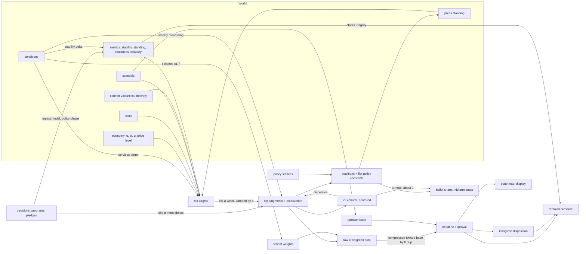

# Approval and player metrics: adversarial audit, 2026-10-12

Branch `codex/simulation-depth-completion`, engine `dist/` at the committed tree (no uncommitted engine, world or content source at the time of the probes). Read-only: no source file was changed, no build, no workspace tests, no verify sweep, no Playwright, no full balance harness. The probes are listed in §10 with their exact commands.

The owner's brief: precedent is evidence of intent, not a constraint; judge each part on what makes the best game; no backward compatibility.

Labels used below: **Fact** is read in source or observed in a probe. **Inference** is a reading of facts that was not directly measured. **Recommendation** is a proposal.

---

## 0. Summary

**Recommendation.** Replace the three parallel publics the engine keeps today (the six-driver headline, the three-coalition ballot reading, the 29 centered cohorts) with **one electorate of three partisan blocs**, whose people-weighted sum is the headline, whose turnout-weighted sum is the ballot, and whose own-party figure is what the President's caucus reads in a removal vote. Keep the six judgments as the shared valence the blocs react to. Make polarization a structural, sourced parameter of the blocs rather than a stock that decays to zero. Bill each cause once, and put a weekly budget on every direct mood writer. Verdict: **accepted with controls** (§8).

**Top findings** (details in §6):

1. **Party is invisible to the headline, the coalitions and the ballot.** At founding, a Democrat and a Republican President read the same approval (0.600), coalition figure (0.533) and projected vote (0.522) to the third decimal. Real approval is mostly partisanship: Gallup measured an 87-point Republican-Democratic gap in January 2020.
2. **The country depolarizes in one term.** Polarization opens at 0.597 and reached 0 by about week 158 in four of five 208-week runs; unity rose to 0.979. Every polarization effect (the compression toward 45%, the inertia, the unity driver) vanishes in the second half of a term.
3. **The player is scored by a number they are not shown.** Elections read `coalitionApproval`, not the headline. A passive Democrat lost re-election with 47.3% of the projected vote while the headline read 51.9%. The headline-minus-coalition gap ran from −7.7 to +11.6 points across runs.
4. **The coalition lens holds policy free lunches.** With nothing else changed, `fiscal-investment` adds 5.3 points to the coalition figure and 1.9 to the vote, `industry-extraction` 2.9 and 1.0, at no headline cost. These are flat constants, not consequences.
5. **The cohort layer moves almost nothing.** Its only vote channel, `turnoutShift`, read between −0.001 and +0.001 in every week of every run (cap 0.03). Cohort support and the state-by-cohort table are display-only by construction.
6. **One live condition is billed five ways** (stability metric, a weekly direct mood drag, the services target, a salience multiplier, and the treasury drain feeding services money), and any weekly direct mood delta settles at about 16 times its weekly size, because the weekly revision treats it as a standing offset.
7. **Rallies are a rounding error.** An attack from outside with thousands dead moves raw approval by about +1.8 points through the impact model; Gallup measured +35 points after September 11, 2001.
8. **Removal reads approval five times** (unpopularity, congressional hostility, recent negative moves, the caucus-break gate, fragility's political capital), and its "recent record" term counts only falls, so weekly noise builds pressure.
9. **Two metrics saturate and one barely moves.** Standing has no reversion and ended at 0.98, 0.004 or 0 in four of five runs (0.222 in the fifth); readiness held its founding value for 208 weeks in three of five runs; fragility's `fiscalSpace` divides a figure in USD millions by 1,000 and would read 1.0 at every observed snapshot.

---

## 1. The model as implemented

### 1.1 Headline approval

All in `packages/engine/src/opinion.ts` unless noted.

**State.** `player.opinion` holds six judgments `m_d ∈ [0,1]` (security, prosperity, services, integrity, unity, competence) and `polarization p ∈ [0,1]` (`state-campaign.ts:195-208`). `player.metrics.approval ∈ [0,1]` is stored and written only by `recomputeApproval` (`opinion.ts:450`), called once per packet.

**Weights.** `OPINION_WEIGHTS` (`opinion.ts:79-86`): prosperity 0.28, security 0.22, services 0.16, integrity 0.14, competence 0.12, unity 0.08. Salience multipliers (`opinion.ts:122-135`) multiply listed drivers when a key fires, then renormalize to sum 1 (`salientWeights`, `opinion.ts:300-313`):

| Key | Fires when (`selectSalience`, `opinion.ts:265-282`) | Multipliers |
|---|---|---|
| atWar | President is a party to a war | security ×1.7 |
| conditionActive | any non-economic condition (or unrest) live at home | services ×1.7, competence ×1.25 |
| economicPain | inflation ≥ term start + 0.03 or unemployment ≥ term start + 0.02 | prosperity ×1.45 |
| disorder | insurgency > 0.25 or protest pressure > 0.4 | security ×1.4, competence ×1.2 |
| scandalLive | any live scandal | integrity ×1.6 |
| pumpShock | pump price shock | prosperity ×1.25 |

**Formula as implemented.**

```
w_d      = OPINION_WEIGHTS_d · Π(multipliers firing on d), renormalized          (opinion.ts:300)
raw      = clamp01( Σ_d w_d · m_d )                                              (opinion.ts:320)
base     = 0.45 − (0.45 − 0.18) · clamp01(gravity · exposure)                    (opinion.ts:372)
gravity  = clamp01( max(0, 0.40 − m_integrity) / 0.40 )                          (opinion.ts:348)
exposure = clamp01( Σ live scandal intensity )                                   (opinion.ts:354)
approval = clamp01( raw + (base − raw) · 0.55 · p  +  honeymoon )                (opinion.ts:333-341, 421)
honeymoon= 0.03 · (1 − weeks/26), 0 from week 26                                 (opinion.ts:408)
```

**Weekly revision** (`opinionPhase`, `opinion.ts:713-746`): each driver moves `0.06` of the way to its target (`driftOpinion`, `opinion.ts:689`), and polarization falls by `POLARIZATION_DECAY = 0.004` (`opinion.ts:528, 725`). Both the revision and every other direct delta pass through `applyMoodDeltas` (`effects.ts:455`, `opinion.ts:511-520`), which multiplies every driver delta by `1 − 0.5·p`. So the effective revision rate is `0.06·(1 − 0.5p)`; the stated 11-week half-life (`OPINION_HALF_LIFE_TURNS`) holds only at `p = 0`.

**Targets** (`opinion-causes.ts`, the sum of named terms, clamped to [0,1], `opinion-causes.ts:594-602`):

| Driver | Target terms (file:line) |
|---|---|
| prosperity | `0.75 − clamp01(2u + 1.5·max(0,π) − 2·max(0,g) + priceScar·1)` (`:250-301`) |
| security | `stability + war term − 0.4·insurgency − 0.3·(crime − crimeBaseline)` (`:314-360`) |
| services | `carrying·(0.4 + 0.6·treasuryHealth) − 0.35·deliveryShortfall`, `carrying = clamp01(0.7 − 0.6·worstReliefConditionSeverity)` (`:378-408`) |
| integrity | `0.75 − Σ scandal·SCANDAL_INTEGRITY_WEIGHT + promises + coverage` (`:427-442`) |
| unity | `1 − p` (`:537-544`) |
| competence | `0.15 + 0.3·readiness + 0.3·stability + 0.25·standing − 0.15·vacancies − 0.45·shortfall + coverage` (`:491-530`) |

`coverage = clamp(±0.15, (press.standing − 0.5)·0.5)` (`:410-413`). `treasuryHealth = clamp01(treasury / 500,000)` with treasury in USD millions (`metrics.ts:42-50`).

**Direct mood writers** (emit `kind: "opinion"`): the weekly revision; scenario impacts (`packages/content/src/impact-model.ts:286-347, 380-384`); conditions (`conditions.ts:311-319`); scandal response, press secretary, issued press plays, pledges, domestic coercion, sovereign downgrade, strike outcomes, coalition break, party beliefs and demos (polarize only), and `scenario-memory.ts` (grep of `kind: "opinion"`, 15 files).

### 1.2 The three other readings of the same public

| Reading | Formula | What reads it |
|---|---|---|
| **Coalitions** (`coalitions.ts`) | per coalition `c`: `approvalOf(mood, LENS_c, base) + Σ drivers`, each driver clamped ±0.3, total clamped [0,1] (`:227-242`). Lenses `:71-75`. Drivers `:117-149`: unemployment and inflation (×0.25 differential), **flat policy-stance constants** (`fiscalToWorkers` etc., `:188-207`), protest, coverage, growth, borrowing cost, legitimacy, corruption, fiscal balance, regime stability. `coalitionApproval = 0.55·workers + 0.30·business + 0.15·elites` (`:258-264`). | **The ballot** (`elections.ts:341`), press standing (`press.ts:232`) |
| **Cohorts** (`demos.ts`) | 29 cells on 10 axes (`world/src/schemas/cohort.ts:10-46`). Per cell: mood through a tilted lens, compressed to the same base, plus a measured partisan baseline in log-odds, then **one log-odds step per axis so the axis mean equals the mood mean** (`demos.ts:343-360`); plus `0.15 · centeredStrain` (`:366-368`). Strain decays linearly, 0.06/week harm, 0.10/week favor (`:87-90, 500-507`). | Turnout driver (`turnout.ts:163-167`, capped ±0.03), polarization from dispersion (`demos.ts:549-553`), display |
| **States** (`regional-opinion.ts`) | each state `logistic(offset + 4·(lean shift + economic shift))`, offset solved so the population mean equals headline minus honeymoon (`:93-138`). State-by-cohort raking (`state-cohort-opinion.ts`) fills the table between the two margins. | Display only (stated at `regional-opinion.ts:15`, `state-cohort-opinion.ts:24`) |

### 1.3 Consequences

**Ballot** (`elections.ts:340-394`):

```
share = 0.5 + 0.36·(coalitionApproval − 0.5) + cities + states + turnoutShift + momentum + opponent
        + nonCooperation + 0.03 (incumbency) + record penalties (scaled, total ≤ 0.15, floor 0.415)
```

Momentum is `clamp(±0.02, 0.5·(approval − remembered approval))` (`momentum.ts:19-46`). Midterm seats use the same share with a midterm penalty (`election-seating.ts:139-160`).

**Removal pressure** (`removal.ts:77-84, 285-342`):

```
readings: unpopularity = 1 − approval
          alignment    = (removalPressureFromAlignment + 1)/2
          decisionHistory = clamp01(Σ |negative approval moves| over 10 weeks)
          congress     = clamp01(0.55·(1 − disposition) + 0.35·min(1, 0.25·unauthorized) + 0.1·oversight)
          floors       = share of the last 24 weeks × 3 floors breached (treasury ≤ 0, stability ≤ 0.05, standing ≤ 0.05)
          faction      = factionPressure
conditions = clamp01(0.331·unpop + 0.184·align + 0.129·history + 0.129·congress + 0.147·floors + 0.08·faction)
pressure   = clamp01(conditions · (1 + 0.5·fragility) + standingBeat)
beats at 0.45 / 0.52 / 0.60, each gated by a caucus count (removal-votes.ts)
caucus break opens only when pressure ≥ 0.60 and approval ≤ 0.36 (removal-votes.ts:108-133)
```

**Congress disposition** drifts 0.04/week toward `0.25 + 0.55·approval − unilateral − oversight − struck orders` (`congress.ts:439-453`). It does not read which party holds either chamber.

### 1.4 Flow, causes to consequences



---

## 2. Ranges, units and normalization

**Fact** unless marked.

| Quantity | Unit and range | Normalized how | Where it binds (observed) |
|---|---|---|---|
| approval, six judgments, polarization | 0..1 | none needed | polarization hit its floor of 0 in 4 of 5 runs |
| treasury (budget authority) | USD millions, ≥ 0 | `/500,000` for services (`metrics.ts:42`); **`/1,000` for fragility** (`fragility.ts:222`) | `fiscalSpace` would read 1.0 at every probe snapshot (lowest snapshot treasury 27,334) |
| stability, standing, readiness | 0..1 accumulators of additive deltas | none | standing at 1.0 (prudent) or 0.0–0.004 (passive by week 198, populist by week 54, reckless by week 28) |
| economy rates | fractions per year | hand scales: u×2, π×1.5, g×2, price scar ×1 (`opinion-causes.ts:262-286`) | strain clamp at 0 and 1 (`bounded` term) |
| vacancies | count | ×0.15 per seat, unbounded (`opinion-causes.ts:513-515`) | four vacancies take 0.6 off competence; this is the seed-2 artifact in `BALANCE-ATTRIBUTION-2026-10-12.md` |
| cohort strain | 0..1 weights, signed | centered per axis, ×0.15 | net effect on the vote rounds to 0 |
| scenario tolls | deaths, by band | `perMillion^0.5 / (perMillion^0.5 + 6^0.5)` (`impact-model.ts:84-96`) | compressive; see F12 |
| scenario money | GDP share by band | × GDP × cost of living × horizon (`impact-model.ts:404-415`) | goes to debt, not to approval directly |
| removal pressure | 0..1 | weighted sum, × (1 + 0.5·fragility) | probes: 0.217–0.674 |
| vote share | 0..1 | linear in coalition approval | floor 0.415 bound in populist and reckless runs |

**Findings on normalization.**

- Heterogeneous inputs reach a judgment through hand-chosen linear coefficients with no shared scale. A count (vacancies) and a share (delivery shortfall) sit in the same sum as 0..1 metrics; the count is unbounded.
- Two different normalizations of one quantity (treasury) disagree by a factor of 500. One of them is dead.
- Policy stances enter the coalitions as constants in coalition-support units (for example +0.16 workers for redistribution). They are not scaled by anything the stance does to the economy, and nothing bounds their sum beyond the ±0.3 per-driver clamp.
- The salience multipliers multiply and then renormalize. With all six keys firing, security reaches ×1.7×1.4 = ×2.38 before renormalizing. Multiplicative compounding is defensible for "what the week is about", but the keys fire on levels (§6, F16), so the compounding is persistent rather than news-driven.

---

## 3. Connections: what reads what

**Fact.** Edges observed in source (reader ← read).

| Reader | Reads |
|---|---|
| security target | stability (1:1), wars, insurgency, crime excess |
| competence target | stability (0.3), standing (0.25), readiness (0.3), vacancies, delivery, coverage |
| services target | relief conditions, treasury health, delivery |
| integrity target | scandals, promises, coverage |
| unity target | polarization |
| salience | wars, relief conditions, prices, unemployment, insurgency, protest, scandals |
| partisan base | integrity judgment, live scandals |
| coalitions | mood, base, unemployment, inflation, growth, policy stances, protest, press, borrowing rate, legitimacy, corruption, fiscal balance, regime stability |
| press standing | coalitionApproval (and others, `press.ts:232`) |
| ballot | coalitionApproval, cities, states, turnout (cohorts), momentum (headline history), opponent, record |
| Congress disposition | headline, unilateral acts, oversight, struck orders |
| removal | headline (×5 paths), alignment, Congress, floors, faction, fragility |
| fragility | standing, headline, treasury (/1000), stability, disposition, conditions, wars, cabinet, institutions, alliances |

**Double counts (fact).**

- **Stability** reaches approval through security (weight 0.22, coefficient 1) and competence (0.12 × 0.3). At resting weights a point of stability is worth about 0.256 points of raw approval, close to the whole prosperity weight (0.28). It also reaches removal through floors and fragility, and its drivers (conditions, protest) fire the `disorder` salience.
- **A condition** reaches approval five ways: the stability delta (`conditions.ts:307`), the weekly direct drag (`conditions.ts:311-319`), the services target (`opinion-causes.ts:379-381`), the `conditionActive` salience (`opinion.ts:272`), and the treasury drain (`conditions.ts:308`) feeding the services money term.
- **Polarization** acts three times: as the unity target, as the compression toward the base, and as damping on every delta, including the weekly revision.
- **Approval** reaches removal five times (unpopularity, disposition via Congress, decisionHistory, caucus-break gate, fragility politicalCapital).
- **Press**: coverage enters integrity and competence; the coalitions read that mood and add `coverageDriver` again (`coalitions.ts:184-186`); press standing reads coalitionApproval (`press.ts:232`). That is a reinforcing loop, held in check only by the caps.

**Missing edges that real politics has (inference, checked against the sources in §7).**

- Party identification to approval. None.
- Party control of Congress to the hostility the removal arc reads. None; the votes are counted by caucus, but the pressure term is not.
- Issue positions (policy agreement) to approval. None in the headline; flat constants in the coalitions.
- Headline approval to the ballot. Indirect only (momentum); the ballot reads a different figure.
- Cohorts to anything the player feels. Turnout only, and it rounds to zero.

**Islands in practice (fact from probes).** Readiness held at its founding value at every snapshot for 208 weeks in the prudent D (0.718), prudent R (0.692) and populist (0.694) runs, and moved only between 0.718 and 0.76 in the passive run, so its 0.3 share of competence is close to a constant.

---

## 4. Ongoing management: decay, persistence, stability over time

**Fact.**

| Process | Form | Rate | Consequence |
|---|---|---|---|
| judgment toward target | exponential | 0.06·(1 − 0.5p)/week | half-life 11 weeks at p = 0, about 16 weeks at p = 0.6 |
| a one-off shock | decays by the same revision | probe: −0.10 integrity at p = 0.6 lands as −0.07, is −0.044 at week 11, −0.023 at week 26 | event memory fades in a season |
| a **recurring** weekly delta `d` | settles at `T − d(1−r)/r` | probe: d = 0.005 settles 0.078 below target at p = 0 and 0.080 at p = 0.6 | **a weekly writer is a 16× standing offset**; polarization damping cancels out |
| polarization | linear decay 0.004/week, rises capped 0.012/week | 150 quiet weeks erase the founding 0.597 | country depolarizes in one term |
| cohort strain | linear, 0.06 or 0.10/week | a 0.5 harm is gone in 9 weeks | short memory, but it barely reads anyway |
| honeymoon | linear, 26 weeks | | |
| stability | reverts 10%/week to founding rest (`conditions.ts:702`) | | bounded |
| standing, readiness | no reversion | | random walk to a clamp |
| Congress disposition | linear 0.04/week to target | | |

**Self-stabilizing or runaway (inference from the probes).** Approval itself is stable: weekly moves averaged 0.23–0.42 points and never exceeded 2.4 points. The runaways are in the side metrics (standing to 0 or 1; polarization to 0) and in the removal ladder once a beat is open (`standingBeatPressure` is designed to carry itself).

**Scalability.**

- **More content.** Only polarization has a joint weekly ceiling (`MAX_TURN_POLARIZE`). Direct mood deltas from decisions, occurrences and conditions sum without a budget. BL-142 plans about 3,000 contested items drawn like foreign events; any of them that writes a mood delta every week it is live becomes a 16× standing offset. The plan's per-issue weekly cap (§13.8, PLAN §9) covers issue state, heat, strain and lean, not the six judgments.
- **Long campaigns.** Standing and readiness have no pull back, so eight years saturates them further. Polarization is at 0 for most of a second term.
- **More cohorts and axes.** Cost: `stateCohortOpinion` rakes every axis per read (up to 200 sweeps); `cohortStartingPoints` solves a bisection per axis. Memoized per campaign value, so cost is per week, not per read. Behavior: adding axes (religion) cannot change any aggregate, by construction, so it adds computation and display without adding consequence.

---

## 5. Probe evidence

All probes ran the committed `dist/` with the harness's own `playCampaign`; one process at a time. Commands in §10.

**Founding, seed `balance-0`, both parties (fact):**

```
democrat   approval 0.6  coal 0.533 vote 0.522 salience (none) protest 0.35 pol 0.6 pressure 0.223
republican approval 0.6  coal 0.533 vote 0.522 salience (none) protest 0.35 pol 0.6 pressure 0.223
removal components at founding: unpopularity 0.4 → 0.132 of 0.223; alignment 0.028; congress 0.033
```

**Policy stance, all else equal, week 1 (fact):**

| Stance | coalitionApproval | vote | workers / business / elites | headline |
|---|---|---|---|---|
| fiscal-continuity | 0.533 | 0.522 | 0.502 / 0.569 / 0.574 | 0.6 |
| fiscal-investment | 0.586 | 0.541 | 0.592 / 0.599 / 0.538 | 0.6 |
| fiscal-redistribution | 0.574 | 0.537 | 0.662 / 0.409 / 0.582 | 0.6 |
| fiscal-austerity | 0.494 | 0.508 | 0.352 / 0.679 / 0.642 | 0.6 |
| industry-extraction | 0.562 | 0.532 | 0.502 / 0.659 / 0.590 | 0.6 |
| industry-nationalization | 0.462 | 0.496 | 0.502 / 0.329 / 0.582 | 0.6 |
| trade-open | 0.535 | 0.523 | 0.462 / 0.649 / 0.574 | 0.6 |
| trade-protective | 0.539 | 0.524 | 0.562 / 0.479 / 0.574 | 0.6 |

**208-week runs (fact; min / mean / max, first, last):**

| Run | Ending | Approval | Polarization | Coalition | Headline − coalition | Vote | Turnout shift | Pressure |
|---|---|---|---|---|---|---|---|---|
| seed 0, prudent, D | in office, re-elected | .530/.571/.618, .603→.571 | .597→0 | .546/.607/.668 | −.077/−.037/+.009 | .530/.559/.596 | .001 throughout | .231/.268/.310 |
| seed 0, prudent, R | in office, re-elected | .535/.566/.610, .603→.554 | .597→0 | .544/.600/.657 | −.072/−.035/+.009 | .530/.560/.589 | 0 to .001 | .232/.295/.335 |
| seed 0, passive, D | defeated week 198 | .465/.514/.600, .600→.519 | .596→0 | .423/.467/.580 | +.018/+.047/+.082 | .439/.465/.549 | 0 to .001 | .217/.282/.312 |
| seed 0, reckless, D | removed week 77 | .303/.435/.599 | .596→.320 | .276/.422/.604 | −.013/+.013/+.034 | .415 floor at end | −.001 to .001 | .321/.528/.674 |
| seed 1, populist, D | defeated week 198 | .356/.458/.608 | .596→0 | .264/.395/.624 | −.031/+.063/+.116 | .415 floor at end | −.001 to .001 | .233/.368/.453, 1 beat |

Other observations from the same runs (fact): cohort spread (max minus min cell) 0.475–0.552; state spread 0.518–0.567; in the four full-term runs `disorder` salience fired 130–156 of 208 weeks and `conditionActive` 80–150; weekly absolute approval move averaged 0.0023–0.0042 with maximum 0.024. Standing ended 0.98 (prudent D), 0.222 (passive), 0.004 (reckless), 0 (populist). Unity ended 0.979–0.987 in the four runs where polarization reached 0.

**Approval movement by road, seed 0, prudent, D, 104 weeks** (harness attribution, fact): world 82.2%, decisions 13.5%, pledges 4.3%, unattributed drift 0. Over the same weeks the weekly revision wrote 48 negative approval entries summing to −0.040 and positive ones summing to +0.037.

**Toll pricing at the dataset's US population of 334,892,847** (calculation from `impact-model.ts`, diffuse routing, resting weights, before polarization damping and compression):

| Band (deaths) | on our watch | our doing (×1.6) | acted upon (×−0.5, a rally) |
|---|---|---|---|
| isolated (3) | −0.23 pts | −0.37 | +0.12 |
| dozens (40) | −0.78 | −1.25 | +0.39 |
| hundreds (400) | −1.94 | −3.11 | +0.97 |
| thousands (4,000) | −3.69 | −5.90 | +1.84 |
| mass (50,000) | −5.25 | −8.40 | +2.62 |

---

## 6. Findings

Severity: **S1** breaks a core claim of the game (legible, plausible, no dominant strategy); **S2** a material distortion or double count; **S3** hygiene.

**F1. Party is invisible to every scored figure.** S1. Change.
Evidence: founding probe above, identical to three decimals for D and R. The headline has no partisan term; `POLARIZATION_ANCHOR` is party-blind (`opinion.ts:166`); the coalitions read party only through nothing; the cohort partisan baseline is calibrated away per axis (`demos.ts:343-360`). Real: Gallup's partisan gap was 65–77 points in every Obama and late-Bush year it tabulated, and 87 in January 2020 (§7). A game about an American President where the President's own party does not approve of them more than the other party does is not a plausible public.

**F2. Polarization decays to zero within one term.** S1. Change.
Evidence: `POLARIZATION_DECAY = 0.004` (`opinion.ts:528`), heal emitted every week (`opinion.ts:725`); founding 0.597 needs 150 quiet weeks; observed 0 by week ~158 in four of five runs. With p = 0 the compression and inertia vanish and unity reads 0.98. Real: Pew found the share of Republicans to the right of the median Democrat rose from 64% to 92% from 1994 to 2014, and Gallup reports 14 of the 15 most polarized presidential years in the most recent 15. Nothing in that record looks like a stock that drains in three years of quiet.

**F3. Polarization is counted three times.** S2. Change.
Evidence: unity target `1 − p` (`opinion-causes.ts:537-544`), compression (`opinion.ts:339`), inertia on all deltas including the revision (`opinion.ts:512`). One fact moving the level, the ceiling and the speed at once makes its total effect hard to read and hard to tune.

**F4. Three publics, and the player is scored by the one they are not shown.** S1. Change.
Evidence: ballot reads `coalitionApproval` (`elections.ts:341`); removal reads the headline (`removal.ts:294`); states and cohorts are rakings of the headline. Probe: headline − coalition ranged −0.077 to +0.116; the passive run lost at 0.473 with a headline of 0.519. The comment at `coalitions.ts:253-257` says the two disagreeing is information; to a player it reads as being told one number and judged on another.

**F5. Flat policy constants are free lunches on the ballot.** S1. Delete.
Evidence: `coalitions.ts:125-149, 188-207`; probe table §5. `fiscal-investment` is positive for workers (+0.09) and business (+0.03) at once; `industry-extraction` is positive for business with no offset. None of these is a consequence of what the stance does; the real economic and fiscal effects of the stance already reach prosperity, services and the books. **Inference:** this is part of why investment-only beats careful at the ballot in `BALANCE-ATTRIBUTION-2026-10-12.md` (careful lost 4 of 12; investment 0), on top of the headline gap that document measured. Not measured here.

**F6. The cohort layer is decoration.** S2. Change (make it carry the vote through the bloc model) or cut.
Evidence: centered strain and per-axis calibration (`demos.ts:333-368`, DECISIONS §5.9); turnout shift observed at −0.001 to +0.001 in every week of every run against a 0.03 cap; state-by-cohort table display-only (`state-cohort-opinion.ts:24`). 29 cells, 10 axes, a raking per week, and a religion axis queued, for a channel that has not moved a vote by a tenth of a point.

**F7. Stale counts in comments.** S3. Change.
Evidence: "sixteen cells/cohorts" at `opinion.ts:329-331, 404`, `demos.ts:15`, `turnout.ts:122` against 29 ids in `cohort.ts:15-46`.

**F8. A condition is billed five ways.** S1. Change.
Evidence: §3. **Inference:** this is the mechanism behind "services, conditions −0.109 careful vs 0.000 investment" in the balance attribution: the same avoided conditions also show up in security (via stability), in the salience weights and in money.

**F9. Recurring weekly deltas are 16× standing offsets.** S1 for scalability. Change.
Evidence: the steady-state calculation in §4 (`T − d(1−r)/r`, verified numerically). Any writer that fires weekly (conditions' `approvalDrag`) is a target term in disguise, sized at 1/0.06 of what its author wrote, and invisible to the cause list (`selectOpinionCauses` lists target terms, not the drag).

**F10. No weekly budget on direct mood writes.** S2. Change.
Evidence: only `MAX_TURN_POLARIZE` exists (`opinion.ts:539`); `applyMoodDeltas` applies everything it is given. BL-142's occurrence volume makes this the first thing to break.

**F11. Approval is mostly the world's, and decisions are mostly costs.** S2. Change (via F12 and the issue term in §8).
Evidence: 82% of approval movement came from the world in the prudent run; decisions 13.5%. The impact model has one positive services term (+0.03 for relief money) and the acted-upon rally; every other term is a cost (`impact-model.ts:286-327`). **Inference:** the desk rewards damage limitation; the player's lever on the headline is mostly which world they let happen. That is defensible for valence politics but leaves no way to win approval by doing something a bloc wants, which is how presidents actually gain with their own side and independents.

**F12. Rallies are an order of magnitude small.** S2. Change.
Evidence: §5 toll table: thousands dead, acted upon, +1.84 raw points before damping; Gallup measured 51% to 86% (+35) within days of September 11, 2001, a 90% peak, and 66% a year later. Rally size and its slow fade both depend on polarization in reality; the model has neither.

**F13. Standing has no reversion and saturates.** S2. Change.
Evidence: 87 lines writing standing deltas (grep), readers in five files, no pull-back found; probes ended at 0.98 (prudent D), 0.975 (prudent R), 0.222 (passive), 0.004 (reckless) and 0 (populist), with standing at 1.0 from week 54 in both prudent runs. A saturated metric feeds competence (0.25) and fragility as a constant.

**F14. Readiness is an island in harness play.** S3. Keep the metric, verify reachability.
Evidence: unchanged at every snapshot over 208 weeks in three of five runs. It may move in play that commits forces (`FORCES_COMMITTED_READINESS`, `impact-model.ts:357`); the proxies did not.

**F15. `fiscalSpace` unit error.** S2 (dead term). Change.
Evidence: `fragility.ts:222` divides USD millions by 1,000; services uses 500,000 (`metrics.ts:42`). It reads 1.0 unless budget authority is under $1 billion, so half of `marketCredibility` (`fragility.ts:227`) is constant too.

**F16. Salience fires on levels, so the "louder this week" week is most weeks.** S2. Change.
Evidence: in the four full-term runs, `disorder` fired 130–156 of 208 weeks and `conditionActive` 80–150. Founding protest pressure 0.35 sits 0.05 under the 0.40 trigger. The comment at `opinion.ts:89-96` says salience is "whatever is on the front page"; a front page that never changes is a different weight table, not salience.

**F17. Stability is weighted about as heavily as the economy.** S2. Change.
Evidence: §3. Real approval research weighs the economy first (the module's own comment says so at `opinion.ts:73-74`); the implemented weights give order at home nearly the same pull.

**F18. Removal reads approval five times, and history counts only falls.** S2. Change.
Evidence: §1.3; `removal.ts:303-306` sums only negative approval moves; the revision alone wrote 48 negative entries (−0.040) against +0.037 positive in 104 weeks of prudent play. Noise accumulates pressure.

**F19. Congress hostility ignores party control.** S2. Change.
Evidence: `congress.ts:439-453` has no seat or party term. An opposition-held House at 55% approval reads the same disposition as one's own.

**F20. Press feedback loop.** S3. Change by removing `coverageDriver` once coalitions go (§8).
Evidence: §3.

**F21. Competent play sits above the modern American range.** S2. Recalibrate.
Evidence: every run opened at 0.598–0.603; prudent play held 0.530–0.618. Target bases are generous: integrity 0.75 with no story, services 0.70, prosperity 0.75 at zero strain. Real: Gallup puts Biden's term average at 42.2%. **Inference:** a polarized-era public should put an ordinary competent term in the mid-40s to low 50s.

**F22. Removal is reachable but slow, which explains the 52-week sample.** S3. Keep the ladder; change the inputs (F18, F19).
Evidence: reckless removed at week 77; populist reached 0.356 with one beat because integrity stayed at 0.59, so the partisan base never eroded and the caucus-break gate (pressure ≥ 0.60 and approval ≤ 0.36) never opened. Real presidents have not been convicted; a ladder that needs grave conduct is plausible. **Inference:** the "no removals in a 52-week population sample" failure is a property of a 52-week window against beats that ripen over 84 days each, not a broken ladder. Not measured here.

**F23. Mixed decay forms.** S3. Change when touched.
Evidence: exponential (judgments), linear (polarization, strain, honeymoon, disposition), proportional reversion (stability), none (standing, readiness).

**F24. Vacancies are an unbounded count term.** S2. Change.
Evidence: `opinion-causes.ts:513-515`; balance attribution seed 2.

**F25. Opening mood and targets use different formulas.** S3. Change.
Evidence: prosperity opens at `0.6 − 0.5·strain` (`opinion.ts:244`) and targets `0.75 − strain` (`opinion-causes.ts:254, 287`); week one drifts by construction. The probe showed prosperity rising 0.55 → 0.66 in the first 28 weeks of every run.

**Kept as they are (fact plus judgment):**

- The six judgments, their named causes and the "explanation is the arithmetic" design (`opinion-causes.ts`). This is the most legible part of the model and the recommendation keeps it as the valence the blocs read.
- The partisan-base erosion as a product of gravity and exposure (`opinion.ts:367-374`). Its logic (a party leaves only when conduct is grave and public) matches 1974. It moves into the bloc model as erosion of the own-party intercept.
- The record penalties and the vote floor on the ballot (`elections.ts:205-252, 405-418`).
- The removal ladder's thresholds and caucus counting by seat (`removal-votes.ts`).

---

## 7. Real-world calibration (sources opened)

| Claim | Source | Figure |
|---|---|---|
| Partisan gap, single poll | Gallup, Jan 16–29, 2020 ([link](https://news.gallup.com/poll/284156/trump-job-approval-personal-best.aspx)) | overall 49%, Republicans 94%, independents 42%, Democrats 7%; gap 87 points, the largest Gallup had measured |
| Partisan gap by year | Gallup ([link](https://news.gallup.com/poll/245996/trump-job-approval-sets-new-record-polarization.aspx)) | Obama years 1–8: 65–77 points; G.W. Bush years 4–7: 66–76; Clinton year 4: 61. 14 of the 15 most polarized presidential years are the 15 most recent |
| Term average | Gallup ([link](https://news.gallup.com/poll/116677/presidential-approval-ratings-gallup-historical-statistics-trends.aspx)) | Biden 42.2%, second-lowest; Carter and Truman about 45.5% |
| Rally size | Gallup ([link](https://news.gallup.com/poll/4924/bush-job-approval-highest-gallup-history.aspx), via search summary and [link](https://news.gallup.com/poll/6793/rally-effect-911-terrorist-attacks-virtually-gone.aspx)) | 51% (Sept 7–10, 2001) to 86% (Sept 14–15) and 90% (Sept 21–22) |
| Rally fade | Gallup ([link](https://news.gallup.com/poll/6793/rally-effect-911-terrorist-attacks-virtually-gone.aspx)) | 66% a year later (Sept 5–8, 2002), still above the 51% baseline |
| Polarization is structural | Pew Research Center, 2014 ([link](https://www.pewresearch.org/politics/2014/06/12/political-polarization-in-the-american-public/)) | Republicans right of the median Democrat 64% → 92% (1994–2014); Democrats left of the median Republican 70% → 94%; very unfavorable views of the other party roughly doubled |

A secondary report (not Gallup's own page, which was not opened) gives a 92-point gap in August 2025; it is not relied on here.

**What these imply for the model (inference).** Since about 2000, approval behaves like three blocs: the President's own party high and sticky (roughly 80–95% approval), the other party low and sticky (roughly 1–15%), and independents carrying most of the movement. The range of a polarized-era term is roughly the mid-30s to the high 50s, with rallies smaller than 2001's and faster to fade. That is a structure, and it is the structure the recommendation builds.

---

## 8. Recommended redesign: one electorate of partisan blocs

### 8.1 The design

**Keep** the six judgments `m_d`, their targets and named causes, the weekly revision toward targets, and the scandal-driven erosion. They become the shared **valence**: how well the country thinks the government is doing, before party.

**Replace** the headline, the coalitions and the cohort calibration with three blocs `b ∈ {own, ind, opp}` (the President's party, independents, the other party), each with a people share `s_b`, a turnout `t_b` and an approval `a_b`:

```
V        = 2·Σ_d w_d·m_d − 1                         ∈ [−1, 1]   (raw approval rescaled; w_d as today, renormalized)
a_own    = σ( G·P·(1 − E) + B_p·V + I_own )           ∈ (0, 1)
a_ind    = σ(               B  ·V + I_ind )
a_opp    = σ( −G·P         + B_p·V + I_opp )
B_p      = B·(1 − κ·P)                                (partisans move less than independents)
headline = Σ_b s_b·a_b  (+ honeymoon, as today)
ballot   = 0.5 + L·(Σ_b s_b·t_b·a_b / Σ_b s_b·t_b − 0.5) + record + opponent + incumbency   (existing terms)
caucus break reads a_own (the President's own voters), not the headline
```

| Symbol | Meaning | Range | Proposed start | Status |
|---|---|---|---|---|
| `σ` | logistic | | | |
| `P` | structural polarization | [0, 1.2] | 1.0 for the 2020s founding | **reverts to its founding value**, not to 0; divisive acts raise it within the existing weekly cap |
| `G` | partisan intercept | > 0 | 2.4 | fit so `a_own − a_opp ≈ 0.83` at V = 0 (Gallup 65–92) |
| `B` | independents' valence slope | > 0 | 3 | fit to the observed range |
| `κ` | how much less partisans move | [0, 1] | 0.6 | |
| `E` | erosion = gravity × exposure (today's function) | [0, 1] | as today | |
| `I_b` | issue agreement term (BL-142), in log-odds | each capped ±0.6 | 0 until BL-142 | symmetric by construction |
| `s_b`, `t_b` | bloc shares and turnout | sum of shares 1 | **placeholder 0.30 / 0.40 / 0.30**; turnout from the cohort habits | must be sourced (party identification with leaners, validated turnout) before build |
| `L` | ballot leverage | | 0.36 (today's `APPROVAL_LEVERAGE`) | re-fit |

**What each piece replaces.**

1. `approvalOf` compression toward 0.45, `POLARIZATION_COMPRESSION`, `POLARIZATION_INERTIA` → the bloc intercepts and `B_p`. Polarization acts once, as the gap between blocs.
2. `unity` target `1 − p` → unity is fed by divisive acts and by the dispersion of cohort strain (today's demos term), not by polarization itself.
3. `coalitionApproval`, `COALITION_LENS`, the flat stance constants and `coverageDriver` → deleted. A stance reaches people through what it does (economy, services, money) and, after BL-142, through `I_b`. The three coalitions can remain as a display lens if the owner wants the words.
4. Cohort partisan baselines → they define which cohorts sit in which bloc. Cohort strain stops being centered: it moves `t_b` (mobilization and disillusion, today's turnout terms) for the blocs the cohort sits in, people-weighted, so hurting a group shows up as fewer of your voters or more of theirs at the polls. Its effect on `a_b` stays zero, so the headline is not double-billed for an act already priced through the judgments.
5. State approval → each state's bloc shares from its lean (today's `stateShareShifts`) instead of an offset solved onto the headline. The population-weighted mean equals the headline because the blocs are the same.

**Cross-cutting fixes, same change.**

6. **One bill per cause.** A condition reaches approval through its services or security target term and its salience only; delete the weekly `approvalDrag` writer (F8, F9) and the stability-to-security 1:1 base (security keeps war, insurgency, crime; stability keeps 0.3 of competence).
7. **Weekly direct-mood budget.** Sum of `|Δm_d|` from all non-revision writers capped per driver per week (start: 0.05), read off the ledger the way `polarizationRiseThisTurn` already is. Recurring causes must be target terms, so they appear in the cause list.
8. **Salience on change.** A key fires on a week-over-week rise or a new event, holds for a fixed span, then stops; a standing condition stays in the target, not in the weights.
9. **Rallies.** An acted-upon toll adds a temporary valence term scaled by `(2 − P)` and decaying with a half-life of about 26 weeks (Gallup's 2001–2002 fade was slower than the 11-week revision).
10. **Removal.** Unpopularity reads the headline once; `decisionHistory` nets rises against falls; Congress hostility reads seats (opposition share of each chamber) plus the own-bloc approval of the President's caucus; fragility's political capital stops reading approval.
11. **Units.** `fiscalSpace` uses `treasuryHealth`; vacancies enter as a share of seats, not a count; standing reverts toward its founding value like stability.

### 8.2 Worked example

Bloc shares 0.30 / 0.40 / 0.30 (placeholders), P = 1, G = 2.4, B = 3, κ = 0.6. Today's comparison uses `approvalOf` at p = 0.6 (founding) and p = 0 (where every run ends).

| raw (today's weighted judgments) | V | own / ind / opp | **proposed headline** | today, p = 0.6 | today, p = 0 |
|---|---|---|---|---|---|
| 0.10 | −0.8 | 0.808 / 0.083 / 0.034 | 0.286 | 0.216 | 0.100 |
| 0.20 | −0.6 | 0.843 / 0.142 / 0.042 | 0.322 | 0.283 | 0.200 |
| 0.35 | −0.3 | 0.885 / 0.289 / 0.060 | 0.399 | 0.383 | 0.350 |
| 0.50 | 0.0 | 0.917 / 0.500 / 0.083 | 0.500 | 0.484 | 0.500 |
| 0.60 | +0.2 | 0.933 / 0.646 / 0.103 | 0.569 | 0.551 | 0.600 |
| 0.70 | +0.4 | 0.947 / 0.769 / 0.128 | 0.630 | 0.617 | 0.700 |
| 0.90 | +0.8 | 0.966 / 0.917 / 0.192 | 0.714 | 0.752 | 0.900 |

Read: the range holds at roughly 29–71% for any valence, the partisan gap stays between 0.775 and 0.834 throughout, and it does not widen to 10–90% when polarization drains, because polarization no longer drains.

**Issue term (BL-142).** A redistribution act with own-bloc agreement +0.3 log-odds and opposition −0.3, at raw 0.6: headline 0.569 → 0.567 (a partisan act is near-neutral overall), but if independents disagree (−0.2): 0.548. Party now matters, symmetrically, and only through what the act is.

**Erosion.** At raw 0.30, erosion 1 takes the headline from 0.370 to 0.223 and own-bloc approval to 0.382, which is the 1974 shape the current base floor was built to reach.

**Before and after on the probe runs** (proposed headline from each snapshot's raw value, P = 1, no issue terms, no erosion applied):

```
prudent D   t3 .603→.592  t54 .551→.555  t106 .557→.549  t158 .594→.565  t209 .571→.550
passive D   t3 .600→.589  t54 .529→.537  t106 .515→.516  t158 .471→.479  t198 .519→.513
populist D  t3 .599→.589  t54 .508→.518  t106 .433→.452  t158 .385→.421  t198 .356→.403
reckless D  t54 .358→.420  t78 .303→.383   (today's run had erosion ≈ 0.9 by then; applying it lowers these)
```

The second half of a term stops expanding as polarization drains (prudent t158: .594 today, .565 proposed). The failing presidencies are held up more by their own party (populist .356 → .403), which is the real pattern, and which means F21's recalibration (lower target bases) is needed in the same change so ordinary governance sits in the mid-40s to low 50s.

### 8.3 Strongest failure mode, best alternative, verdict

**Strongest failure mode.** The partisan floor makes the presidency too safe. With the own bloc near 0.8–0.9 at any valence, the headline cannot fall below about 0.29 without erosion, the caucus never breaks without grave and public conduct, and a merely incompetent President is never removed: only re-election punishes them. If balance and the owner want incompetence to be removable, this design will not deliver it without a further channel. Second risk: placeholder shares and slopes are tuned to look right on a handful of seeds; mis-set, the blocs could make every election a coin flip decided by turnout.

**Best alternative.** Keep the scalar headline and fix it in place: party-aware anchor (`POLARIZATION_ANCHOR` depends on own-party share), polarization reverting to a founding value, delete the coalition constants and point the ballot at the headline. Cheaper (one file plus elections), keeps every save field. It loses the one thing the bloc model buys: a place for BL-142's issue positions and for turnout to act on named people, so the cohort and issue layers would remain display.

**Verdict: accepted with controls.**
- Controls: (1) bloc shares, intercepts and turnout sourced and dated before build, with seeded jitter inside the estimate's error, the same rule DECISIONS §5.8 sets for cohort baselines; (2) the balance acceptance tests below gate the change; (3) the owner answers Q1 (§9) on whether incompetence alone should be removable before the removal inputs change.

### 8.4 What it would take

**Files (engine).** `opinion.ts` (headline, polarization reversion, honeymoon unchanged), `opinion-causes.ts` (unity, security base, vacancies), new `electorate.ts` (blocs: shares, intercepts, turnout, the three formulas, under 800 lines), `coalitions.ts` (delete or reduce to a display lens), `demos.ts` and `turnout.ts` (strain feeds bloc turnout; remove centering of support), `regional-opinion.ts` and `state-cohort-opinion.ts` (states from bloc shares), `elections.ts` (ballot from blocs), `removal.ts` and `removal-votes.ts` (inputs per §8.1 item 10), `congress.ts` (disposition reads seats), `conditions.ts` (delete `approvalDrag` writer), `fragility.ts` (units), `effects.ts` (mood budget), `press.ts` (stop reading coalitions), and a standing reversion beside `STABILITY_REVERSION`. Content: `impact-model.ts` rally term.

**Engine contract changes.** `PublicMood.polarization` keeps its field but changes meaning (structural, reverting); new campaign state for bloc shares and the founding polarization; `CohortStanding.support` semantics change; `VoteProjection.drivers` lose the coalition line and gain bloc lines; `AdvanceResult` digests that quote coalitions change. No backward compatibility, per the owner: a save version bump with a derivation, not a migration of old figures.

**Doc-sync surfaces (blocking).** `docs/ARCHITECTURE.md` §3 (player metrics and removal), `docs/SCHEMA.md` (campaign state), `docs/CONTENT_DOCTRINE.md` §2 (`OPINION_WEIGHTS`, salience, `MAX_TURN_POLARIZE`, `POLARIZATION_DECAY`, `PRESSURE_WEIGHTS`, `BEAT_THRESHOLDS`) with `scripts/verify-doctrine-metric-alignment.mjs`; `docs/DECISIONS.md` §5.8 and §5.9 rewritten (cohorts move turnout through blocs; the headline is the bloc aggregate), §13.9 amended (issue terms reach bloc approval, capped); the doc-sync contract in `CLAUDE.md` names the loop's public contract, which this touches.

**Balance acceptance tests** (12 seeds, both parties, the existing proxies plus BL-142's `wedge`):
1. Party symmetry: D and R medians within 0.01 on headline, vote and ending rates.
2. Partisan gap: `a_own − a_opp` between 0.60 and 0.92 in every week of every run.
3. Range: careful play's term mean between 0.42 and 0.55; no week above 0.75 without a rally; reckless reaches below 0.35.
4. Polarization at week 208 within ±0.2 of its founding value absent divisive play.
5. No free lunch: no stance or proxy beats `careful` by more than 0.02 median vote share unless its economic record is measurably better (the existing investment-vs-careful gate, extended to the ballot).
6. Headline and ballot agree: the ballot share's coalition-equivalent and the headline differ by under 0.03 except through named turnout, record and opponent drivers.
7. Turnout matters: median |turnout driver| at the contest ≥ 0.005 in `wedge` and populist runs.
8. Budget: no week's direct mood movement exceeds the cap; a recurring cause appears in `selectOpinionCauses`.
9. Saturation: standing and readiness spend under 25% of weeks at a clamp in careful play.
10. Removal: reckless removed in at least half of seeds inside one term; careful never removed.

**Interaction with BL-142.** This is the place BL-142's measured issue positions land. Today, DECISIONS §13.9 routes contested issues around the headline into derived issue polls and mobilization, because the headline has no place for agreement and the turnout channel rounds to zero (F6). With blocs, an issue act reaches people twice and only twice: through `I_b` (capped, symmetric, heat-weighted agreement of each bloc's cohorts with the act) and through bloc turnout (backlash and disillusion, the plan's mobilization term). The religion axis and the cultural coordinate then matter, because they decide bloc membership and issue agreement. The cap on `I_b` and the weekly mood budget are what keep 3,000 items from summing without bound (F9, F10). Recommend building the bloc layer before BL-142's issue scoring (its PLAN §9), not after.

---

## 9. Open questions only the owner can answer

1. **Should an unpopular but honest presidency be removable?** The bloc model, like real politics, protects it; today's model mostly does too (F22). If yes, which channel: a caucus that breaks on own-bloc approval alone below some line, or a 25th-Amendment-style capacity path?
2. **Is the founding a 2020s public?** That sets P, the bloc shares and the partisan gap. A scenario option for a less polarized country (P ≈ 0.5) is cheap in this design.
3. **Independents as one bloc or two** (leaners vs pure independents)? Two is more faithful to how Gallup reports; one is easier to read.
4. **Keep the three coalitions as words on screen**, computed as a lens over the blocs, or retire them?
5. **Should the honeymoon reach the ballot?** Today it is excluded by design (`opinion.ts:402-406`); unchanged in the proposal unless the owner says otherwise.
6. **How large may a rally be?** 2001's +35 points came from a much less polarized public; the `(2 − P)` scaling gives roughly a third to half of that at P = 1. Is that the game the owner wants?

---

## 10. Probe commands

Scripts were written to the session scratchpad (`/private/tmp/claude-501/-Users-geralddagher-Developer-Projects-admin-app/de978b3c-7bf2-4843-8068-0f815599efba/scratchpad/`, abbreviated `$P`) and import the committed engine `dist/`. Each 208-week run took about 45 seconds of one core.

```bash
cd .
node $P/probe-approval.mjs balance-0 prudent democrat 208
node $P/probe-approval.mjs balance-0 prudent republican 208
node $P/probe-approval.mjs balance-0 passive democrat 208
node $P/probe-approval.mjs balance-0 reckless democrat 208
node $P/probe-approval.mjs balance-1 populist democrat 208
node $P/probe-static.mjs                         # founding: party symmetry, stance table, compression grid, shock decay
node $P/probe-paths.mjs balance-0 prudent democrat 104   # approval movement by road; weekly revision signs
node $P/probe-drift-mood.mjs                     # revision entries carry mood diffs (13 of 13)
node $P/calc-blocs.mjs $P                        # §8.2 table and before/after
node -e '...steady-state of a weekly drag...'    # §4, d = 0.005, r = 0.06
node -e '...toll weight at 334,892,847...'       # §5 toll table
```

`probe-approval.mjs` calls `playCampaign(seed, profile, weeks, party, undefined, { observeWeek })` from `packages/engine/dist/balance-harness.js` and, each week, reads `player.metrics.approval`, `rawApproval(mood, salientWeights)`, `partisanBase`, `coalitionApproval`, `projectVote().share`, `turnoutShift`, `removal.pressure`, `selectCohorts` supports, `stateApprovals`, `selectSalience`, metrics and `congress.disposition`. `probe-static.mjs` founds with `foundedForBalance("balance-0", party)` and swaps `player.policies[domain]` on a copy. `calc-blocs.mjs` is pure arithmetic over the §8.1 equations and the probe JSON. None writes outside the scratchpad.
