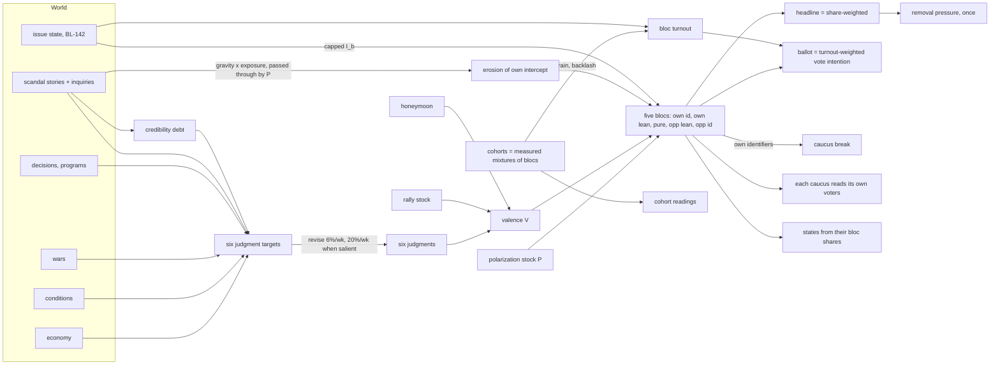

# The electorate and public opinion: design, 2026-10-12

As written 2026-10-12, before the build (see Build status below). Branch `codex/simulation-depth-completion`. Design only: no source file changed, no build, no workspace tests, no verify sweep, no Playwright, no balance harness. The probes are pure arithmetic over the design's own equations, plus one read of the committed engine `dist/` for cohort shares and baselines (§12).

Inputs read in full: `AUDIT.md` and `VERIFY.md` in this folder; the contested-issues `PLAN.md`, `RELIGION-RESEARCH.md` and `PUBLISHED-TOPLINES.md`; DECISIONS §5.8–§5.11 and §13. Source read: `opinion.ts`, `opinion-causes.ts`, `opinion-war.ts`, `press-scandal.ts` (stage machine and weights), `scandal-origins.ts` (gravity table), `removal.ts`, `removal-votes.ts`, `elections.ts`, `election-seating.ts`, `momentum.ts`, `congress.ts` (`dispositionTarget`), `turnout.ts`, `demos.ts` (calibration), `cohort-baseline.ts`, `state-cohort-sensitivity.ts` (baselines), `cohort-channels.ts`, `content/src/impact-model.ts` (mood terms), and the approval readers listed in §5.

Labels: **Fact** is read in source, in a source opened this session, or printed by a probe. **Inference** is a reading of facts not directly measured. **Recommendation** is a proposal.

---

## Build status, 2026-10-13

Branch `feat/bloc-electorate`. The engine source for slices 0 to 2 and the core of slices 4 and 5 is written in the working tree. **None of it has been through the workspace gates yet** (`build`, `typecheck`, `lint`, `test`, the `verify-*` sweep, the balance harness); the integration checkpoint does that. `docs/DECISIONS.md` §5.8, §5.9, §5.12 to §5.16 and §13.9 hold the standing rules; `docs/SCHEMA.md` ("The electorate") and `docs/ARCHITECTURE.md` (Public opinion, Removal) describe the engine as built, at save v66.

**Built in this change.**

| Slice | What exists |
|---|---|
| 0 Data (partly) | Gallup 2025 party shares as constants and a founding draw (`Campaign.electorateShares`, a symmetric leaned-margin range of ±0.06, so neither party is favored on average), bloc turnout habits, the hawk and dove figures from Pew 2019. Not built: the BLS and BEA economy series, older-era party shares. |
| 1 Electorate core | `electorate.ts` (five blocs, valence, bloc formula, headline as the share-weighted sum, ballot with party loyalty and bloc turnout, caucus break on the President's own identifiers, three display blocs); `polarization.ts` (a stock: era anchor 1 plus a drift in [−0.15, +0.25], saturating step, 104-week half-life, weekly ceiling of one fully divisive week). Deleted: `approvalOf`, `partisanBase*`, `POLARIZATION_ANCHOR/COMPRESSION/INERTIA/DECAY`, `HONEYMOON_BONUS`. The honeymoon is a valence term. |
| 2 Judgment hygiene | One bill per cause (the `approvalDrag` writer deleted); security base `0.6 + 0.4·(stability − rest)` and competence's stability term deleted; salience fires on change with `Campaign.salienceMemory`, an 8-week hold and fast revision 0.20 while salient; `WEEKLY_DIRECT_MOOD_BUDGET` 0.05; vacancies as a share; unity `0.6 − 1.6 × drift`; `fiscalSpace` reads treasury health; standing reverts toward its founding expectation at 0.02 a week (`standing-settling.ts`). |
| 4 Ballot and removal (partly) | Bloc ballot (`projectVote` reads `selectBallot`); caucus break on own identifiers; `BREAK_APPROVAL` and `CEILING_APPROVAL` deleted; **removal for inability** (`inability.ts`: own identifiers under 0.70 for 91 days, a declaration, two thirds of each chamber; state on `RemovalArc.inability`), which is the capacity path owner Q1 asked about. |
| 5 Cohorts as mixtures | `cohort-blocs.ts` (tilted mixtures matched to each CES baseline exactly), cohort starting points read through the blocs, bloc turnout displacement capped at 0.04 per bloc, coalitions retired (`coalitions.ts` and `coalition-break.ts` deleted, `OpinionSample.blocs` replaces `coalitions`). No raking step: it pushed baselines up to 5.5 points off, so re-aggregation across an axis is a stated tolerance. |
| 7 BL-142 hook (partly) | The one issue term built is the force term (`force-issue.ts`, Pew 2019), capped at 0.30 per bloc and, new in the build, 0.01 on the headline. Issue state and `I_b` from it are not built. |

**Differences from the design as written.** The erosion exposure term drops the inquiry's 0.6 because inquiry exposure is not built. `IDENTIFIER_SLOPE_FLOOR` (0.1) is new (required change 4). `HEADLINE_ISSUE_CAP` (0.01) is new (required change 3, slice 7). `MIDTERM_PENALTY` and `SWING_SENSITIVITY` are unchanged. `press.ts` reads the headline, not each desk's audience. `VALENCE_MIDPOINT` is 0.52, provisional: the design's `M0` was to be fitted by the harness.

**What remains.**
- Slice 3, events: the rally table and stock, credibility debt, inquiry exposure, charge classes, siege. `pass(P)` exists only as the erosion pass-through.
- Slice 4: the midterm turnout differential and the seat refit, per-caucus Congress disposition, removal's `congress` term (still in `PRESSURE_WEIGHTS`), press standing by audience.
- Slice 6: the economy refit, jointly with slice 3 (required changes 1 and 2).
- `VALENCE_MIDPOINT` measured 2026-10-14: 0.60 puts careful play at 0.506 (passive 0.468, reckless 0.433), but it is held at 0.52 (careful 0.571) because the headline's readers are calibrated on it; at 0.60 the national-books checks H2 and H3 fail. The move comes with slice 4's per-caucus disposition and removal terms. The rest of the slice-9 acceptance list is not run.
- State tilt: states still read the headline moved by map and economy, not their own bloc shares.
- Slice 8 surfaces, and the readers outside the engine that still name a deleted symbol: `player-core` `record/polarization-reading.ts`, `desk/approval-breakdown.ts`, `desk/opinion-causes.ts`, `world/war-powers-reading.ts`, `glossary/desk.ts`, `glossary/record.ts`, `economy/coalitions.ts`, `polling/crosstabs.ts`, `polling/opinion-trends.ts`, `electorate/electorate.ts`; `apps/web` `nation/electorate/approval-build.ts`; `scripts/fixtures/inflation-shock.mjs`; and `content/src/impact-model.ts`, which reads `MAX_TURN_POLARIZE` as its divisive ceiling (the constant still exists). That list comes from a grep of 2026-10-13 and DESIGN-VERIFY's earlier one; slice 8 re-runs the grep.
- Owner Q2 (largest rally class) and Q5 (era option) are open, and the rally table is not built.

## Corrections from DESIGN-VERIFY, 2026-10-13

`DESIGN-VERIFY.md` §4 listed nine required changes. They are applied below as corrections to this record, each in place where the claim stood. The refits some of them call for are **not done**.

| # | Required change | Applied at |
|---|---|---|
| 1 | Today's economy terms move prosperity the wrong way in 1991–92 and about zero in 2021–22; slice 6 changes the shape and does not scale | §0, §4.4, §8 slice 6, §10 |
| 2 | Fit scandal constants, rally table and economy terms jointly on real monthly series; re-run Watergate, Carter and the Gulf War | §4.4, §8 slices 3 and 6, §10 |
| 3 | Fix the acceptance tests (slice 1 band, party test, naive baselines, slice 4 House vote, slice 5, slice 7, balance 3 and 4) | §8 |
| 4 | Bound κ·P_max or floor the identifier slope | §2.3, §2.4 |
| 5 | One share set, the restated asymmetry, and a symmetric seed instead of fixed shares | §0, §2.1, §3, §11 Q3 |
| 6 | One turnout cap, per bloc and all causes together; quote 2.2 and 1.3, not 2.6 | §2.6, §4.6 |
| 7 | Refit δ and seats per point against the Clerk of the House vote | §2.3, §4.7, §8 slice 4 |
| 8 | Label the rally half-lives that are judgments, the second Watergate miss, and λ as unidentified | §0, §2.3, §2.4, §4.1, §4.2 |
| 9 | Add the readers the first grep missed | §5.1, §7 |

---

## 0. Summary

**Recommendation.** Replace the headline, the three coalitions and the centered cohort calibration with **one electorate of five partisan blocs** (the President's party identifiers, its leaners, pure independents, the other party's leaners, its identifiers), with sourced shares. Every bloc reads the same valence (the six judgments, kept), through one logistic formula whose partisan intercept and valence slope depend on one structural polarization stock. The headline is the share-weighted sum of the blocs; the ballot is the turnout-weighted sum of their vote intentions; the caucus break reads the President's own identifiers. Cohorts become a grouping of the blocs: each cohort is a measured mixture of them, so a cohort's partisan baseline falls out of the blocs, and a cohort's strain or issue position reaches people through bloc turnout and a capped issue term. Scandals get persistence (a credibility debt and inquiry exposure), rallies get a sized, decaying impulse table fitted to Gallup, and polarization becomes a bounded stock that reverts to its founding anchor.

**Status.**

| Part | Status |
|---|---|
| Bloc formula and constants | Fitted to 17 Gallup party readings (49 points, 20 free parameters), RMSE 2.5 points pooled, 1.9 on 2017–21 (§2.4). Headline-only test: own identifiers 2.3, opposition 1.4, independents 4.4. `λ` is unidentified and `κ` weakly identified, so the leaner distinction and the leaner turnout habit are judgment |
| Rally table | Six Gallup episodes fitted, 9/11 shape RMSE 1.8 points. The table sets standoff (10 weeks against a fitted 94), national emergency (6 against 104, ill-determined) and war launched (2.0 to 2.4 against Iraq's fitted 1.86) by judgment (§4.1) |
| Scandal mechanics | Watergate RMSE 4.3 (in-sample: beats placed at the series' drops), Iran-Contra 2.7, Lewinsky 5.5 against Gallup. Lewinsky loses to a flat line at the series mean (3.8) and Iran-Contra to a two-level step (2.0) (§4.2) |
| Disasters, pandemic | Katrina 2.5, pandemic onset 3.6 points (§4.5) |
| Wars | Iraq 2003–06 RMSE 5.5 points; misses the late-2003 and 2006 drops (§4.3) |
| Economy | **Fails**: Biden 2021–22 RMSE 8.6, G.H.W. Bush 1991–92 RMSE 14.0. Run through today's terms, the real series move prosperity the wrong way in 1991–92 and about zero in 2021–22, so the shape is wrong and scaling cannot fix it (§4.4). Needs a joint refit on BLS and BEA series |
| Ballot, midterms | Party loyalty fitted to Pew 2020 validated vote; midterm turnout differential and seat sensitivity fitted to Gallup's 1946–2014 table (two parameters, two targets; a fit, not a test). Fails the Clerk of the House vote by 4 to 6 points in 2002 and 2010 (§4.7) |
| Caucus break | Fitted to the 2020 and 2021 Senate roll calls; Clinton 1999 predicted 1.9 of 45 against 0 (§4.8) |

**Verdict: accepted with controls for slices 0 to 2; needs validation for the rest** (§10; `DESIGN-VERIFY.md`). The bloc structure, caucus reading and polarization stock hold up and are built. The calibration beyond the bloc core is weaker than first claimed: the economy pricing, the scandal and rally constants, the midterm level and the cohort acceptance tests are not settled, and the slice that touches the economy cannot close until it reproduces 1991–92 and 2021–22.

**Top risks.**
1. Economic pricing: the record needs the weighted judgments to fall 0.11 to 0.25 in a season. Today's terms do not just move prosperity too little: in 1991–92 they move it the wrong way (strain 0.149 to 0.113 while Gallup fell from 66 to 37) and in 2021–22 they barely move it. A real refit will also put 1973–74 stagflation into the Watergate replay and 1980 into the Carter rally, so the refit is joint with slice 3 (§4.4).
2. Sourced party shares make a fixed founding asymmetric: at the same valence a Democratic President reads 51.6 and a Republican 48.4 (Gallup 2025 shares), which is 2.0 points of ballot at equal headline and 3.5 at equal record (the 0.1 to 0.4 first quoted mixed two share sets). The build seeds shares from a symmetric range instead (§11, Q3).
3. A 9/11-scale attack still lifts a 2020s President about 31 points (§4.1). No 2020s case exists to test it.

**Next actions.** Owner answers §11; open a backlog item for slices 0–9 (§8); slice 0 sources the economy series and older party shares before any engine change.

---

## 1. What changes, in one picture



---

## 2. The model

### 2.1 State

| Stock | Range, unit | Moves by | Decay or bound | Status |
|---|---|---|---|---|
| six judgments `m_d` | 0..1 | revision toward targets | targets are bounded sums of named terms | kept |
| polarization `P = P* + D` | `P*` founding anchor (1.0 for the 2020s); `D ∈ [−0.15, +0.25]` | divisive and unifying weeks | `D` decays with a 104-week half-life | new; replaces `POLARIZATION_DECAY` toward 0 |
| rally stock `ρ` | valence units, ≤ 6 | impulses from the rally table | each impulse decays at its class half-life | new |
| scandal stories | existing stage machine | `press-scandal.ts` | break 0.5, +0.09 a week to crest at 6 weeks, −0.18 a week after | kept |
| credibility debt `C` | 0..0.45 | live story intensity and open inquiries | 52-week half-life, capped | new |
| inquiry flag | open or closed | committee inquiry, special counsel, impeachment inquiry | closes with the proceeding | new reading of existing state |
| bloc shares `s_b` | five shares, sum 1 | founding, seeded from a symmetric range | fixed for the campaign | new. One share set (Gallup adults) serves the headline and the ballot. Real party shares move with the President (Gallup 700499: a 12-point leaned swing in four quarters), so fixing them drops a real channel; a slow, bounded leaner drift driven by own-side approval and fit to Gallup's quarterly series is recommended and not built |
| cohort bloc composition `s_{b|c}` | five shares per cohort | founding (tilt, §2.6) | fixed | new; replaces per-axis calibration |

Derived each week and never stored: valence `V`, bloc approvals `a_b`, headline, issue terms `I_b`, bloc turnout `t_b`, ballot share, erosion `E`.

### 2.2 Equations

All logits are natural. `σ` is the logistic function. Bloc index `b` runs over `ownId, ownLean, pure, oppLean, oppId` with partisanship `π_b = (1, λ, 0, −λ, −1)`.

**Valence.**
```
raw = Σ_d w_d · m_d                      (today's OPINION_WEIGHTS with salience multipliers, renormalized)
V   = S · (raw − M0) + ρ(t) + h(t)
h(t)= 0.3 · max(0, 1 − weeks/26)         (honeymoon, in valence units)
```

**Bloc approval.**
```
logit a_b = G0·P·π_b·(1 − E·[π_b > 0]) + (1 − κ·P·|π_b|)·V + I_b + siege·π_b·[π_b > 0]
E         = gravity · exposure · pass(P)
gravity   = clamp01((0.4 − m_integrity) / 0.4)                       (today's partisanBaseGravity)
exposure  = clamp01(Σ live story intensity + 0.6·[inquiry open])
pass(P)   = clamp(1.5 − P, 0.25, 1)                                  (1 at P ≤ 0.5, 0.5 at P = 1)
```

**Headline.** `A = Σ_b s_b · a_b`. No compression toward an anchor, no inertia on deltas, no separate partisan base: polarization acts once, inside the bloc formula.

**Ballot.**
```
vote_b = σ( logit a_b + τ·π_b )                                       (party loyalty holds a disapproving partisan)
t_b    = habit_b + Δt_b, Δt_b = clamp(Σ cohort displacement, ±0.04)    (§2.6)
share  = Σ s_b·t_b·vote_b / Σ s_b·t_b  +  record + incumbency + opponent + momentum + states + cities
```
Turnout composition enters at full size. The leverage `APPROVAL_LEVERAGE = 0.36` and `ELECTORATE_ANCHOR` are deleted; the bloc loyalty `τ` does their job (§4.7 shows the slope). The named record drivers, their 0.15 aggregate cap and the 0.415 floor stay.

**Midterms.** The same ballot with a structural turnout differential: own blocs `−δ`, pure `−δ/2`, opposition blocs `+δ`. `MIDTERM_PENALTY` is deleted because the differential is the penalty. Seats from share by a refitted sensitivity.

**Caucus break** (removal votes, when the charge is grave):
```
breaking = 0.65 · σ( 18.4 · (0.75 − a_ownId) )
```

**Polarization stock** (`x ∈ [−1, 1]` is the week's net divisiveness, from divisive and unifying acts):
```
D ← D + 0.02·x·(0.25 − D)   if x > 0
D ← D + 0.02·x·(D + 0.15)   if x < 0
D ← D − D·ln2/104
```

**Scandal into integrity** (replaces the flat `SCANDAL_INTEGRITY_WEIGHT · intensity` term):
```
target_integrity −= pass(P) · (0.40 · Σ live intensity + C)
C ← min(0.45, C·0.5^(1/52) + 0.03·(Σ live intensity + 0.6·[inquiry open]))
```

**Issue agreement** (BL-142): `I_b = clamp(Σ_issues heat_i · agreement_{b,i} · record_i, ±0.30)`, derived from issue state and the administration's record on each issue, never stored. One ordinary act contributes at most 0.15 to any bloc.

**Revision.** `m_d ← m_d + r_d·(T_d − m_d)`, with `r_d = 0.06` normally and `0.20` while a salience key on `d` is live. Polarization no longer damps the revision or any delta.

### 2.3 Parameters

| Symbol | Value | Unit | Where it comes from | Status |
|---|---|---|---|---|
| `G0` | 2.26 | logit per unit P | fit, Gallup party series, rescaled so the 2017–21 era is P = 1 | fact (probe) |
| `κ` | 0.678 | 1/P | held at 0.6 on the pooled scale (weakly identified, §2.4), × 1.13 era rescale. Bounded: `κ·(P* + D_max)` stays at or under 0.9 (0.678 × 1.25 is 0.85), and the build also floors the identifier slope at 0.1 | fit with a judgment |
| `λ` | 0.65 | share of an identifier's partisanship | not identified: RMSE 2.552, 2.533, 2.524, 2.563 at λ 0, 0.3, 0.65, 1.0 | judgment. Only `G0` is identified. Add a λ sensitivity row (0.3, 0.65, 1.0) to the slice 1 and slice 9 outputs |
| `P*` | 1.0 | | 2020s founding | recommendation |
| `S` | 12 | logit per unit raw | maps the record's valence range onto raw 0.30–0.69 (§2.4) | inference |
| `M0` | fitted by the harness | raw | one knob: careful play's term mean lands in 0.42–0.52 | recommendation |
| `τ` | 0.9 | logit | fit, Pew 2020 validated vote (§4.7) | fact (probe) |
| `habit_b` | 0.72 / 0.58 / 0.23 / 0.58 / 0.72 | turnout share | partisans and pure derived from Pew 2020; the identifier versus leaner split (0.58) has no source: Pew's page says leaners often share identifiers' behavior | partly sourced, leaner habit is judgment |
| `δ`, seat sensitivity | 0.115, 3.74 seats per point | | fit to Gallup's midterm table | fit; fails the Clerk of the House vote by 4 to 6 points in 2002 and 2010 and sits near the probe's grid edge (§4.7). Refit before use |
| caucus `0.65, 18.4, 0.75` | | | ceiling from the engine's 1974 anchor; slope and midpoint fitted to 2020 and 2021 | fit |
| `pass(P)` | `clamp(1.5 − P, 0.25, 1)` | | anchored on 1974 (P ≈ 0.5 assumed) and January 2021 | judgment, testable |
| rally table | §4.1 | valence units, weeks | fit to Gallup for five of the classes' episodes; three half-lives and the war-launched size are judgment (§4.1) | partly fit, partly judgment |
| scandal weight 0.40, debt 0.03 / 0.45 / 52 wk, inquiry exposure 0.6 | | | chosen to replay Watergate and Iran-Contra at `S` = 12, so those replays favor `S` = 12 by construction | fit by hand, in-sample |
| polarization `c, Dmax, Dmin, half-life` | 0.02, 0.25, −0.15, 104 wk | | design: a wedge term moves P by about 0.19 (§4.9) | judgment |
| `I_b` cap, per-act cap | 0.30, 0.15 | logit | keeps an ordinary act under a point (§4.10) | judgment |
| bloc turnout cap | ±0.04 | turnout share | per bloc, all causes together (§2.6) | judgment |

### 2.4 Calibration of the bloc formula (fact)

`design-fit.mjs` fits `G0, κ, λ` and one valence per reading to 17 Gallup readings: G.W. Bush years 4–8, Obama years 1–4, 6 and 8, Trump years 1–2 (Gallup 245996), Trump January 2020 (284156) and January 2021 (328637), Biden September 2021 (354872) and Biden's term average (655298); overall annual means are computed from the Gallup series compiled by the American Presidency Project. Shares are Gallup's 2025 five-way split (Republican 27, Democrat 27, lean Republican 15, lean Democratic 20, no lean 10; Gallup 700499). Applying 2025 shares to the 2004–2021 fit and the 1973–92 replays is anachronistic; a symmetric counterfactual (27, 17.5, 10, 17.5, 27) moves the fit little (2.54 against 2.52), so the fit is robust to it.

- Best fit `G0 2.0, κ 0.75, λ 0.85`, RMSE 2.48 points over 49 points, with 20 free parameters (three constants and a free valence per reading; six Obama readings carry two points each for one valence). Holding `κ` at 0.3, 0.45, 0.6 or 0.75 gives RMSE 2.54, 2.53, 2.52, 2.48: **κ is weakly identified**. **`λ` is unidentified too** (RMSE 2.552, 2.533, 2.524, 2.563 at λ 0, 0.3, 0.65, 1.0), so the leaner and pure distinction that five blocs add over three is not supported by the approval data; only `G0` is identified (2.0; RMSE 4.38 at 1.6, 3.42 at 2.4). The design's grid stopped κ at 0.8 and with λ free the optimum sits at that edge (κ 0.8, λ 0.9, 2.458). At the data's best κ (0.85 to 0.90 on the 2020s scale) the identifier valence slope goes negative at P 1.19 (−0.009 to −0.076) and 1.25 (−0.06 to −0.13), both reachable by wedge play. The design holds `κ = 0.6` (pooled scale), bounds `κ·(P* + D_max)` at 0.9 and the build floors the slope at 0.1. Five blocs stay for turnout and the caucus, and their behavior is assumption, not fit.
- **Out-of-sample checks (DESIGN-VERIFY).** Headline-only: solve the valence from the overall reading alone and predict the split with the 2020s constants: RMSE own identifiers 2.3, opposition 1.4, independents 4.4. Era holdout: fit on Bush and Obama, take the era's P from Trump year 1, predict the other five 2017–21 readings from their headlines: 3.7. The core holds at about 3 to 4 points out of sample.
- Era polarization with those constants: Bush 2004–08 P 0.92, Obama 0.90, Trump–Biden 1.13 (pooled scale). Rescaled so 2017–21 is P = 1: Bush 0.82, Obama 0.80, Clinton 1996 0.63, Trump–Biden 1.0, with RMSE 1.24, 1.91, 0.63 and 1.90 points.
- Identifier gap at V = 0 on the 2020s scale: 59 points at P 0.6, 72 at 0.8, 81 at 1.0, 88 at 1.2. Valence slopes at P = 1: identifiers 0.32, leaners 0.56, pure 1.
- Valence range in the record (pooled scale): Bush year 8 V −2.99 to Obama year 1 V +1.69. `S = 12` puts those at raw 0.30 and 0.69 with `M0 = 0.55`. Sensitivity: S 10, 12, 16, 20 trade scandal fit against economy fit (Watergate RMSE 5.2, 4.3, 5.6, 8.6; G.H.W. Bush 14.9, 14.0, 12.1, 10.2), so S is not the lever that fixes the economy. This test is circular: the scandal weight and debt were chosen to replay Watergate and Iran-Contra at S = 12, so the scandal fits favor S = 12 by construction. A fair test refits the scandal constants at each S. Iraq improves with S (5.5 to 4.0 at 16).

**Misfits to remember.** Own-party approval in January 2020 is 94 against a model 89.9; the model underestimates the most loyal readings. In the 1974 end state the model puts Republican identifiers at 34.6 where Roper's "38 percent of Republicans disapproved" allows up to 62; the 2025 shares are the likely cause (the 1974 party mix was not opened), and the acceptance test says so (§8).

### 2.5 The judgment layer: what changes and why

The six judgments and their named causes stay; they are the most legible part of the current model (AUDIT F-keep list). These changes make them fit to feed blocs:

1. **One bill per cause** (AUDIT F8, F9). Delete the conditions' weekly `approvalDrag` writer. A condition reaches approval through its target term and its salience only.
2. **Security base** (VERIFY 8). Today security starts at the stability level (coefficient 1). Replace with `0.6 + 0.4·(stability − stability_rest)` plus war, insurgency and crime terms as today. Stability then bills its change from rest once, at 0.4, and its 0.3 term in competence is deleted. Unrest still reaches approval through stability's deviation and the disorder salience.
3. **Salience on change** (F16). A key fires on onset or escalation and holds 8 weeks, then stops even if the level persists. While a key holds, its drivers revise at 0.20 a week instead of 0.06. This is where steep moves come from: the public re-reads what is on the front page, fast.
4. **Weekly direct-mood budget** (F10). Non-revision writers may move each driver at most 0.05 a week; anything recurring must be a target term so it appears in `selectOpinionCauses`. Steep moves do not need direct writes, because targets plus fast revision deliver them.
5. **Units** (F15, F24, F13). `fiscalSpace` reads treasury health; vacancies enter as a share of seats; standing reverts toward its founding value as stability does.
6. **Polarization acts once.** Unity's target stops reading `1 − p`; it reads the divisive record `D` and cohort strain dispersion (today's demos term), so unity is about what this administration did, and P's level effect lives only in the blocs.

### 2.6 Cohorts as a grouping of the blocs

Cohorts are marginals on overlapping axes; there is no joint table. Each cohort is given a bloc composition by exponential tilting of the national shares:

```
s_{b|c} ∝ s_b · exp(θ_c · π^R_b)        (π^R = +1 Republican identifiers … −1 Democratic identifiers)
θ_c solved so the cohort's two-party vote at neutral valence equals its CES baseline (COHORT_PARTISAN_BASELINE)
(the design added one raking step per axis so every axis re-aggregates to s_b; DESIGN-VERIFY found that with a one-parameter tilt, raking and the CES baselines cannot all hold, so the build takes no raking step and matches each baseline exactly)
```

**Fact (probe `design-cohort-blocs.mjs`, committed dist).** Before raking, axes re-aggregate within 0.3 points (sex, work) to 4.2 points (place); after raking, cohort two-party baselines drift up to 5.5 points (suburban), 4.2 (race-other) and 3.4 (age 35 to 64) (DESIGN-VERIFY `rake.mjs`). Sample compositions (Republican identifiers / leaners / pure / Democratic leaners / identifiers): Black voters 2.8/2.7/4.9/26.9/62.8 from a baseline of 0.129 Republican; rural 36.5/18.2/9.9/16.0/19.4 from 0.616; veterans 41.4/19.4/9.5/13.9/15.8 from 0.672.

What follows from it:
- **A cohort's reading** is `Σ_b s_{b|c} a_b` plus its own deviation (issue position and strain). The partisan baseline needs no separate calibration, so `demos.ts`'s per-axis log-odds step is deleted.
- **Turnout.** Bloc habits come from Pew (partisans about 0.68–0.70, no-lean about 0.23). Cohort habits in `cohort-motivation.ts` barely separate blocs (0.56–0.62 by bloc on every axis), so they cannot be the source of bloc turnout; cohorts contribute displacement only. A strain on cohort `c` moves bloc turnout by `share_c · s_{b|c} · response / s_b`, summed across axes as main effects, capped at ±0.04 per bloc, all causes together (this section first said per act while §6 said per bloc in total; the build uses per bloc in total).
- **Fact (probe).** An act straining rural and goods-producing households at 0.5 each under a Democratic President, with today's 0.2 disillusion and mobilization coefficients, moves the vote 2.6 points against the President. **Correction:** that probe used a cap of 0.06 (`design-cohort-blocs.mjs`), above the design's 0.04. At 0.04 the figure is 2.2 points at today's coefficients and 1.3 with the halved ones (DESIGN-VERIFY `cb-0.04-0.2.mjs`, `cb-0.04-0.1.mjs`). Today's whole turnout driver read 0.001 (AUDIT F6). **Recommendation:** halve the coefficients to 0.1 and cap each bloc's total displacement at 0.04, because overlapping axes sum.
- **Religion** (§5.8, owner-accepted) joins as the eleventh axis with the same tilt. Its measured issue positions feed `I_b` and backlash through the blocs; it never reaches a group by name.
- **States** read their own bloc shares (national shares tilted by the state's lean, the same tilt), so state approval is the blocs read through geography and the national mean is the headline by construction. Lean still never derives from demography (§5.10).

---

## 3. The VERIFY objections, answered

| # | Objection | Answer | Evidence |
|---|---|---|---|
| 1 | κ = 0.6 cannot reach Bush 2008 (Republicans 67) without scandal, because V was bounded at [−1, 1] | V is unbounded logit units with `S = 12`. Bush year 8 sits at V −2.99 on the pooled scale with own identifiers at 69.1 (observed 67), no erosion | `design-fit.mjs` table |
| 2 | G was fit to a record poll above every annual average | G is fit to 17 readings, mostly annual averages; the 2020s identifier gap at V = 0 is 81 points and the model's Trump–Biden readings run 82–90 own, 5.5–9 opposition | §2.4 |
| 3 | A party-symmetry test fights sourced shares | Two tests replace it. Mirror symmetry: the formula reads side, never party, so swapping shares swaps results exactly (probe: 46.7 either way). Asymmetry is content: Gallup 2025 shares give D 51.6 vs R 48.4 at V = 0, P = 1; the 0.1–0.4 point ballot difference first quoted scored the ballot on Pew 2023 registered-voter shares while the headline used Gallup 2025 adult shares. With the single share set the equations specify, the Democratic-Republican ballot gap is **2.0 points at equal headline and 3.5 at equal record** (DESIGN-VERIFY `ballot.mjs`). The build seeds shares from a symmetric range (§11 Q3) | `design-electorate.mjs` §1, §2 |
| 4 | The ballot formula shrinks turnout by L | L is deleted. Turnout weights blocs directly: opposition +3 / own −3 turnout moves the share 1.9 points; opposition +3 alone 0.9 | §4.7 |
| 5 | Rally capped and unspecified | A rally is a valence impulse with a class size and half-life fitted to six Gallup episodes; there is no cap below a 9/11-scale lift | §4.1 |
| 6 | The caucus gate on own-party approval decides removability by construction | Own approval now falls with plain failure (Bush year 8 shape: 77.9 own at a 30 headline, P = 1), so failure narrows the caucus without deciding it; a grave charge is still required. Thresholds are re-sourced on own-party approval and Senate roll calls | §4.8 |
| 7 | Seats in the Congress pressure term double-count party control | The `congress` pressure term is deleted. Party control acts once, in the counts; each caucus's disposition reads its own voters (§5) | §5 |
| 8 | Removing stability from security lacks a replacement | Security base becomes `0.6 + 0.4·(stability − rest)`; competence's stability term goes | §2.5 |
| 9 | The issue-term cap conflicts with §13.9 | Per-bloc total cap 0.30 and per-act cap 0.15; an ordinary act moves the headline 0.1 point, a term-long agenda at the cap 0.7 to 1.7 points when agreement splits by party. **Correction:** a consensus act (every bloc +0.15, the per-act cap) moves the headline 45 to 46.9, and an agenda at the 0.30 cap in every bloc gives 48.7 or 41.2, so the caps hold only when agreement splits by party. The build caps the headline effect directly (`HEADLINE_ISSUE_CAP` 0.01). §13.9 must be amended by the owner | §4.10 |

VERIFY's cheap path (revert polarization to a founding value, point the ballot at the headline, drop stance constants, budget drags, fix units, make turnout matter) is contained in this design: items 1, 3, 4 and 5 appear as §2.5 and the polarization stock; item 2 is superseded by the bloc ballot; item 6 is §2.6.

---

## 4. Occasions

Each occasion lists inputs, the path through the equations, the model trajectory and the real one. Probe outputs are quoted as printed. Inputs are drawn from the design's tables; where a case needed an input chosen to match timing (when a revelation broke), the text says so. These replays show the model can produce each shape with stated inputs. They are not out-of-sample forecasts.

### 4.1 Rallies

**Path.** An event of a rally class adds `ρ0` to V, decaying with the class half-life. Every bloc moves by its slope, so identifiers move least, and a more polarized public rallies less.

**Fit** (`design-rallies.mjs`, Gallup series via the American Presidency Project; P per era from §2.4 or assumed where no party series was opened):

| Episode | P | ρ0 (valence) | half-life (weeks) | RMSE | Peak lift |
|---|---|---|---|---|---|
| 9/11, 2001 | 0.8 | 5.18 | 30 | 1.8 | +35.1 |
| Gulf War, 1991 | 0.6 (assumed) | 2.36 | 20 | 3.4 | +23.8 |
| Iraq invasion, 2003 | 0.82 | 1.86 | 7 | 1.8 | +15.1 |
| Iran hostages, 1979 | 0.55 (assumed) | 1.40 | 94 | 7.1 | +19.1 |
| Pandemic onset, 2020 | 1.0 | 0.52 | 104 (ill-determined) | 2.6 | +3.6 |
| bin Laden, 2011 | 0.8 | 1.22 | 2 | 0.3 (two points) | +11.7 instantaneous |

Real comparisons: Gallup measured 51 (Sept 7–10, 2001) to 86 (Sept 14–15) and 90 (Sept 21–22), 84 in January 2002, 66 in early September 2002 (series). Gulf War: 64 (Jan 11, 1991), 82 (Jan 17), 89 (Feb 28), 66 by late September. Iraq: 58 (Mar 14, 2003), 71 (Mar 22), 59 by July. Carter: 32 (Nov 2, 1979), 58 (Jan 25, 1980), 39 by late March as the crisis became a failure; the poor fit is that second half, which belongs to a competence charge, not the rally. Pandemic: 44 (Mar 2–13, 2020), 49 (Mar 13–22), 43 (Apr 1–14). Gallup's own list of rally sizes: 9/11 +35, Gulf War +20, Cuban missile crisis +13, Mayaguez +11, bin Laden +7, Bay of Pigs +5, Beirut +4 (Gallup 169907; **not verified**: the page returned Page Not Found when DESIGN-VERIFY re-opened it by ID). bin Laden by group: overall 44 to 50, Republicans +4, conservative Republicans +2 (Gallup 147920); the model's instantaneous peak moves opposition identifiers +6.4, too much, because the fit treats a monthly average as a peak. Averaged over May the model gives headline +6.1, opposition identifiers +3.1 and pure independents +15.1 (Gallup 147920: national +6, Republicans +4, "within a couple of points of the national average"); the pure-independent figure is untested because Gallup's page gives no number for that group. The 9/11 baseline is the June to August mean, 55, but the last pre-attack reading was 51 (Sept 7–10); a baseline of 51 would raise ρ and the 2020s lift.

**Rally table (recommendation), in valence units:**

| Class | ρ0 | half-life | Fires on |
|---|---|---|---|
| Homeland attack, thousands dead | 5.0 × toll weight relative to that band | 30 | impact `acted-upon` toll at home, band thousands or mass |
| War launched with a stated cause | 2.0 to 2.4 | 20 if the case holds, 7 if it is contested | war opened by the President |
| Standoff onset (hostages, missile crisis) | 1.4 | 10, then a competence charge if unresolved | crisis scenario class |
| Decisive operation | 1.2 | 2 | named operation succeeds |
| National emergency onset | 0.5 | 6 | pandemic or disaster onset at national scale |

**Judgment, not fit.** The table above is not all fitted: standoff onset uses a 10-week half-life against a fitted 94, national emergency 6 against 104 (ill-determined), and war launched sizes 2.0 to 2.4 sit above the Iraq fit (1.86). These are judgments presented beside a fit, and the bin Laden row is the admitted misfit.

Today's war rally (`RALLY_PEAK` 0.15 on security, 6-week half-life) and the impact model's `acted-upon` toll term are replaced by this one table, so a rally is billed once.

**The same impulses on other publics** (peak lift from 45, Republican President): 9/11 +30.7 at P 1.0, +24.0 at P 1.15, +40.6 at P 0.8; pandemic +3.6 at P 1.0. **Inference:** polarization damps a rally through the slopes, which matches Gallup's 2018 remark that Trump had yet to benefit from a rally event under record polarization (Gallup 245996). Whether a 2020s 9/11 should lift 31 points is untested (§11 Q2).

### 4.2 Scandals

**Path.** A story (existing stage machine, intensity = heat × charge gravity) lowers the integrity target by `0.40 × intensity` and accrues credibility debt; an open inquiry keeps exposure at 0.6 and accrues debt; integrity revises fast while the story is live; when integrity falls below 0.4 and the story is exposed, erosion cuts the own side's partisan intercept, passed through less in a polarized public. Every term scales by `pass(P)`.

**Charge gravity (recommendation).** Keep `SCANDAL_GRAVITY` and add classes so writers never size an effect: abuse of office 1.0, misled the country 0.6, private conduct 0.4.

| Case | Inputs | Model vs Gallup | RMSE |
|---|---|---|---|
| **Watergate**, P 0.5 assumed, from 56 with the January 1973 ceasefire lift | six gravity-1 revelations placed at the series' drops (April, July, October 1973; January, May, July 1974), inquiry open from July 1973 | 68.9/67 Jan 1973; 53.6/45 May; 31.5/31 Aug; 26.7/27 Oct; 24.6/25 Feb 1974; 24.6/24 Aug 1974. Two misses: 36.1/26 in April 1974, a gap between beats, and 53.6/45 in May 1973, off by 8.6. The six beats were placed at the series' visible drops, so the fit is in-sample by construction | 4.3 |
| **Iran-Contra**, P 0.55 assumed, from 63 | one gravity-1 revelation, an inquiry open a year, a competence charge (debacle) of −0.15 | 52.5/47 Dec 1986; 45.4/48 Jan 1987; 47.3–47.5 through 1987 against 43–51 | 2.7 |
| **Lewinsky**, P 0.63, from 60 | two private-conduct stories (gravity 0.4), an inquiry from late 1998, prosperity +0.12, a siege term while the opposition prosecutes, and a small backlash impulse at a party-line impeachment | 61.8/69 Jan 30, 1998; 62.3/62 Aug; 66.8/73 Dec 19; 59.6/69 Jan 1999. Integrity bottoms at 0.27 and erosion peaks at 0.18, so the base never leaves | 5.5 |
| **A story that fizzles**, P 1, from 45 | one gravity-0.7 story without legs | low 44.7, back to 44.9 by week 26, debt 0.008 | |
| **The same story with legs** | | low 42.2, 43.9 at week 26 | |
| **A grave three-beat scandal in the 2020s** | three gravity-1 beats eight weeks apart, inquiry open | low 30.9 at week 24; own identifiers 66.7, leaners 44.3, pure 12.5 | |

**Naive baselines (DESIGN-VERIFY).** Lewinsky: a flat line at the series mean scores 3.8 against the model's 5.5, so the model is worse, and it needs four hand inputs (two siege spans, a prosperity ramp, a backlash rally) and still misses the 1998 rise (October 57.8 against 66, January 1999 59.6 against 69). Iran-Contra: a two-level step (63, then the post-break mean) scores 2.0 against 2.7. Watergate beats the series mean (13.5) by a wide margin, but see the in-sample note above. The model cannot produce a scandal that raises approval without hand-placed impulses.

Real figures: Nixon 67 (Jan 26, 1973) to 24 (Aug 2–5, 1974); Republican disapproval 38 in the last poll (Roper Center). Reagan 63 (Oct 24, 1986) to 47 (Dec 4) and 43–51 through 1987. Clinton 59–60 in mid-January 1998, 69 on Jan 30, 73 on Dec 19 (the day of impeachment).

**The steep part.** The Watergate replay falls from 45.2 to 31.5 between late June and early August 1973 (Gallup 44 to 31), and Iran-Contra from 63 to 52.5 in six weeks (Gallup 47), from fast revision of a salient judgment, not from a direct write. Under 2020s polarization the same grave case stops near 31 with two thirds of the President's identifiers still approving, which is where the caucus break begins to bind (§4.8).

**How content and the player feed it.** A scenario introduces a scandal through the `scandal origin` lever (§13.6) with a charge class; it never writes integrity. The player's decisions move the stage machine and the inquiry: an answer that fits the file crests the story early, a heavy one adds 4 weeks of legs (existing `crestAge`); cooperating with or obstructing an inquiry changes how long it stays open, and so the debt; firing, pardoning or defying a ruling (§13.13) opens new stories at their gravity. The press climate still decides whether a story gets legs.

### 4.3 Wars

**Path.** Launch fires the war rally class and the `atWar` salience; the dead cost security on the engine's log term (`CASUALTY_WEIGHT` 0.08 per tenfold, capped 0.25); a rising insurgency costs security; a war going badly is a competence charge; a disputed case for war is a story of gravity 0.6.

- **Iraq 2003–06**, P 0.82, from 58 (with Katrina at week 125): 74.1/71 Mar 22, 2003; 62.0/59 Jul; 58.6/50 Sep; 53.8/49 Jun 2004; 50.6/51 Oct 2004; 45.8/45 Aug 2005; 42.5/40 Sep 2005; 44.5/36 Mar 2006; 42.4/31 May 2006. RMSE 5.5. The model runs about 8 points high in late 2003 and 2006; the 2006 drop also carried prices and other events not modeled.
- **Casualties alone at P 1** (from 45, at war salience, 40 weeks): one tenfold of the dead costs 2.1 points, two 4.1, three 6.0. **Fact:** Mueller fit war *support* as falling about 15 points per tenfold of American casualties in Korea and Vietnam (support = 114.46 − 14.89·log10 casualties for Korea, 121.68 − 15.76·log10 for Vietnam; APSR 1971, excerpt at janda.org). **Inference:** approval should move less than war support, because approval carries every other judgment; 2 points per tenfold on approval is in the right direction, and the balance harness should check that a long war with rising dead erodes approval by single digits per tenfold, not tens.
- **Withdrawal that goes badly** (Afghanistan 2021 shape), P 1, from 49: a debacle charge of −0.25 on competence takes the headline to 46.0 by week 8; a −0.40 charge with −0.1 security takes it to 42.7, and pure independents from 40.9 to 26.2. Gallup: 49 (Aug 2–17, 2021) to 43 (Sep 1–17), independents 37 in September, down from 55 in June (Gallup 354872). **Recommendation:** a debacle class at −0.4.

### 4.4 Economy: the part that does not fit

- **Biden 2021–22**, P 1, from 56: a services charge for the COVID resurgence, the Afghanistan debacle at −0.25, and prosperity falling 0.18 over 40 weeks with economic-pain salience. Model 55.6/49 Aug 2021, 53.7/43 Sep, 51.4/43 Dec, 50.8/40 Jan 2022. RMSE 8.6. Gallup: Biden's second-year average 41.0, term average 42.2 with Democrats 85, independents 39, Republicans 6 (Gallup 655298).
- **G.H.W. Bush 1991–92**, P 0.6 assumed: the fitted Gulf rally fading into a recession, prosperity −0.20 over 40 weeks. Model 64.9/52 Nov 1991, 62.0/46 Jan 1992, 51.8/29 Jul 1992. RMSE 14.0.

**Inverse (fact, probe).** To reproduce these declines with the fitted blocs, valence must fall by 2.36 (Biden, June 2021 to January 2022), 2.96 (G.H.W. Bush, September 1991 to July 1992), 1.67 (Bush, March 2005 to May 2006) and 1.36 (Carter, January to March 1980). At S = 12 that is a fall in the weighted judgments of 0.196, 0.247, 0.139 and 0.113. If prosperity alone carried it at full economic-pain salience, prosperity would have to fall 0.54, 0.68, 0.39 and 0.31.

**Fact (DESIGN-VERIFY: the real series through today's terms).** The probe above never runs the economy terms: it injects prosperity −0.18 and −0.20 by hand. Today's prosperity target charges `2u + 1.5·max(0, π) − 2·max(0, g) + price scar` (`opinion-causes.ts`, as it stood on 2026-10-12). G.H.W. Bush: September 1991 (u 6.9, π 3.4, g 2.0) gives strain 0.149 and June 1992 (u 7.8, π 3.0, g 4.4) gives 0.113, so **today's terms say prosperity improved while Gallup fell from 66 to 37**. Biden: June 2021 (u 5.9, π 5.3, g 7.1) to January 2022 (u 4.0, π 7.6, g 6.8): unemployment and inflation nearly cancel (about −0.004) and only the price scar adds a few hundredths. The earlier reading, that the terms are too weak by a factor of three to six, was wrong: the shape is wrong, and scaling the terms up cannot fix it.

**Fact: it fits inside the structure.** A joint fit with economic pain co-moving prosperity −0.5, competence −0.25 and services −0.125 reaches RMSE 4.0 on January 1991 to July 1992, with the Gulf rally refit to ρ 2.5, h 16 against the table's 2.36 and 20 (`checks2.mjs`). Slice 6's ≤ 5 target is reachable.

**Fact: the failure is not contained in slice 6.** Real series reach other replays. From January 1973 to August 1974 CPI inflation ran 3.6 to 10.9 percent and unemployment 4.9 to 5.5; from November 1979 to March 1980 CPI ran 12.6 to 14.6 percent (FRED CPIAUCSL, UNRATE). Under any pricing strong enough to pass slice 6, the Watergate replay and the Carter hostage fade, both tuned with zero economy, will overshoot, and the Gulf rally half-life moves. The design had warned only about `S`.

**Recommendation.** Slice 6 changes the shape of the economy terms and does not scale them: direction since the term began (the public reads change more than level), a heavier price-level scar, and a co-moving competence and services term for economic pain. Before any of the three is called fit, every replay in slices 3 and 6 runs with the real monthly BLS unemployment and CPI and BEA growth as input, and the scandal constants, the rally table and the economy terms are fit jointly, re-running Watergate, Carter and the Gulf War. Lags: revision at 0.06 a week is an 11-week half-life, and economic pain fires salience, so a sustained deterioration lands over one to two quarters. Gas prices keep the `pumpShock` salience.

### 4.5 Disasters and pandemics

- **Katrina alone**, P 0.82, from 45: a relief condition at severity 0.7 (services −0.30, competence −0.08, held 26 weeks), salience on onset. Model 41.8/46, 40.7/40, 39.8/44, 38.1/39, 39.8/41, 39.7/37, 39.5/42 (Sept to Dec 2005). RMSE 2.5.
- **Pandemic and unrest 2020**, P 1, from 44: the fitted small rally, services −0.15 and prosperity −0.08 over 8 weeks, then a debacle charge for unrest. Model 48.1/49, 46.9/43, 46.1/49, 45.1/49, 43.2/39, 42.2/38. RMSE 3.6.

A disaster bills services and competence once, through targets and salience (§2.5 item 1); the money the response costs reaches services through treasury health, not through a second mood write.

### 4.6 The player's own decisions

All at P 1 from 45 or 49 (`design-decisions.mjs`):

| Decision | Path | Effect |
|---|---|---|
| A program that lifts the prosperity target 0.05 | valence, every bloc by its slope | +0.9 points after 30 weeks; independents move most in logit, identifiers least |
| A partisan act (issue terms own +0.15/+0.08, pure −0.05, opposition −0.15) | `I_b` | headline 49.0 to 48.9; own identifiers 89.5 to 90.8, opposition identifiers 8.5 to 7.4 |
| The same act in turnout | backlash and disillusion through cohorts | 2.2 points of vote at today's coefficients and the 0.04 cap, 1.3 halved (§2.6; the 2.6 first quoted used a 0.06 cap) |
| A debacle | competence charge −0.4 | −6.3 points by week 8 |
| Honeymoon | valence 0.3 to 0 over 26 weeks | +2.1 points at the oath |

**Inference.** Cross-cutting governing moves the headline, partisan acts move the blocs and turnout but barely the headline, and that is the real distinction. The economy-pricing refit (§4.4) will raise the first row; the second row is held by the caps.

### 4.7 Elections

**Re-election.** Party loyalty `τ = 0.9` reproduces Pew's 2020 validated vote: own party 92.3 for the incumbent (Pew 92), opposition 6.2 (Pew 6), at the V where Gallup had Trump at 46 (Oct 16–27, 2020). Vote share before the record drivers, P 1, Pew 2023 voter shares, habit turnout:

| Headline | D President | R President | Today (incl. +0.03 incumbency) |
|---|---|---|---|
| 0.30 | 40.1 | 40.0 | 45.8 |
| 0.40 | 45.9 | 45.6 | 49.4 |
| 0.50 | 50.2 | 49.8 | 53.0 |
| 0.60 | 54.4 | 54.1 | 56.6 |
| 0.65 | 56.9 | 56.7 | 58.4 |

The bloc ballot is steeper than today's (about 0.48 a point against 0.36) and needs incumbency, opponent and record terms added as today. Pew's 2020 file also shows the composition argument for full-size turnout: voters were 50 D+lean, 48 R+lean; nonvoters 46 and 41, so no-lean independents were about 2 percent of voters and 13 of nonvoters.

**Midterms.** Gallup's table of 18 midterms (1946–2014) gives seats = −97.7 + 1.415 × approval, r 0.658: −41 seats at 40, −27 at 50, −13 at 60 (Gallup 242093; above 50 averaged −14, below −37). A midterm turnout differential δ 0.115 and 3.74 seats per point of share reproduce the line at 40 and 60 (two parameters, two targets). This also removes the oddity VERIFY found, a midterm popular-vote win that still lost 11 seats, because the structural loss is now in the share, not subtracted after it. **Correction: refuted in level.** Gallup 242093's 18-row table matches and the line reproduces, but the fitted model gives the President's party 41.0 percent of the House vote at 45 percent approval and 48.6 at 63. The Clerk of the House records 46.6 percent two-party for the Democrats in 2010 (D 38,854,459, R 44,593,666; Obama at 45) and 52.4 for the Republicans in 2002 (R 37,091,270, D 33,642,142; Bush at 63). The model sits 4 to 6 points low in both years and makes up for it with a seat slope that is too flat. δ also sits near the probe's grid edge (0.12; on a wider grid the optimum is 0.125). Slice 4 refits δ and seats per point against the Clerk's House vote by midterm year, not only Gallup's seat line.

### 4.8 Removal

**Path.** Removal pressure reads the headline once (unpopularity), alignment, net recent moves (rises offset falls), floors and faction; the `congress` term is deleted. When the charge is grave (pressure at the last rung), the President's caucus breaks by own-identifier approval.

| Case | P | Headline | Model own identifiers | Breaking × seats | Record |
|---|---|---|---|---|---|
| Nixon, Aug 1974 | 0.5 assumed | 24 | 33.7 (erosion 1) | 27.3 of 42 | resigned before a count; Republican disapproval 38 (Roper) |
| Clinton, Feb 1999 | 0.63 | 66 | 89.4 | 1.9 of 45 | 0 of 45 (Senate roll call 106-1, vote 17: 45 guilty, 55 not) |
| Trump, Feb 2020 | 1 | 49 | 90.8 (observed 94) | 1.8 of 53 | 1 of 53 (vote 116-2-33: 48–52) |
| Trump, Feb 2021 | 1 | 34 | 82.0 (observed 82) | 7.0 of 50 | 7 of 50 (vote 117-1-59: 57–43) |
| Plain failure, no charge | 1 | 30 | 77.9 | 0.24 of the caucus if a charge were grave | |

The 2021 row is a fit point and the 2020 row nearly one; Clinton is the out-of-sample check and lands within two senators.

**Inference on owner Q1.** An honest President who fails badly is not removed, because nothing makes the charge grave; but their caucus is already a quarter gone if one arrives. Incompetence makes a scandal fatal rather than being fatal itself. That is the record; the owner may want a capacity path in addition (§11 Q1).

### 4.9 Polarization over time, and the range it allows

**Fact (probe).** From P 1.0, a wedge every week reaches 1.095 at 26 weeks, 1.176 at 104, 1.188 at 416; half the weeks divisive 1.15; a unifier 0.887. When a wedge stops, 1.19 returns to 1.134 after a year and 1.047 after four. A quiet term holds 1.0 exactly. The stock saturates at about +0.19, so a balance test of "wedge at most +0.25" is vacuous (§8). Today's model instead drains P from 0.6 to 0 by about week 155–160 (VERIFY F2).

**Range.** Headline at V −3.5 / +2.5: 23.9/71.2 at P 0.85, 30.0/67.0 at P 1.0, 36.3/62.9 at P 1.19. Identifier gap at V = 0: 74.4, 81.1, 87.3. **Fact:** Gallup's Trump term ran 34 to 49 and Biden's 36 to 57; Gallup's polarized-era landmark in `benchmarks.ts` is 0.55. Inference: at P 1 an ordinary term sits in the 38–52 band, and only a rally or the economy at its best breaks 60. A polarizing President buys a higher floor and a lower ceiling, and gives up rally size (9/11 at P 1.15: +24 against +31).

Pew's 1994–2014 measures (Republicans right of the median Democrat 64 to 92 percent; very unfavorable views of the other party 17 to 43 among Republicans, 16 to 38 among Democrats; Pew 2014) describe a two-decade structural rise. **Inference:** one President should move it a little and not reverse it, which is what the bounded stock does.

### 4.10 Contested issues (BL-142)

**Path.** An issue act changes law and heat (issue state). Each bloc's agreement with the administration's record on that issue, weighted by heat, gives `I_b`, capped per act and per bloc. Backlash and disillusion reach bloc turnout through cohort positions (§2.6). No authored mood delta rides along; a contested item may not also carry `divisive`, because the issue machinery derives the divisive record `x` from its own heat and asymmetry.

**Fact (probe), P 1, from 45:** an ordinary culture act (own identifiers +0.10, leaners +0.05, pure −0.05, opposition −0.10) moves the headline +0.1; the same act with independents opposed −0.6; a term-long agenda at the 0.30 cap with independents on side +1.7, against them −0.7. That keeps PLAN §9's "one ordinary culture act is worth under a point". The turnout channel carries the real weight.

**Double billing.** `I_b` is derived from issue state, so a thousand occurrences cannot sum: they move issue state under §13.8's caps, and `I_b` reads the state. A violent incident bills security once (PLAN §6.3); the rally table does not fire on domestic incidents.

---

## 5. Readers, and what the player sees

### 5.1 Every reader of approval (fact: grep of `metrics.approval`, `selectApproval`, `coalitionApproval`, `approvalFor`, `partisanBase`)

| Reader | Today | New input |
|---|---|---|
| Removal pressure `unpopularity` (`removal.ts:294`) | headline | headline, once |
| Removal `decisionHistory` (`removal.ts:303`) | sum of falls only | net moves over 10 weeks |
| Removal `congress` term | disposition | deleted; party control acts in the counts |
| Caucus break (`removal-votes.ts` `caucusBreakAt`) | headline ≤ 0.36 | own identifiers, §2.2 |
| Congress disposition (`congress.ts:439`) | 0.25 + 0.55 × headline | per caucus: administration caucus reads own blocs, opposition caucus reads opposition blocs; unilateral, oversight and struck-order terms kept |
| Ballot (`elections.ts:341`) | `coalitionApproval` | bloc ballot, §2.2 |
| Midterm seats (`election-seating.ts`) | share minus 0.04 | midterm ballot, refitted sensitivity |
| Momentum (`momentum.ts`) | headline history | unchanged |
| Press standing (`press.ts:232`) | `coalitionApproval` × 0.4 | each national desk reads its audience's bloc mix (`outlet-audience.ts` already knows who reads it) |
| Statehouses (`governors.ts:611`) | headline | the state's bloc reading, by the governor's party |
| Lobbying (`lobbying.ts:334`) | headline | unchanged |
| Cabinet loyalty slump (`loyalty.ts:161`) | headline | own blocs for co-partisan secretaries |
| Fragility political capital (`fragility.ts:206`) | standing and headline | standing only (AUDIT §8.1 item 10) |
| Scenario director weakness (`scenario-director.ts:245`) | headline | unchanged |
| Scenario gates (`scenario-conditions.ts:83`) | `metric: approval` bounds | kept, plus a band gate on the President's base (own identifiers: holding, slipping, breaking), banded per §7.5 |
| Polls (`poll.ts:22`) | headline + noise | headline and per-bloc polls, same noise rule |
| States (`regional-opinion.ts:55`) | offset solved onto headline | state bloc shares |
| Projections (`modeling-projection.ts`, `projection-record.ts`), player-core desk, nation overview, war-powers reading, legacy | headline | headline, plus bloc readings where the surface explains a cause |
| Courts, foreign leaders | none found | none. Standing abroad keeps reading standing; a sourced leader-table column would be needed before foreign leaders read US opinion |

**Readers the first grep missed (DESIGN-VERIFY, grep of non-test, non-dist source).** `position-assessment.ts` read `POLARIZATION_INERTIA`. `player-core/src/record/polarization-reading.ts` read `POLARIZATION_ANCHOR`, `POLARIZATION_COMPRESSION` and `POLARIZATION_INERTIA`. `turn-loop.ts`, `party-beliefs.ts` and `content/src/impact-model.ts` (`DIVISIVE_POLARIZATION = MAX_TURN_POLARIZE`) read the polarization ceiling the stock replaces. `player-core/src/world/war-powers-reading.ts` and `apps/web/src/nation/electorate/approval-build.ts` called `approvalOf`. `player-core/src/desk/approval-breakdown.ts`, `desk/opinion-causes.ts` and `scripts/fixtures/inflation-shock.mjs` read `approvalDrag`. Coalition consumers beyond `Coalitions.tsx`: `player-core` `polling/crosstabs.ts`, `polling/opinion-trends.ts`, `economy/coalitions.ts`, `electorate/electorate.ts` and `glossary/record.ts`. Slice 8 names these or the build breaks. The engine readers in this list (`position-assessment.ts`, `turn-loop.ts`) are moved in the build; the Build status section lists what still names a deleted symbol.

### 5.2 Legibility

Everything is additive in logit, so attribution is exact per bloc. **Recommendation:**

1. **The topline** is drawn as five readings, not a number in a box: a bar per bloc at its approval, width by share, with the headline as their sum. The President's base is labeled as such.
2. **Why each bloc moved.** For each bloc, the week's logit change splits into valence (×slope), erosion, issues, siege and rally, converted to points by the bloc's local slope. The valence part opens into the six judgments and their named causes, as `selectOpinionCauses` does today.
3. **Turnout** shows per bloc with the cohorts that moved it and their reason sentences (§5.11).
4. **The caucus** shows the break reading next to own-identifier approval: "a grave charge would cost you about N of your senators".
5. **Polarization** shows the anchor, the divisive record and what it costs: "your base is firmer and independents notice less".
6. **Coalitions** (workers, business, elites) retire as figures. If the owner wants the words (Q4), they are lenses over cohorts, display only.

---

## 6. Scale: eight-year campaigns and thousands of items

| Accumulator | Bound | Decay |
|---|---|---|
| Polarization `D` | [−0.15, 0.25] by its saturating form | 104-week half-life |
| Rally stock | ≤ 6 valence; at most three live impulses (a new one of a class replaces the old) | class half-life |
| Credibility debt | ≤ 0.45 | 52-week half-life |
| Scandal stories | existing stage machine; each ends | fade 0.18 a week |
| `I_b` | ±0.30 per bloc total, 0.15 per act | derived from issue state, which reverts (§13.3) |
| Bloc turnout displacement | ±0.04 per bloc | derived from cohort strain, which decays |
| Direct mood writes | 0.05 per driver per week | n/a |
| Judgments | bounded targets | revision |

Nothing accumulates per content item: content moves issue state, scandal stages, conditions and targets, and the blocs read those. Cost per week: five blocs and 36 cohorts (29 today plus seven religion) times five blocs for turnout, a few hundred operations. The cohort tilt is 36 bisections once at founding. The per-week raking in `state-cohort-opinion.ts` (up to 200 sweeps) is replaced by the state tilt.

---

## 7. Migration (no compatibility)

**Deleted.** `approvalOf` compression, `POLARIZATION_ANCHOR`, `POLARIZATION_COMPRESSION`, `POLARIZATION_INERTIA`, `POLARIZATION_DECAY`, `partisanBase` and `PARTISAN_BASE_FLOOR` (erosion moves into the bloc intercept), `HONEYMOON_BONUS` as a headline addend; `coalitions.ts` entire (`coalitionApproval`, lenses, stance constants, `coverageDriver`); `demos.ts` per-axis calibration and centering (§5.9 as written); `turnout.ts` `cohortAlignment` and `participationShift`; `ELECTORATE_ANCHOR`, `APPROVAL_LEVERAGE`, `MIDTERM_PENALTY`; the conditions' `approvalDrag` writer; `RALLY_PEAK` and the impact model's acted-upon rally term; removal's `congress` term; fragility's approval read; unity's `1 − p` term; competence's stability term. **Consumers the first list missed** (§5.1): `position-assessment.ts` (`POLARIZATION_INERTIA`), `record/polarization-reading.ts` (`POLARIZATION_ANCHOR`, `COMPRESSION`, `INERTIA`), the polarization ceiling's readers (`turn-loop.ts`, `party-beliefs.ts`, `impact-model.ts`), the `approvalOf` callers (`war-powers-reading.ts`, `approval-build.ts`), the `approvalDrag` readers (`approval-breakdown.ts`, `desk/opinion-causes.ts`, `inflation-shock.mjs`) and the coalition consumers (`crosstabs.ts`, `opinion-trends.ts`, `economy/coalitions.ts`, `electorate/electorate.ts`, `glossary/record.ts`).

**Kept.** The six judgments and their causes; `OPINION_WEIGHTS`; salience keys (on change now); the scandal stage machine and `SCANDAL_GRAVITY`; record penalties, their cap and the 0.415 floor; the removal ladder thresholds and caucus counting by seat; momentum; the CES cohort baselines and sensitivities.

**New.** `electorate.ts` (blocs, valence, headline, ballot, caucus reading), `polarization.ts` (stock), `rally.ts` (table and stock), credibility debt and inquiry exposure beside `press-scandal.ts`, cohort tilt in `demos.ts`, state tilt in `regional-opinion.ts`.

**Saves.** A version bump; founding derives bloc shares, the polarization anchor and cohort compositions; old saves are not migrated (owner: no backward compatibility). **As built:** save v66 reads v51 to v66. Bloc shares are drawn at founding and stored (`Campaign.electorateShares`); cohort compositions are derived and not stored; an older save's polarization is rebased to the anchor, and its absent shares read an even country.

---

## 8. Build plan

Ordered slices; each closes only with its acceptance met. Per owner direction, bulk tests, sweeps and balance run at the integration checkpoint, not per slice. Engine-contract changes carry SCHEMA and ARCHITECTURE in the same commit (§9).

| # | Slice | Acceptance |
|---|---|---|
| 0 | **Data.** Party ID shares (Gallup 2025 five-way, Pew 2023 voters) into the world dataset with dates, error and seeded jitter; Pew 2020 turnout derivation in a vendor note; monthly BLS unemployment and CPI and BEA growth for the four calibration windows; older-era party shares (1973–74, 1986–87, 1991–92) if Gallup publishes them | Each figure carries source, date and error; the economy series are on disk for slice 6 |
| 1 | **Electorate core.** `electorate.ts`; valence map; honeymoon term; headline from blocs; polarization stock; delete compression, inertia and decay | Unit: mirror symmetry exact; headline-only party test (solve V from the overall reading, predict the split: own identifiers ≤ 3, opposition ≤ 2, independents ≤ 5; DESIGN-VERIFY measured 2.3, 1.4, 4.4), replacing a replay in which a free V per reading lets almost anything pass; P holds 1.0 over 416 quiet weeks; identifier gap at V = 0 within 74–88 for P 0.85–1.19 (the design's own constants give 74.4, 81.1, 87.3, so the earlier 75–87 band failed at P 0.85) |
| 2 | **Judgment hygiene.** One bill per cause; security base; salience on change with fast revision; weekly direct budget; vacancies as share; standing reversion; `fiscalSpace` units | Unit: no recurring writer outside targets; budget never exceeded; a condition appears once in the cause list |
| 3 | **Events.** Rally table and stock; credibility debt; inquiry exposure; `pass(P)`; charge classes; siege | Replays in a test harness of the design simulator against the engine, fed the real monthly economy and fit jointly with slice 6: 9/11 RMSE ≤ 3, Watergate ≤ 6, Katrina ≤ 3, fizzle returns within 0.5 points; Lewinsky no worse than a flat line at the series mean (3.8) and Iran-Contra no worse than a two-level step (2.0), or reported as failing them |
| 4 | **Ballot, Congress, removal.** Bloc ballot; midterm differential; seat sensitivity; caucus break on own identifiers; per-caucus disposition; removal terms; press by audience | Unit: Pew 2020 loyalty replay within 2 points; Gallup midterm line within ±10 seats at 40 and 60 (two parameters fit two targets, so it is a fit, not a test) **and** the Clerk of the House two-party House vote by midterm year within ±3 points (the current fit misses 2002 and 2010 by 4 to 6); Senate 2020 and 2021 counts within 2; Clinton 1999 ≤ 3 (a weak test: 0 of 45 has probability about 0.14 under the model) |
| 5 | **Cohorts as grouping.** Tilt; raking; cohort readings; turnout displacement with caps; states by tilt; delete coalitions and centering | Unit: cohort two-party baseline reproduced within 0.5 points (the build matches it exactly); re-aggregation across each axis within a stated tolerance, not 0.1 (the two criteria cannot both hold with one tilt parameter and raking: baseline drift up to 5.5 points), or a two-parameter tilt; turnout displacement cap holds under overlapping strains |
| 6 | **Economy pricing refit.** Against the slice-0 series | 1991–92 and 2021–22 replays RMSE ≤ 5; Bush 2005–08 ≤ 5, with the economy terms, scandal constants and rally table fit jointly on the real monthly series and Watergate, Carter and the Gulf War re-run. Change the shape of the terms; do not scale them. **Gate:** no economic balance claim before this passes |
| 7 | **BL-142 hook.** `I_b` from issue state; caps; backlash in bloc turnout | Ordinary act < 1 point headline; the headline effect of `I_b` capped directly (a consensus act at the per-act cap moves it 1.9 points and an agenda at the cap 3.7, so "agenda at cap ≤ 2 points" held only when agreement split by party), or opposite-sign agreement required; double-billing test from PLAN §6.3 |
| 8 | **Surfaces.** Bloc topline, why-moved attribution, turnout by bloc, caucus forecast, polarization panel; glossary | Six widths captured; a fresh player can say which bloc moved and why |
| 9 | **Balance gate** | Below |

**Balance-harness acceptance** (12 seeds, both parties, the existing proxies plus `wedge`, `careful`, `investment`):

1. Mirror symmetry: with shares mirrored, D and R outcomes identical. With sourced shares, the D–R headline difference equals the share-attributable amount within 0.005.
2. Range: `careful` term mean 0.42–0.52 (sets `M0`); `reckless` below 0.35 by week 104; no week above 0.70 without a live rally.
3. Partisan gap: own identifiers minus opposition identifiers between 0.60 and 0.92 at the era's polarization every week outside a 9/11-class rally. Stated per P and scandal weeks excluded: at P 0.85 the gap reaches 41.1 points under a grave scandal and 57.6 at V −3.5 (DESIGN-VERIFY `gap.mjs`), which falls outside the band as first written; war, standoff and operation rallies stay inside it.
4. Polarization: `careful` within ±0.05 of the anchor at week 208; `wedge` between +0.15 and +0.20 (the stock saturates near +0.19, so "at most +0.25" is vacuous).
5. No free lunch: `investment` beats `careful` on median vote share by at most 0.02 unless its economic record is measurably better; `wedge` does not beat `careful` by more than 0.01.
6. Turnout matters: median |turnout effect on the share| ≥ 0.005 in `wedge` and populist runs; never beyond the cap.
7. Budgets: no week's direct mood movement exceeds 0.05 per driver; no stock spends more than 25% of weeks at a bound in `careful` (standing and readiness included).
8. Removal: `reckless` removed in at least half the seeds within a term; `careful` never; a populist proxy with no grave charge never.
9. Midterms: across seeds, seat change regressed on approval has slope 1.4 ± 0.5 seats per point and −27 ± 10 seats at 50.
10. Eight-year runs: no drift in any stock beyond its bound; per-week opinion cost under 1 ms on the harness machine.

---

## 9. Doc-sync surfaces (blocking)

- **`docs/ARCHITECTURE.md` §3**: player metrics and removal rewritten for blocs, valence, polarization stock, rally, debt, ballot, caucus reading.
- **`docs/SCHEMA.md`**: campaign state (bloc shares, polarization anchor and `D`, rally stock, credibility debt, cohort compositions); dataset (party ID shares with source and error). **Status 2026-10-13:** SCHEMA.md and ARCHITECTURE.md were written for the engine as built (`electorateShares`, `salienceMemory`, `RemovalArc.inability`, the polarization stock, `OpinionEffect.salience` and the new `heal`, `OpinionSample.blocs`, the derivation, the state target, `projectVote`, the removal caucus, save v66). Rally stock and credibility debt are not built, so they are not documented. `CONTENT_DOCTRINE.md` and `DECISIONS.md` are modified in the working tree and were not reviewed in this pass; `IMPACT_MODEL.md` waits on the rally table.
- **`docs/CONTENT_DOCTRINE.md` §2**: the score in plain words; `OPINION_WEIGHTS` unchanged, salience now on change, `MAX_TURN_POLARIZE` and `POLARIZATION_DECAY` replaced by the stock, `PRESSURE_WEIGHTS` without `congress`, `BEAT_THRESHOLDS` re-verified; with `scripts/verify-doctrine-metric-alignment.mjs`.
- **`docs/IMPACT_MODEL.md`**: the rally table replaces the acted-upon toll term; charge classes for scandal origins.
- **`docs/DECISIONS.md`**: §5.8 (cohorts are mixtures of blocs; baseline by tilt), §5.9 rewritten (the headline is the bloc aggregate; cohorts reach it only through bloc turnout and the capped issue term), §13.9 amended by the owner (issue agreement enters bloc approval with a 0.30 per-bloc cap), and new rules for the polarization stock, the rally table and `pass(P)`.
- **`CLAUDE.md` doc-sync list**: the loop's public contract changes (`AdvanceResult` digests that quote coalitions), and the scoring constants named there change.

---

## 10. Strongest failure mode, best alternative, verdict

**Strongest failure mode.** The economy does not move the public enough, so the game's largest lever on approval is scandals and events, and a careful President who manages the economy well is barely rewarded while a recession barely hurts. The replays show it: 8.6 and 14.0 points RMSE on the two valence-driven economic cases, against 2.5–4.3 on scandals and disasters. A second failure hides under the first: with partisan slopes of 0.32 and 0.56, most movement comes from the 10 percent of pure independents and the leaners, so if the economy is refit by simply scaling every judgment up, scandal replays overshoot (Watergate RMSE rises from 4.3 at S 12 to 8.6 at S 20). The refit has to be in the economy terms, not in S. A third failure sits under both: scaling cannot repair terms whose direction is wrong (§4.4), so the economy terms change shape.

**Best alternative.** VERIFY's cheap path: keep the scalar headline, revert polarization to a founding value, point the ballot at the headline, delete stance constants, budget the drags, fix units, and un-damp cohort turnout, with blocs only as a later display grouping. It is cheaper and keeps most save fields. It cannot read the caucus from the President's own voters, cannot let polarization damp rallies and scandals through the people it acts on, cannot carry BL-142's issue agreement per bloc, and keeps turnout as a correction on a scalar rather than as composition. Every one of those is something the owner asked for ("the blocs thought", scandals, steep moves where warranted).

**Verdict: accepted with controls for slices 0 to 2; needs validation for the rest** (`DESIGN-VERIFY.md`). Controls added by the verification: κ·P_max bounded or the identifier slope floored (built as a floor); every replay in slices 3 and 6 runs on the real monthly economy, with the scandal constants, rally table and economy terms fit jointly (Control 5); the midterm level refit against the Clerk's House vote (Control 6).
- Control 1: slice 6 (economy refit) gates every economic balance claim; slices 1–5 may land before it, but the balance gate (slice 9) does not pass without it.
- Control 2: founding shares, turnout habits and the economy series are sourced and dated in slice 0, with seeded jitter inside each source's error (§5.8's rule).
- Control 3: the replays in slice 3 and 4 run as tests against the engine, so a retune that breaks Watergate or the 2021 count fails.
- Control 4: the owner answers Q1–Q3 before slice 4. As the source records them, Q1 became the inability path, Q3 a symmetric seeded range, and Q4 and Q7 the retired coalitions and three display blocs.
- Control 5: no replay is called fit until it runs on the real monthly BLS and BEA series, and the scandal constants, rally table and economy terms are fit together. Re-run Watergate, Carter and the Gulf War.
- Control 6: δ and seats per point are refit against the Clerk of the House vote by year before the midterm differential is built.

---

## 11. Owner questions

1. **Removability.** An honest President who fails badly is not removed, but a grave charge then finds their caucus already a quarter gone (§4.8; DESIGN-VERIFY confirmed the arithmetic: headline 30 at P 1 gives own identifiers 77.9 and a break share of 0.242). Keep that, or add a capacity path that reads own-identifier approval alone below some line? (Built as removal for inability, 2026-10-13.)
2. **Rally size.** A 9/11-scale attack lifts a 2020s President about 31 points and a pandemic about 4 (§4.1). The 31 rests on a baseline of 55; the last pre-attack reading was 51, which would raise it. Accept, or cap the largest class?
3. **Founding party balance.** Fixed at Gallup's 2025 shares (Democrats and leaners 47, Republicans and leaners 42, no lean 10), which gives a Democratic President about 3 points more at the same record; or seeded per campaign across Gallup's recent quarterly leaned-party margins (Republicans +4 in Q4 2024 to Democrats +8 in Q4 2025)? Recommendation (corrected by DESIGN-VERIFY, which disagreed with the first one): seeded over a symmetric range, since seeding uniformly across R+4 to D+8 has mean D+2 and favors Democrats on average by 2 to 3.5 ballot points; or let leaned shares drift endogenously with the President's own-side approval. The build seeds from a symmetric range of the same width.
4. **Coalition words.** Retire workers, business and elites, or keep them as display-only lenses?
5. **Era option.** Offer a 1990s founding (P about 0.63, Clinton 1996) as a scenario option? It is not one parameter: the era P is fit to one reading (Clinton year 4, three points, two free parameters), and an era option also needs era party shares (Pew: 1994 leaners 15 R and 12 D of voters).
6. **§13.9.** Amend it to let capped issue agreement into bloc approval (§4.10)?
7. **Bloc display.** Show five blocs, or three (party with its leaners, and pure independents) to the player while the engine keeps five?

---

## 12. Sources and probes

**Sources opened this session (2026-10-12).**
- Gallup, party affiliation 2025 (news.gallup.com/poll/700499): 27/27/45; leaners 15 R, 20 D; no lean 10; 13,454 adults; quarterly leaned margins.
- Pew, partisanship of registered voters, 2023 (pewresearch.org/politics/2024/04/09/the-partisanship-and-ideology-of-american-voters): D+lean 49, R+lean 48; identify D 33, R 32; lean D 16, R 15.
- Pew, Behind Biden's 2020 victory (pewresearch.org/politics/2021/06/30/behind-bidens-2020-victory): turnout 66; party loyalty 92 and 94; voter and nonvoter composition.
- Gallup 245996 (approval by party and year), 284156 (Jan 2020), 328637 (Jan 2021), 354872 (Sep 2021), 655298 (Biden term), 147920 (bin Laden by party), 169907 (rally sizes), 242093 (midterm table).
- Gallup presidential job approval series, compiled by Gerhard Peters, American Presidency Project (presidency.ucsb.edu/statistics/data/presidential-job-approval and its linked sheet): Nixon, Ford, Carter, Reagan, G.H.W. Bush, Clinton, G.W. Bush, Trump (first term), Biden (2021 to January 2022). Obama's tab was not found, so Obama readings come only from Gallup 245996 and 147920.
- Roper Center, attitudes about Nixon after Watergate: last pre-resignation Gallup disapproval by party (D 78, I 69, R 38).
- U.S. Senate roll calls: 106th Congress vote 17 (Feb 12, 1999), 116th 2nd session vote 33 (Feb 5, 2020), 117th 1st session vote 59 (Feb 13, 2021); senate.gov impeachment list.
- Mueller (1971), excerpt at janda.org/c10/readings/mueller.htm: the Korea and Vietnam support equations.
- Pew 2014, Political polarization in the American public.

Re-opened by `DESIGN-VERIFY.md`: Gallup 700499, 245996, 242093, 147920, 655298, 354872, 284156 and 328637, Pew 2024/04/09 and 2021/06/30, the American Presidency Project series and its tabs, the three Senate roll calls, the Clerk of the House 2002 and 2010 statistics, and FRED UNRATE, CPIAUCSL and A191RL1Q225SBEA. Gallup 169907 returned Page Not Found by ID and is **not verified**. The Biden tab of the American Presidency Project sheet was not among the exported tabs, so its 2021–22 points were not checked.

Not opened by the design, so not relied on by it (DESIGN-VERIFY opened the BLS and BEA series and the Clerk of the House tables later, above): Gallup's own Nixon party breakdown, any 1973–74 or 1986–87 party ID shares, BLS and BEA series, the Clerk of the House popular-vote tables (the 1974 figure quoted in `elections.ts` was not re-opened), academic rally and economic-voting papers beyond the Mueller excerpt.

**Probes** (pure arithmetic over the design's equations unless noted; each runs in under 7 seconds):

```bash
cd .
P=docs/audits/2026-10-12-approval-model/probes
node $P/design-fit.mjs           # bloc constants, era P, κ profile, turnout derivation, caucus fit
node $P/design-rallies.mjs       # rally sizes and half-lives, the same impulses on other publics
node $P/design-occasions.mjs     # scandal, war, disaster, economy replays; the economy inverse
node $P/design-electorate.mjs    # range, asymmetry, ballot, turnout, midterms, removal, polarization, issues
node $P/design-decisions.mjs     # single-cause magnitudes at a 2020s founding
node $P/design-cohort-blocs.mjs  # reads engine and world dist: cohort tilt, axis re-aggregation, turnout routing
```

`design-blocs.mjs` holds the shared equations and constants; `design-sim.mjs` is the weekly simulator (`DESIGN_S` overrides S for the sensitivity check). Not run: any build, workspace test, verify gate, Playwright, or the balance harness. Nothing here was measured inside the engine except `design-cohort-blocs.mjs`'s read of founding shares and baselines.
