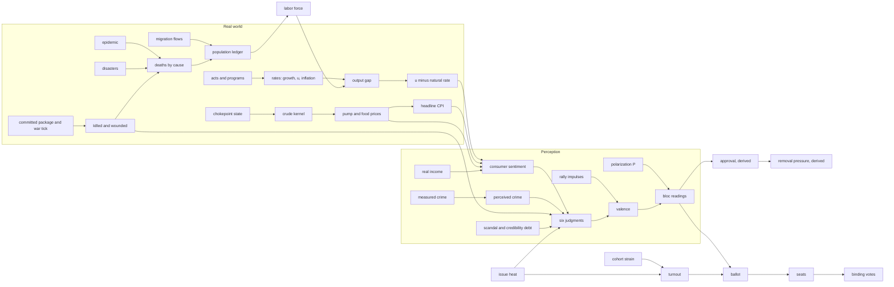

# The target data model, designed as a permanent metric registry, 2026-10-13

Branch `codex/simulation-depth-completion`. Design only. No source file changed, nothing built, no workspace tests, no verify sweep, no Playwright, no balance harness. One read-only probe was written and run (`probes/extract-readers-writers.mjs`, §5.3); it parses source with the TypeScript compiler API and reads the committed `packages/world/dist`. Nothing is committed.

Inputs read in full: `CLAUDE.md`, `AGENTS.md` (headings), `docs/NORTH_STAR.md`, `docs/DECISIONS.md` §1 to §7 and §12 to §13, this folder's `INVENTORY.md` and four research briefs, the approval audit's `VERIFY.md`, `DESIGN.md` and `DESIGN-VERIFY.md`, the coercion audit's `VERIFY.md`, `REGIME-CHANGE.md` (summary, findings, build plan) and `REGIME-VERIFY.md`, the casting `VERIFY.md` and `AUDIT.md` (summary, model), and the contested-issues `PLAN.md` §1, §6 to §14. Source read: `stat-consumers.ts` and its paired test (`bands.test.ts:230-279`), `metrics.ts` and its test, `units.ts`, `scripts/capability-ledger.json`, `scripts/engine-internal-actions.json`, `effect-types.ts`, the `apply` handler table, `turn-phases.ts`, `external-shocks.ts`, `impact-event.ts`, `strike-outcomes.ts`, `vitals.ts` (head), `content/src/impact-model.ts:405-440`, `studio-cli/src/corpus/shard-store.ts` (head), and the corpus files on disk.

Labels. **Fact**: read in source or a source opened by an input brief, or printed by a probe, with a citation. **Inference**: a reading of facts. **Recommendation**: a proposal. Research tags carried from the briefs: [O] opened, [C] computed, [S] search summary only (not to be built on), [D]/[M] design judgment. A number with none of these came from source and carries its file:line.

---

## 0. Summary

**Outcome.** The game needs one model of the world in which every figure has a declared kind, a declared timing class, one owner per cause, a calibration case where a real series exists, and a mechanically derived list of who writes and who reads it. The registry is that model's spine, not a document beside it.

**Recommendation, in one line per part.**

1. **Ten metric kinds** (§1): the nine requested plus *process record*, because bills, pending rules, nominations and cases are neither stocks nor events. Each kind fixes how a figure may be written, how it persists, how the player sees it and how it is calibrated. Derived readings and perceptions are never written by content.
2. **Five timing classes** carried on every effect (§2). One generic **scheduled-contribution queue** replaces the bespoke deferred-effect stores (today `externalShocks`; later the rally impulses, scheduled consequences, distributed pass-throughs). It does **not** absorb process records (pending rules, issued acts, cases, conditions, impact events), which own their own state machines. Verdict: accepted with controls.
3. **The domain model** (§3) across sixteen domains, each row marked keep, change, add or delete against `INVENTORY.md`, with treatment model-fully, derive or skip. It inherits every audit's verified verdict and upgrades none of them.
4. **The influence graph** (§4): about thirty load-bearing edges with sign, magnitude source and lag; ten cycles with their damping; a weekly budget per metric so thousands of content items cannot sum without bound.
5. **The registry** (§5) extends the existing `metrics.ts` join and `stat-consumers.ts` rather than replacing them, adds a runtime surface for engine state, derives writers and readers with a typed extractor, generates `docs/METRICS.md` and a graph, and holds it with `verify-metric-registry` plus its proof twin. Calibration cases are tests with tolerances. An audit becomes a registry diff.
6. **One scenario per file** (§6), pretty-printed JSON at `content/corpus/scenarios/<class>/<id>.json`, with the sidecars and the player bundle regenerated by the bake. Migrate now, while drafting is on hold.
7. **Build order** (§7): registry seeded with today's model first (R0, R1), then the verified first slices from each audit (war casualties, decisiveness and reach; the smaller blockade change; approval slices 0 to 2 and the economy refit through sentiment; casting's data-weighted draw), then the population ledger, the queue, the strike pipeline and the rest.

**Verdict.** Registry: **accepted with controls**. Generic queue: **accepted with controls**. Scenario-per-file: **accepted**. The domain model as a whole: **needs validation**, slice by slice, because most of its calibration rests on audits whose own verdict is needs validation (§8).

**Top risks.**
1. The registry repeats `stat-consumers.ts`'s failure: hand-written reader claims that drift. The probe found 32 of 79 `NationStats` leaves with no reader a syntax-level scan can confirm, and two named readers (`macro.deathBaseline`, `macro.birthBaseline`) that do not exist anywhere in source (§5.3). Control: derived fields are never hand-authored, and the gate fails on an unconfirmed claim.
2. A large model built ahead of what the player can see. Control: every slice ships a player-visible reading or a calibration test, never a stock alone.
3. Calibration that fits by construction (DESIGN-VERIFY found two replays worse than a naive baseline; REGIME-VERIFY found the Iraq fit circular). Control: every calibration case carries a naive baseline and, where possible, a held-out case.

**Next actions.** Owner answers §8.4. After the current checkpoint closes: open BL-143 for R0 to R2 (the next free id per `docs/BACKLOG.md:5`), land R0 in report mode, then the war, blockade and approval-hygiene slices in the order of §7.

**What is complete, partial, not attempted.** Complete: taxonomy, timing decision, registry schema and gate design, storage decision, build order. Partial: the domain tables cover every domain the brief names, but Congress, courts, press, intelligence and foreign politics rows rest on located-not-traced fields (`INVENTORY.md:87`), marked "untraced". Not attempted: any numeric fit of my own; any run of the engine.

---

## 0.1 Corrections to `INVENTORY.md` found in this pass

| # | Inventory says | Observed | Evidence |
|---|---|---|---|
| I1 | `populationToll` defined and applied but no emitter in engine; content untraced (`INVENTORY.md:14`) | Content emits it. The impact model books `TOLL_DEATHS[lives]` against the bearer nation and home state, skipping `accounting: "already-reported"` | `packages/content/src/impact-model.ts:415-433`; correction stripping it from commitments at `content/src/scenario-corrections.ts:24` |
| I2 | "the 64-phase sequence" (`INVENTORY.md:95`) | 62 `{ id: … }` entries in `campaignPhaseSequence`, no spreads | `turn-phases.ts:98-206` |
| I3 | "six special-purpose stores" for timing (`INVENTORY.md:15, 95`) | At least eleven more domain records carry their own due date or due turn | `pledges.ts:34`, `state-legislature.ts:259, 344`, `state-orders.ts:29, 74`, `state-judiciary.ts:104`, `trade.ts:96`, `war-powers-report.ts:52`, `offshore-leasing.ts:49`, `projection-record.ts:23`, `case-types.ts:45`, `case-families.ts:98`, `action-support.ts:15` |
| I4 | Inventory treats `stat-consumers.ts` as the registry to seed | A second registry already joins schema, units, consumers and copy: `packages/world/src/dataset/metrics.ts` (`METRICS`, `MetricSpec`, provenance `authored / derived / runtime`), consumed by the studio's metrics page | `metrics.ts:1-60`, `apps/studio/metrics-view.mjs:25-55` |
| I5 | `vitalsPhase` is the population writer | Its header claims sole ownership ("This phase owns `demography.population` alone"), but `impact-lifecycle.ts:41-45` and `effects.ts` (`populationToll`) also write it | `vitals.ts:15-20`; `INVENTORY.md:27-29` |
| I6 | The paired consumer test proves a reader exists | It checks only that `readBy` (or `owedBy`) is longer than three characters; a claim naming a function that does not exist passes | `bands.test.ts:245-252`; the comment at `bands.test.ts:271` asserts `deathBaseline` and `birthBaseline` are live readers; neither symbol exists in any package source (grep, this session) |

---

## 1. Metric taxonomy

### 1.1 The kinds

Ten kinds. The inventory used seven (`INVENTORY.md:20`); this adds *rate* (split from flow, because DECISIONS §6.1 gives rates one law), *event record* and *process record*.

| Kind | What it is | Examples today | May be written by | Persistence and decay | What the player sees | Calibrated how |
|---|---|---|---|---|---|---|
| **Stock** | A quantity that accumulates and is conserved: inflows and outflows change it, nothing resets it | population, debt, munitions, treasury (budget authority), force headcount, casualties to date | `apply` only, through flow effects booked by the owning phase or an act's level write. A stock with an accounting identity (population, debt) has exactly one phase that books each flow line | No decay of its own; changes only by booked flows. Bounded only by physical floors (≥ 0) | Truth for the President's own government's administrative stocks (treasury, forces); a dated release for statistical stocks (population is published annually, `RESEARCH-SOCIETY` §A) | An identity test (stock' = stock + Σ flows) plus a range check against the sourced level at founding |
| **Flow** | A per-period amount moving a stock | births, deaths by cause, net migration, deficit, weekly casualties, munition draw | Computed in its owning phase from rates × stocks; never stored as state. What a flow *was* is an event record (history row) | None: a flow exists for one step | Usually through its release or the cause ledger, never as a live meter | Against a sourced series of the flow (weekly deaths band, NIM by year) |
| **Rate** | A level a figure tends toward under one law | growth, inflation, unemployment, policy rate, crime index's resting point | One law per rate in `macro.ts` (`nextValue`, DECISIONS §6.1). Acts write levels; standing programs move resting points (§6.2) | Mean reversion toward a target built from named drivers; reversion speed is a registered constant | A monthly or quarterly release with revision (`economic-releases.ts`), not the live value | Fit of reversion speed and target terms to the sourced series; per-term dispersion across seeds (`RESEARCH-ECONOMY` §4.3) |
| **Index** | A bounded 0..1 reading of a condition with no natural unit | stability, readiness, standing, regime stability, legitimacy, protest pressure | Effects through `apply`. Every index must declare an anchor and a reversion, so it cannot saturate (approval VERIFY F13: standing clamped in 126 of 208 weeks) | Reverts to a declared anchor; the anchor may itself be derived (DECISIONS §5.5 pattern) | A graded word (`gradeOf` in `units.ts`) with its two ends named (`metric-copy.ts` scale), not a decimal | Fraction of weeks at a bound (≤ 25% in careful play, DESIGN §8 balance 7) plus a sourced level where one exists |
| **Perception** | What a public or a bloc believes, as a stock with its own lag and filters | the six judgments, polarization, consumer sentiment (target), perceived crime (target), trust in government (target) | Never written directly by content. Moves by revision toward a target built from named terms; non-revision writers spend a weekly budget (DESIGN §2.5 item 4, 0.05 per driver per week [D]) | Revision speed (today 0.06 a week, DESIGN §2.2) and, where measured, asymmetry (bad news faster, `RESEARCH-ECONOMY` §3.4) | Shown as itself: it is the fact that the public holds. Its *target* is hidden, never shown (`RESEARCH-ECONOMY` §5.11) | Persistence (monthly AR(1) 0.928 [C], `RESEARCH-PRESIDENCY` §2.1), event replays with naive baselines (DESIGN-VERIFY §1) |
| **Latent trait** | A slow characteristic that sets what an actor will do or how something responds | nation traits, person attributes, the proposed constitutional-health `checks`, fertility index | Rolled at founding inside an authored range (DECISIONS §4.7); changes only through declared slow channels or a declared break channel | Years; asymmetric where sourced (damage faster than recovery, `RESEARCH-PRESIDENCY` §5.1) | Hidden. Shown only through readings (report cards, dossier sentences) and in God Mode (NORTH_STAR §5). A dossier never shows a hidden number (DECISIONS §13.12, memory note) | Range at founding against the sourced distribution; for a break channel, the size of observed breaks |
| **Derived reading** | A composite recomputed from state on every read | approval, removal pressure, bands, cohort support, life expectancy, median age (target), excess deaths | Nothing. Recomputed, never stored (DECISIONS §1.10). Approval in particular is never named by an effect (`INVENTORY.md:8`) | None; its history is an event record written once at the week's close | As its definition says: a poll, a band, a published statistic | The calibration of its inputs, plus an identity test that the reading equals its formula |
| **Config constant** | A number in code that a rule reads | `OPINION_WEIGHTS`, `PRESSURE_WEIGHTS`, `REVERSION_RATE` 0.04, `WEEKLY_CASUALTY_RATE` 0.02, `STATE_ROUTE_CAP` 0.025 | Code changes only, each one a registry diff with its calibration case re-run | Permanent until changed | Never directly; the doctrine restates the ones writers reason about (`verify-doctrine-metric-alignment.mjs`) | Each constant names its source and status `provisional / calibrated`, mirroring `ImpactSpec.calibration` (`impact-event.ts:44`) |
| **Event record** | An immutable dated fact with an origin, including issued reports about the world | ledger entries, impact events' reports, collection reports, the weekly opinion and economy history, a strike's assessed damage | Appended once by the writer that observed it; never rewritten (DECISIONS §1.10, §1.11). A report is a subtype: it carries `revision`, `confidence` and a stage `initial / update / final` (`impact-event.ts:64-71`) | Bounded rings with declared retention (DECISIONS §5.4 pattern) | The report, not the truth: a range, a confidence and a date | Reporting lag and revision size against sourced cases (CDC 4-month overdose lag; Al Asad TBI 34 → 109 in weeks; Mosul 352 vs 1,066 to 1,579) |
| **Process record** | A mutable stage machine that owns its own decisions at each step | bills, pending rules, nominations, issued acts, cases, conditions, impact events, scenario families, scandals | Only its owning phase advances its stage; its *effects* go through `apply` like any other | Lives until its terminal stage; clocks are real or absent (DECISIONS §3.5) | Its stage and clock | Duration distributions against sourced lags (confirmation medians 38 to 164 days, `RESEARCH-PRESIDENCY` §3.6) |

### 1.2 Rules that hold across kinds

1. **Units and normalization.** Every numeric field carries a `UnitSpec` (`units.ts:20`; DECISIONS §4.3). Money in USD millions. Indices are 0..1 and name both ends. Perceptions are 0..1 shares of a public. Logit-space quantities (the bloc intercepts in DESIGN §2.2) are internal and never shown.
2. **Write policy is a property of the kind, not of the caller.** The registry stores `writePolicy` per entry: `derived-only`, `revision-only` (perceptions), `phase-law` (rates), `level-or-flow` (stocks, indices), `founding-only` (latent traits), `append-only` (events), `owner-phase` (process records), `code-only` (constants). The gate checks every extracted writer against it.
3. **Truth and observation are separate fields, never one.** Where the world reports a figure, the registry entry names the observing channel: `truth` (administrative fact the President's government holds), `release` (scheduled print, lagged, revised), `report` (event-driven, with confidence and reporter bias), `perception` (the public's stock), `hidden` (latent; God Mode only). The security and society briefs recommend this for casualties, civilian harm, NIM and crime (`RESEARCH-SECURITY` §3.5, §7.1 principle 2; `RESEARCH-SOCIETY` §3.4). The impact-event record already implements it for incidents (true `totals` beside bounded `reports`, `impact-event.ts:79-85`). DECISIONS §7.11 already requires projections to run on what the government believes.
4. **One owner per cause.** A cause (for example "war deaths → security judgment") is billed by exactly one system; sub-national readings steer and never bill twice (DECISIONS §6.3). The registry records `owns` on the writer's entry.
5. **Variance never touches a promise** (DECISIONS §1.12): a seeded draw may set a realized outcome, never a quoted cost or a recorded history.

---

## 2. Timing classes and the scheduled-contribution queue

### 2.1 The five classes

| Class | Meaning | Today | Evidence for the game's parameters |
|---|---|---|---|
| **Immediate** | Lands in the packet that causes it | Effect packets via `apply`; approval recomputed per packet (`INVENTORY.md:95`) | Pump price 65% of a crude move in month 0 [C]; rally onset within a month (+19.7 after 9/11 [C]); strike damage on the day |
| **Lagged** | A fixed or drawn delay, then a step | Issued acts (`state-campaign.ts:575`), pending rules (`:482`), confirmation lags | Confirmation medians 38 to 164 days [C]; retaliation 1 to 5 days modal, 0 to 7 range [O]; deaths 13 to 17 days after infection, reported 19 to 21 days later [O] |
| **Distributed** | Spread over many weeks by a declared kernel | `externalShocks` (26-week target shift, ring 128, `external-shocks.ts:16-36`); impact events stepped daily; tariff shelf over 26 weeks (`RESEARCH-ECONOMY` §5.3); mean reversion | Tariffs half at 3 months, full at 7 [O]; spending multiplier mostly in two quarters [O]; rally decay about 27 points in 14 months (Bush 43) [C] |
| **Conditional** | Size or occurrence depends on state at landing | Phase gates, condition onset, scenario gates | Multiplier by slack (up to 2.5 in recession, about −1 in expansion) [O]; oil shock only above the prior three-year high [S]; rally only when the public does not start opposed [O] |
| **Trait-modulated** | A bounded modifier from a person's or nation's traits | Minister competence and loyalty (`war-tick.ts:95`), person attributes (`stat-consumers.ts:310-366`) | No source quantifies an official's effect on outcomes; traits modulate speed, information quality, variance and blame, not truth (`RESEARCH-ECONOMY` §6.3, `RESEARCH-SOCIETY` §7). Bounds such as ±20% rally size from charisma, ±15% execution from competence are [D] (`RESEARCH-PRESIDENCY` §7) |

**Recommendation.** Every effect a writer emits declares its class through the effect's own fields: no field (immediate), `at` (lagged), `kernel` (distributed), `when` (conditional), `modulatedBy` (trait-modulated). The registry records, per metric, which classes its writers use, so a reader can see that a metric moves only immediately, or only through a kernel.

### 2.2 One generic queue, and what it does not absorb

**Decision.** Add one store, `campaign.scheduled`, of **scheduled contributions**: a dated, origin-stamped contribution to a registered metric, with a kernel and an optional landing predicate. It replaces the bespoke *deferred-effect* stores and is drained by date, inside the phase that owns the target metric.

```
ScheduledContribution {
  id, origin: CausalId,                 // DECISIONS §1.11
  metric: RegistryId,                   // must be registered; the gate checks the writePolicy
  mode: "target-term" | "level" | "flow" | "impulse",
  amount: number,                       // fixed at scheduling when it is a quoted promise (§1.12)
  kernel: { kind: "step", at } | { kind: "linear", from, days } | { kind: "decay", from, halfLifeDays } | { kind: "table", from, weights[] },
  when?: PredicateRef,                  // re-evaluated at landing; declares its default (DECISIONS §3.5 pattern)
  modulatedBy?: { trait: RegistryId, bound: number },
  budgetKey: string                      // which weekly budget it spends (§4.4)
}
```

**What moves into it (candidates; verify each against source before moving).** `externalShocks` (already a target-term contribution with a step kernel and a span, `external-shocks.ts:16-24`); the rally impulses of the approval design (a decay kernel per class, DESIGN §2.1); scheduled consequences of the `delayed-consequence` case family (`case-families.ts:35`); distributed pass-throughs (tariff shelf, crude to pump 65% / 34%, fiscal impulse over two quarters); lagged reporting revisions that are not already an impact event's reports; retaliation strikes after their delay; WIA diagnoses that grow over weeks.

**What stays out, and why.** Pending rules, bills, nominations, issued acts, cases, conditions, impact events, scenario families and scandal stories are **process records**: at each step they decide something (a court rules, a vote counts, an onset draws) rather than deliver an amount fixed earlier. Folding them into a queue would turn their decisions into pre-computed amounts, which is exactly the stale-state failure below. They keep their own stores and emit queue entries when *they* schedule a metric consequence.

**Strongest failure mode.** A contribution computed at scheduling lands weeks later into a world that has moved: a scheduled toll lands after the population it names has left, or a quoted distributed cost lands in full after the program it paid for was cancelled. Second: thousands of content items each schedule small contributions, and the queue becomes an unbounded second simulation that no screen explains. Third: a queue drained by tick count would break DECISIONS §2.3 (a 28-day advance equals 28 one-day advances).

**Controls.**
1. `amount` is frozen only when it is a promise shown to the player (a priced cost); everything else is a `target-term` or `flow` re-read against live state at landing, the way `populationToll` is applied relative to the population when the packet lands (`impact-model.ts:420-422`).
2. A `when` predicate declares a default on failure (drop, land at a reduced amount, convert to a record), never a silent skip (DECISIONS §3.5).
3. Drained by calendar date inside the owning phase, so day layout does not change results; a test steps 28 days both ways.
4. Ring bound per metric and per origin, with a full eviction order (DECISIONS §1.4); entries spend the metric's weekly budget (§4.4) at landing.
5. Every entry is visible in the Record through its origin.

**Best alternative.** Keep per-domain stores and add a registry field naming each store's timing class. Cheaper, and nothing moves. It leaves six to a dozen bespoke drains with their own bounds and no shared budget, which is how unbounded summing happens. **Verdict: accepted with controls.**

---

## 3. The domain model

How to read the tables. **Δ** is the change against today: keep, change, add, delete. **T** is the treatment: **M** model fully, **D** derive, **S** skip, **P** perception layer. Writers and readers are the target; today's are in `INVENTORY.md` at the cited line. "Untraced" means the inventory located the store but no one has traced its writers. Each audit's verified verdict governs its rows; nothing here upgrades a "needs validation".

### 3.1 Presidency and the public

| Metric (kind) | Δ | Definition, units, range, cadence | Writers → readers | Calibration (source) | Brief | T |
|---|---|---|---|---|---|---|
| Six judgments (perception) | change | prosperity, security, services, integrity, competence, unity; share 0..1; weekly revision | Target terms only; direct writes spend a 0.05 per driver per week budget [D]; 13 source files construct `kind: "opinion"` today (probe §5.3) → approval, blocs | Persistence and replays; economy terms refit jointly with scandal and rally constants (DESIGN-VERIFY §4.2) | Presidency §2, Economy §4.2 | M |
| Approval (derived reading) | keep | Share approving; 0..1; recomputed per packet (`opinion.ts:450`) | No writer → removal unpopularity 0.331 (`removal.ts:78`), elections, Record | Monthly AR(1) near 0.928, change SD near 4.11, p90 6.5 [C]; honeymoon means 66.3 / 63.9 / 56.4 / 53.8 [C]; economy share of variance 15 to 25% (Gordon 16 to 22% [O]) | Presidency §2.1, §8 | D |
| Polarization (perception stock) | change | `P = P* + D`, anchor from founding, `D ∈ [−0.15, 0.25]`, 104-week half-life (DESIGN §2.1) | Divisive and unifying acts → bloc intercepts once (DESIGN §2.5 item 6) | Drains to 0 by weeks 155 to 160 today (VERIFY F2); reverts to anchor in quiet runs (DESIGN-VERIFY: 1.0 held); bound κ·P_max (DESIGN-VERIFY §3.2) | Society D6 | M |
| Rally stock (stock of impulses) | add | Valence impulses with class size and half-life | Rally table via the queue (§2.2) → valence | 9/11 shape RMSE 1.8 [fit]; several half-lives are judgments (DESIGN-VERIFY row "Rally sizes"); self-started wars damped (coercion VERIFY item 11) | Presidency §3.9, Security §6.2 | M |
| Credibility debt (stock) | add | 0..0.45, 52-week half-life (DESIGN §2.2) | Live scandal intensity, open inquiries → integrity target | Watergate 4.3, Iran-Contra 2.7 (worse than a two-level step, 2.0), Lewinsky 5.5 (worse than flat line, 3.8) (DESIGN-VERIFY §1) | Presidency §3.7 | M, needs validation |
| Trust in government (perception, per bloc) | add | Share trusting Washington; per bloc grouping (§3.6) | Outcomes, integrity events, White House party → legitimacy readings | Pew 17% (Sep 2025), party flip 20 to 25 points in months [O] | Presidency §4.1, Society D5 | P |
| Favorability, issue approval (derived) | add | Readouts | From judgments and BL-142 issue state | No favorability series sourced (`RESEARCH-PRESIDENCY` §9) | Presidency §3.2, §3.3 | D (issue approval); S (favorability until sourced) |
| Removal pressure (derived reading) | keep, change pending | Six weighted terms (`removal.ts:77-84`), beats 0.45 / 0.52 / 0.60 | No writer → removal ladder | DESIGN proposes deleting the Congress term (party counted in votes already, VERIFY F19, DESIGN-VERIFY item 7) | Presidency §3.4 | D |
| Standing (index) | change | 0..1 | Add reversion to a founding anchor (VERIFY F13) | ≤ 25% of weeks at a bound | — | M |
| Stability, military readiness (index) | change | 0..1 | Security base `0.6 + 0.4·(stability − rest)` (DESIGN §2.5 item 2); readiness island (VERIFY F14) | Bound-dwell test | — | M |
| Treasury (stock) | change | Budget authority, USD millions; refilled about $27.5B a week to a ceiling (`fiscal.ts:352-385`, coercion VERIFY point 3) | Apportionment, acts → `treasuryHealth` (`packages/engine/src/metrics.ts:42-48`), removal floors | `fiscalSpace` reads 1.000 every week today (VERIFY F15) | Economy §5.5 | M; rename in copy to "budget authority" [D] |
| Alignment vector (latent) | keep | −1..1 per axis; gains the cultural axis (DECISIONS §13.1) | Acts → removal expected alignment (`removal.ts:248-254`) | Untraced | — | M |
| Constitutional health `checks` (latent) | add | One slow latent per nation; drift 0.05 to 0.1 a year, break 0.1 to 0.3 per act cluster [D from WGI breaks] | Executive acts (defying courts, firing overseers) → integrity, removal capacity, report cards | US one-year SD of change 0.07 to 0.14 [C]; breaks Poland −0.22, Turkey −0.24, US 2025 −0.21 Rule of Law [C] | Presidency §5 | M, hidden; owner question |
| Report cards, historian score, promise ledger, GAO-style list (derived) | add | Annual, biennial, end of game | From latents, pledges, workforce | WGI, FH, V-Dem, WJP levels [O]; C-SPAN ten characteristics [O]; Obameter shares [C] | Presidency §3.8, §3.10, §4.2, §4.6 | D |
| Election integrity meter | — | — | — | Measured only in election years | Presidency §4.4 | S (election-year property) |

### 3.2 Government, institutions and capacity

| Metric (kind) | Δ | Definition, units, range, cadence | Writers → readers | Calibration | Brief | T |
|---|---|---|---|---|---|---|
| Appointments filled / acting / vacant per agency (stock, process) | change | Counts per agency; weekly step | Nomination pipeline (`nomination.ts`, untraced) → agency leadership factor → services, competence | Confirmation medians 38 to 164 days [C]; 30% vacancy in four departments in 2024 [O]; vacancy effect about 1 SD [S] | Presidency §3.6 | M; vacancies as a share of seats, not a count (VERIFY F24) |
| Workforce capacity per agency (stock) | add | Index or headcount; fast fall, slow rise; monthly effect | Budgets, freezes, shutdowns, reorganizations → program execution, services, Government Effectiveness | −10.9% federal employment Jan 2025 to Sep 2026 [C]; rebuild rate unsourced | Presidency §4.5 | M, needs validation |
| Services and backlogs (stock, process) | keep | `services.ts`, `service-catalog.ts` (untraced) | Enforcement priorities (BL-142 §6.1) → services judgment | — | Contested PLAN §6.1 | M |
| Executive orders, rules (process records) | keep | `orders`, `pendingRules` | Acts, courts, Congress → law, counts | Final rules 2,441 to 4,491 a year [O]; EO counts are activity, not efficacy | Presidency §3.5 | M (acts); D (counts) |
| Emergencies (process) | keep | DECISIONS §6.7 | Declaration acts | — | — | M |

### 3.3 Congress

| Metric (kind) | Δ | Definition | Writers → readers | Calibration | Brief | T |
|---|---|---|---|---|---|---|
| Caucus seats, delegations (stock) | keep | Apportioned by one writer (DECISIONS §5.2) | Elections → every binding vote | — | — | M |
| Member disposition, votes (process, latent) | keep, untraced | `congress.ts:439-453`, `congress-votes.ts:270-300` | Approval on salient bills only (Canes-Wrone [S]); issue heat multiplies conviction (BL-142) | Laws per Congress 274 to 442 [O]; unified vs divided ratio, not a fixed count | Presidency §3.4 | M |
| Midterm seat model (derived) | change | Seats from ballot share | Bloc ballot (DESIGN §4.7) | Fails in level: 41.0% House vote at 45% approval vs Clerk 46.6% (2010), 48.6% vs 52.4% (2002) (DESIGN-VERIFY row 32); slope 1.4 ± 0.5 seats per point | Presidency §2.1 | D, needs validation |
| Support score, laws, vetoes (derived) | add | Counts per Congress | From the vote record | Veto counts [O] | Presidency §3.4 | D |

### 3.4 Courts

| Metric (kind) | Δ | Definition | Writers → readers | Calibration | Brief | T |
|---|---|---|---|---|---|---|
| Benches, vacancies, justices (stock, latent) | keep, untraced | `judiciary` (`state-campaign.ts:526`) | Nominations → rulings | Article III confirmations by term [C] | Presidency §3.6 | M |
| Docket, doctrine questions, rulings (process) | add (BL-142) | October intake, June season (DECISIONS §13.12) | Challenge seeds → issue state, heat | Not built | Contested PLAN §6.1 | M |
| Defiance (event, latent effect) | add (BL-142) | Hard case (DECISIONS §13.13) | → `checks` break channel, integrity, impeachment beat | — | Presidency §5.1 | M |

### 3.5 People

| Metric (kind) | Δ | Definition | Writers → readers | Calibration | Brief | T |
|---|---|---|---|---|---|---|
| Person attributes: competence, integrity, charisma, loyalty, ambition, ideology (latent) | keep, change | `PersonRuntime` (`state-campaign.ts:122-145`); readers at `stat-consumers.ts:280-383`; ideology gains the cultural axis | Founding pool; slow drift → modulators only (§2.1) | Bounds are [D]; the cabinet-sweep constants are already gated against the dossier (`verify-person-consequence-alignment.mjs`, CLAUDE.md) | Presidency §7, Economy §6.3, Society §7 | M; modulate speed, information, variance, blame |
| Official information quality (derived) | add | Noise and lag of a briefing from the owning official's competence | → projections (DECISIONS §7.11) | No effect size sourced; labeled [D] | Economy §6.3 | D |

### 3.6 Electorate

| Metric (kind) | Δ | Definition | Writers → readers | Calibration | Brief | T |
|---|---|---|---|---|---|---|
| Cohorts on eleven axes (latent shares, perception strain) | keep | DECISIONS §5.8 incl. religion (accepted, not built) | Domestic signatures → strain → turnout | CES baselines; raking drift up to 5.5 points (DESIGN-VERIFY row 29) | Society §5.1 | M |
| Blocs (derived grouping of cohorts) | add, as grouping | own identifiers, own leaners, pure, other leaners, other identifiers | Cohort compositions → bloc readings, caucus reading | Headline-only party test: own ≤ 3, opposition ≤ 2, independents ≤ 5 points RMSE (DESIGN-VERIFY §3); λ unidentified, label as judgment | Approval VERIFY "simpler alternative", DESIGN §2.6 | D. VERIFY recommends blocs as a grouping of the cohort layer, not a parallel electorate; DESIGN-VERIFY lets slices 0 to 2 start under controls |
| Party ID shares (latent, dated data) | add | Five shares; Gallup 2025 and Pew 2023 voters | Founding → headline, ballot | Seeded symmetric range or endogenous leaner drift (DESIGN-VERIFY Q3) | DESIGN §8 slice 0 | M |
| Turnout displacement (derived) | change | ±0.04 per bloc (cap per act or total: undecided, DESIGN-VERIFY row 30) | Cohort strain → ballot | Inert today: 0.001 to 0.002 against a 0.03 cap (VERIFY F6) | — | D |
| State lean (index with derived anchor) | keep | DECISIONS §5.5 | Grievance marks → lean anchor; never from demography (§5.10) | — | — | M |

### 3.7 Economy: four layers

| Layer and metric (kind) | Δ | Definition, units, cadence | Writers → readers | Calibration | Brief | T |
|---|---|---|---|---|---|---|
| **Real.** Output level, potential, gap (stock, derived) | keep | `MacroState.potential` exists | Cycle, fiscal impulse, shocks → Okun, receipts, sentiment | Gap +1.4% Q2 2026, −5.0% 2009, −8.8% 2020 [C] | Economy §5.1 | M (gap, potential); D (per capita) |
| Unemployment U-3 (rate) and natural rate (rate) | change, add | Fraction; weekly step, monthly release | Okun from gap → sentiment (as a gap), Fed rule, poverty | Okun −0.422 (−0.432 post-1985) [C]; NROU 4.39% vs engine `FED_FULL_EMPLOYMENT` 0.05 [C, O] | Economy §5.2 | M |
| Real wage and real disposable income (derived) | add | Wage growth minus CPI | → sentiment, vote (Hibbs 3.61 points per point [O]) | Real pay negative since Apr 2026 [C] | Economy §4.2 item 2 | D |
| **Prices.** Core inflation and expectations (rate, stock) | keep | `expectedInflation` 104-week half-life exists | Gap, expectations → headline | CPI 12-month peaks [C] | Economy §5.3 | M |
| Gasoline, food at home (stock price layers) | keep, change | `household-prices.ts` exists | Commodity kernel → pump with distributed pass-through 65% / 34% [C] | Gas range $0.907 to $5.006 [C] | Economy §5.8 | M |
| Headline CPI, PCE, shelter (derived) | keep | Weighted sum | → releases | CPI weights [O] | Economy §5.3 | D |
| **Money and markets.** Policy rate, 10-year (rate) | keep, add 10-year if absent | FOMC calendar exists | Rule, deficits → mortgage, interest cost, equities | Funds +4.0 points in ten months 2022 [C] | Economy §5.4 | M |
| Mortgage, curve, spreads, NFCI (derived) | add | From 10-year and cycle drag | → housing (3 to 8 months lag) | 2022 housing shape [C] | Economy §5.4, §5.7, §5.9 | D |
| Equities (index) | keep | `markets.ts`, weights "labeled here, not sourced" | → sentiment (no sourced approval effect) | Fit to S&P 2016 to 2026 [C] | Economy §5.7 | M |
| **Perception.** Consumer sentiment (perception) and inflation expectations sub-index | add | Michigan-style index; decay toward data-implied value with a half-life of months; asymmetric; per-bloc filter | Gaps, real income, gasoline, partisan filter → prosperity target, vote | Gordon RMSE about 7 index points [O]; 2022-24 gap 10 to 16 points below indicators [O]; the brief's 2000-19 OLS is unstable in 2021-26 [C] | Economy §5.11 | P; **the central addition** |
| State and sector economies (derived) | add | State U-3 = national + sector exposure term | Shocks × six state axes → electoral votes | 50 state URs [C] | Economy §5.12 | D |
| Poverty (derived); Gini, wealth shares | add; — | | Unemployment, real wages, transfers | Official 10.2%, SPM 13.1% [O] | Economy §5.10 | D; S |

### 3.8 Fiscal

| Metric (kind) | Δ | Definition | Writers → readers | Calibration | Brief | T |
|---|---|---|---|---|---|---|
| Debt (stock), deficit (flow), receipts and outlays (flows) | keep, untraced | `fiscal.ts`, `national-books.ts` | Cycle, legislation, interest → rating, debt limit | CBO FY2026 deficit 5.8% of GDP [O via House Budget summary] | Economy §5.5 | M |
| Interest cost (flow from a maturity-weighted rate) | change | Reprices over years | 10-year, debt stock → outlays | FY2025 interest $970.1B vs $658.3B FY2023 [C] | Economy §5.5 | M |
| Multiplier (config, conditional) | change | Below 1 in expansion, higher in slack, legislative lag | → output | 0.6 to 1 spending [O]; up to 2.5 in recession [O] | Economy §5.5 | M |
| War outlay (flow) | change | Today 2% of US GDP × intensity for any aggressor (`fiscal-impulse.ts:118-131`) | Committed package's brigade-year cost (REGIME S0b) | Grenada-scale under 0.05% of GDP; Iraq within 20% of brigade-year sum (REGIME §9) | Security §5 | M |

### 3.9 Society and population

| Metric (kind) | Δ | Definition, units, cadence | Writers → readers | Calibration | Brief | T |
|---|---|---|---|---|---|---|
| Population ledger, US (stock) | add | State × age band (6) × sex: 612 cells; weekly | Births, deaths by cause, international and domestic migration, located tolls → every population reading, labor force, cohort age shares | No-event 8-year run reproduces natural increase near 0.15% a year, 17 states in natural decrease at founding [O, C] | Society §5.1, §5.2 | M |
| National, state totals; median age; 65+ share; life expectancy; crude rates (derived) | change | Recomputed from the ledger | → bands, readings, releases | Life expectancy 78.8 → 76.4 → 79.0 (2019, 2021, 2024) [O] | Society A4, A7 | D. `medianAge` stops being a dead read (`INVENTORY.md:34`) |
| Births (flow) and fertility index (latent) | change | Births = fertility × women 15 to 44 × season | Fertility drifts toward authored figure; no player lever | 2025 births 3,606,400 [O] | Society A1 | M, no lever |
| Deaths by cause (flow, event record ledger) | add | About 12 to 17 cause lines; chronic lines are baseline hazards, shock lines are written by their owning system | Each cause line has one writer (epidemic, overdose, homicide, disaster, war, heat) → ledger, excess deaths | 2024 age-specific rates [O]; 2019 weekly deaths 51,134 to 58,675, SD 4.7% [C] | Society A2, A3 | M |
| Excess deaths (derived) | add | Observed minus expected band | → releases, services and competence salience | COVID peak +47.6% week [O]; 2020-22 totals as a band, top 1.32M [C] | Society §3.1 | D |
| Net international migration, inflow and outflow (flows) | add | Policy flow; reported vs true | Acts via resting points → ledger, nativity share | 2.73M → 1.26M (2024 → 2025) [O]; Census vs CBO disagree by about three times [S for CBO] | Society A5 | M |
| Domestic migration (flow, zero-sum) | add | Push-pull from state conditions | → state weights only, never lean (§5.10), never apportionment mid-game | Florida +310,892 → +22,517 (2022 → 2025) [O] | Society A6 | M |
| Epidemic (process: condition + impact event) | change | Age-banded SEIR-lite per state; hospital capacity raises fatality | Outbreak mechanism exists (`impact-event.ts:31`); add age bands and capacity → deaths, services, unemployment once | CDC planning parameters [O]; capacity peak 20.6% of staffed beds COVID [C] | Society B1 | M |
| Health coverage (stock) | add | Covered share by state and program | Standing programs → near-elderly low-income mortality with years of lag | Medicaid expansion −0.132 points annual mortality in the studied group [O] | Society B2 | M |
| Overdose (stock-flow) | add | 12-month count by state, 4-month report lag | Program effects → cause line | 52,623 → 109,413 → 70,646 (2015, 2022, 2025) [O] | Society B4 | M |
| Crime index, measured (index) | keep | `crimeIndex` reverts toward a baseline (`macro.ts` nextSecurity) | Programs move resting point → homicide line, perceived crime | Homicide per 100,000 4.73 to 6.78 [O] | Society C4 | M |
| Perceived crime (perception) | add | Lags measured crime; salience and partisan frame | → security judgment | Gallup 77% "more crime" while FBI shows falls [O] | Society §3.3 | P |
| Unrest (condition) and protest scale and violence tail (derived) | keep, change | Heavy-tailed size draw; violence share 0.5% to 4% [O] | Grievance, mobilization → security (violent tail), issue salience (scale) | CCC counts [O] | Society C1, C2 | M (condition); D (counts) |
| Political violence threat (derived) | add | From P, grievance, rhetoric events | → protective cost, rare located incident | USCP cases 14,938 in 2025 [O] | Society C3 | D |
| Incarceration, poverty, social trust (derived) | add | | | BJS rates [O] | Society C5, D1, D4 | D |
| Institutional and media trust (perception per bloc) | add | | Bloc reading, in-party flip | Gallup average 27%, presidency gap 70 points [O] | Society D5 | P |
| Education, media mix, inequality, civic participation | — | | Cohort exposure weights only | | Society D2, D3, D7, D8 | S |
| City population (stock) | change | Fixed today (`INVENTORY.md:40`) | Displacement moves a metro; deaths in a city debit it | New Orleans −53% in a year, 78% back after nine years [O, C] | Society §3.2 | M (displacement only) |
| Non-US nations' population (stock) | keep | Three-rate identity | Tolls from war, disaster, epidemic via `populationToll` | WPP 2024 [O] | Society F | M (rates), no ledger |

### 3.10 Security and conflict

The strike or operation pipeline is the security brief's nine stages (`RESEARCH-SECURITY` §7.3), mapped onto code that exists.

| Stage | Inputs (dataset fields) | Outputs (kind) | Today | Δ |
|---|---|---|---|---|
| 1 Access and reach | distance, `basesAbroad`, lift, overflight | feasible, lead days, premium (derived) | Reach caps refuse Iraq, Afghanistan, Kuwait; `basesAbroad` unread by `forceProjectionCost` (REGIME-VERIFY E4) | change: reach from basing |
| 2 Penetration | salvo N, interceptors, p_d [M] | arrivals, aircraft lost, interceptors drawn (event; stocks) | Not modeled; munitions stock exists (`munitions.ts`) | add |
| 3 Intelligence | `intelCapability` (A), `counterIntel` (T), mobility | P_valid (derived) | `intelCapability` enters civilian risk only (`strike-outcomes.ts:19-25`) | add |
| 4 Effect on target | hardness by class, yield factor [M] | damage fraction, recovery days (event) | `damageShare` 0.15, `recoveryDays` 14 fixed (`strike-outcomes.ts:58`) | change |
| 5 Collateral | local density, area of effect [M], discrimination, ROE | true civilian deaths and injuries (event) | Civilian risk formula and one impact-event step (`strike-outcomes.ts:15-27, 44-63`) | change (§5.6 worked example) |
| 6 Friendly losses | committed troops, exposure, adversary effectiveness | KIA and WIA separately (event; stock) | No killed/wounded split; `casualtyCost` reads the midpoint as dead (REGIME-VERIFY E3c) | change |
| 7 Retaliation and escalation | provocation, legitimacy need, retaliation capacity, nuclear gate | retaliation event (queue entry with 0 to 7 day delay), pair escalation state (stock) | The "escalation" risk is a label with no retaliation behind it (coercion VERIFY F9) | add |
| 8 Political, legal, alliance | duration, casualties, polling | War Powers clock, partner alignment shifts | War Powers exists; rung 3 not hostilities (coercion VERIFY F10) | change (blockade slice) |
| 9 Opinion, economy, population | events and stocks above | no new writer: `warOpinionTerms`, chokepoint kernel, population toll, displacement | Strike writes `opinion` and `metric` directly (`strike-outcomes.ts:62`) | change: route through target terms |

| Metric (kind) | Δ | Definition | Writers → readers | Calibration | Brief | T |
|---|---|---|---|---|---|---|
| Committed package (stock) | add, first-class | Units, personnel and munitions actually committed, from commitments | Acts → every casualty, cost, reach and readiness reader | — | Security §7.1 principle 1 | M |
| War casualties, killed and wounded (stocks) | change | Engaged = committed package; rate reads the opponent; WIA/KIA ratio by operation type | War tick → opinion (killed only), population (state of record) | OIF WIA/KIA 11.96, Desert Storm 3.27 [C from O]; Just Cause 23, Urgent Fury 19, Desert Storm 148 hostile deaths [O] (REGIME-VERIFY §4) | Security §4.2, §6.1 | M |
| Decisiveness (derived) | change | A collapse against a much larger committed force is decisive | → succession | Today `sideStrength` uses profile scores, ratio 1.22 to 1.26 for a US invasion of Venezuela (REGIME-VERIFY E3b) | — | D |
| Munitions per class (stock) and production (flow) | keep, extend | `DRAW_PER_WAR_WEEK` 0.02, 156-week restock lead (coercion VERIFY point 3) | Strikes, wars → strike gate, side strength | Interceptors at least five years to rebuild [O via Roll Call] | Security §2.1 | M |
| Readiness (index) | keep | Per nation and per unit | War intensity, refit → strike gate (0.45), discipline | USAF MC 67 to 71% [O] | Security §2.1 | M |
| Mission success, casualty counts (event, observed) | add | Observed lags 1 to 4 weeks [M], biased by reporter (`pressFreedom`) | → briefings, Record | Mosul 352 vs 1,066 to 1,579 [O]; 2026 Pentagon revisions [O-2] | Security §3.5, §7.4 | M |
| Displacement and refugees (stock) | add | Per target and neighbors | Civilian harm, duration → neighbors' migration, aid | Lebanon over 1M stated [O-2] | Security §6.5 | M |
| Chokepoint state (stock) and route shocks | change (blockade slice) | Every chokepoint, littoral custodians, sourced commodity shares, bypass as capacity | Blockade as hostilities → kernel → pump → CPI | Kernel recalibrated on net supply loss (coercion VERIFY sources) | Security §6.3 | M |
| Occupation, insurgency, regime hold, contenders | add, later | REGIME-CHANGE §3 to §4 | | Design **rejected as written**; structure kept with controls (REGIME-VERIFY) | Security §4.3 | defer |
| Conflict intensity (index) | keep | Seeded draw weekly | → losses | — | — | M |

### 3.11 Foreign relations

| Metric (kind) | Δ | Definition | Writers → readers | Calibration | Brief | T |
|---|---|---|---|---|---|---|
| Relationships: trust, tension, grudges (stock with decay) | keep | Directed, remembered (DECISIONS §4.8) | Acts, strikes, settlements → NPC agent, ripples | — | — | M |
| Standing (index) | change | Reversion (VERIFY F13) | — | — | — | M |
| Foreign politics: leaders, coups, elections (process) | keep | Coup hazard off at stability ≥ 0.45 (`foreign-politics.ts:236`) | → successions | P2 coup ceiling table (REGIME-CHANGE §1.4) | — | M |
| NPC tempo (derived reading with cap) | add | Per-pair cooldown on every coercive rung | → NPC agent | China blockaded Russia 11 times a term; Russia's imports 0.070 of founding (coercion VERIFY point 4) | — | M |
| Governance readings for every nation (derived) | add | Six WGI dimensions as derived readings for all 196 | From `checks`, corruption, press | WGI 2025 [C] | Presidency §4.2 | D |

### 3.12 Environment and disasters

| Metric (kind) | Δ | Definition | Writers → readers | Calibration | Brief | T |
|---|---|---|---|---|---|---|
| Acute conditions (process) | keep | `ACUTE_CONDITIONS` incl. heat, wildfire, cyclone, flood | Onset → located tolls, displacement, damage (billed once at the nation), declaration case | Billion-dollar events 9.0 a year 1980-2023, 23.0 2020-24 [O]; declarations 43 to 104 a year [C] | Society E1 to E3 | M |
| Damage (derived) | keep | From class and exposure | → economy once (DECISIONS §6.3) | Helene $78.7B [O] | Society E1 | D |
| Reported vs true toll (event) | change | Heat certificates understate about 5× [O] | → briefings | Camp Fire, Lahaina revisions [O] | Society §3.4 | M |
| Climate trend | — | About 0.51 °F a decade [C] | Authored exposure drift only | | Society E4 | S |
| Pandemic base rate (config) | add | Design number until sourced | | Marani et al. [S] only | Society §9 item 1 | owner question |

### 3.13 Press

| Metric (kind) | Δ | Definition | Writers → readers | Calibration | Brief | T |
|---|---|---|---|---|---|---|
| Outlets, beliefs, press standing (latent, index) | keep, untraced | `press` (`state-campaign.ts:618`) | → framing by audience | Loop gain about 0.11, stable without caps (VERIFY F20) | — | M |
| Scandal stories (process) | keep | Stage machine, break 0.5, crest at 6 weeks | → integrity target, credibility debt | See §3.1 | Presidency §3.7 | M |

### 3.14 Content state

| Metric (kind) | Δ | Definition | Writers → readers | Notes | T |
|---|---|---|---|---|---|
| Flags (event record) | keep | Deed grammar (DECISIONS §7.7) | Engine writes deed flags; content reads unbound forms | REGIME hooks bound to target ids conflict with §7.7 (REGIME-VERIFY D13) | M |
| Scenario families (process) | change | Gains an optional `place` (casting VERIFY incremental slice item 2) | Opener → beats and closes inherit place | Saves: optional field, absence reads empty (DECISIONS §9.3) | M |
| Issue state: statute step, constitutional rule, state regimes, heat (stock, index) | add (BL-142) | DECISIONS §13.3 | Rulings, triggers, levers → occurrences, judgments' salience, mobilization | Heat loop closed by rule (§13.8) | M |
| Cases, cooldowns, director pacing (process) | keep | DECISIONS §3 | | | M |

### 3.15 Deletions

Each is an audit's recommendation; the registry entry moves to `status: deleted` with the audit cited, so the history stays readable.

| Delete | Why | Source |
|---|---|---|
| Polarization decay toward 0 | Drains to 0 in about three years | VERIFY F2 |
| Flat stance constants | Free lunch worth about +0.048 coalition | VERIFY F5 |
| Conditions' weekly `approvalDrag` writer | Bills a condition five times | VERIFY F8, DESIGN §2.5 item 1 |
| The rung-3 imports write | Permanent, compounding cut | coercion VERIFY F2 |
| GDP-share covert pricing | Contradicts DECISIONS §6.8's reason | REGIME-VERIFY E5 |
| `chokepointExposure` unweighted | Weights dropped at assembly | coercion VERIFY F6 |
| `macro.deathBaseline`, `macro.birthBaseline` reader claims | The functions do not exist | §0.1 I6 |

---

## 4. The influence graph

### 4.1 Shape



### 4.2 Load-bearing edges

Sign is the direction of effect on the destination. "Magnitude" names where the number comes from; [D] means a design number fitted at the named slice.

| # | From → to | Sign | Magnitude source | Lag |
|---|---|---|---|---|
| E1 | u − u* gap → sentiment | − | Gordon five-indicator fit, RMSE about 7 [O]; fit at slice E1 | weeks to a quarter |
| E2 | Excess and accelerating inflation → sentiment | − | Gordon [O] | weeks |
| E3 | Real disposable income growth → sentiment; → vote | + | Hibbs 3.61 vote points per point, decay 0.914 a quarter [O] | quarters (vote memory half-life 7.7 quarters [C]) |
| E4 | Gasoline price → sentiment | − | Correlation with approval −0.52 to −0.47, weakening [O/S]; modest weight [D] | within the month |
| E5 | Sentiment → prosperity target | + | Within-president +0.554 approval points per index point [C] | revision 0.06 a week (about 11-week half-life) |
| E6 | Judgments → approval | + | `OPINION_WEIGHTS` prosperity .28, security .22, services .16, integrity .14, competence .12, unity .08 (`opinion.ts:79-86`) | immediate recompute |
| E7 | Approval → removal pressure | − (lower approval, more pressure) | unpopularity weight 0.331 (`removal.ts:78`) | weekly |
| E8 | Approval → House seats at midterm | + | Gallup correlation 0.66; −37 vs −14 seats below and above 50% [O]; δ refit needed | at election |
| E9 | Killed → security judgment | − | 0.08 per tenfold, cap 0.25 (`opinion-war.ts:22-25`, REGIME-VERIFY E3c); change to scale by (1 − expected success) [O abstract] | weekly |
| E10 | War started → rally | + | `RALLY_PEAK` 0.15, 6-week half-life (`opinion-war.ts:13-16`); conditional on who started it | immediate, decays |
| E11 | Chokepoint loss → crude | + | Kernel recalibrated on net loss; undershoots about 15% today (coercion VERIFY) | weeks |
| E12 | Crude → pump | + | $0.0287 a gallon per $1 a barrel, 65% month 0, 34% month 1 [C] | 0 to 1 month (queue kernel) |
| E13 | Tariff → consumer prices | + | Half at 3 months, full at about 7 [O] | distributed |
| E14 | Policy rate → mortgage → housing starts | − | 2022: starts −28% in 8 months [C] | 3 to 8 months |
| E15 | Output gap → unemployment | − | Okun −0.422 [C] | within a quarter |
| E16 | Fiscal impulse → output | + | 0.6 to 1, up to 2.5 in slack [O] | two quarters, legislative lag |
| E17 | Epidemic infections → deaths | + | CDC IFR by age [O]; capacity coupling [C] | 13 to 17 days |
| E18 | Epidemic → unemployment, GDP | − | 2020 shock-year series [O]; billed once | weeks |
| E19 | Disaster → services, competence targets | − | Katrina at severity 0.7: services −0.30, competence −0.08, 26 weeks (DESIGN §4.5) | immediate, held |
| E20 | Measured crime → perceived crime | + | Lagged; salience [D] | months |
| E21 | Protest violence tail → security | − | Wasow: sign depends on violence [O] | weeks |
| E22 | Vacancies, workforce → services, competence | − | About 1 SD [S]; bounded [D] | months |
| E23 | `checks` break → integrity, report cards | − | 0.1 to 0.3 per cluster [D from C] | event, then years |
| E24 | Scandal intensity → integrity; → credibility debt | − / + | DESIGN §2.2 constants (fit by hand) | weekly |
| E25 | Issue heat → judgment salience; backlash → turnout | + | BL-142 tables keyed by kind, severity, band | weekly, capped |
| E26 | Cohort strain → bloc turnout | ± | cap ±0.04 [D] | election |
| E27 | Strike civilian deaths → standing, integrity, competence, relationship | − | `min(0.12, ln(1 + deaths)·0.018)` (`strike-outcomes.ts:61-62`) | immediate today; target term after slice A2 |
| E28 | War intensity → readiness | − | `−intensity·(0.03 + 0.09·pressure)` (`INVENTORY.md:78`) | weekly |
| E29 | Grievance marks → state lean anchor | ± | DECISIONS §5.5 | weekly |
| E30 | Migration, deaths → labor force → output | ± | `LABOR_FORCE_RATE` 0.62 × population (`effects.ts:328`); no sourced migration-to-output effect | weekly |

### 4.3 Cycles and how each is damped

| Cycle | Damping today or proposed | Status |
|---|---|---|
| C1 Issue heat ↔ occurrences | An occurrence gated on heat may not raise it; only declared triggers raise heat; weekly decay and cap (DECISIONS §13.8) | rule accepted, not built |
| C2 Approval ↔ press coverage | Loop gain about 0.11, stable without caps (VERIFY F20) | measured |
| C3 Condition ↔ the figure it gates on | A condition may not write its own trigger (DECISIONS §6.4) | rule, checked by extractor (§5.4 check 8) |
| C4 War → readiness → strike gate → counter-move | Readiness drain −0.056 a week on a 14-hull package locks out the gate in about seven weeks (coercion VERIFY item 9); needs a recovery balance | defect |
| C5 Polarization ↔ divisive acts ↔ unity | Saturating form and 104-week reversion (DESIGN §2.2) | proposed |
| C6 Unrest ↔ stability ↔ security ↔ approval ↔ protest | Unverified whether protest pressure reads approval; the extractor's SCC report answers it | untraced |
| C7 NPC coercion ↔ grudges ↔ NPC coercion | Per-pair cooldown, per-term cap (REGIME S0c) | proposed |
| C8 Coup hazard ↔ stability ↔ regime contest | Founding subtraction refuted; reference must be the no-operation counterfactual (REGIME-VERIFY D4) | rejected as written |
| C9 Population ↔ labor force ↔ output ↔ coverage ↔ mortality | Years of lag on the coverage channel [O] | proposed |
| C10 Sentiment → approval → … → sentiment | No edge from approval or sentiment back to output: partisan spending effects are contested on replication [S] | [D], deliberate |

**Rule (recommendation).** Every strongly connected component of the extracted graph must contain at least one edge with a declared lag of a week or more (DECISIONS §1.9) and at least one bounded edge (a cap, a saturating form or a reverting stock). The gate computes the components and fails a component with neither.

### 4.4 Weekly budgets and one bill per cause

**Budgets.** A budget is a per-week bound on how far all non-law writers together may move a metric, spent at landing (including queue entries). Existing and proposed:

| Metric | Budget | Source |
|---|---|---|
| Each judgment, direct writes | 0.05 a week | DESIGN §2.5 item 4 [D] |
| Polarization | `MAX_TURN_POLARIZE` 0.012 a turn today (`opinion.ts:539`); replaced by the saturating stock | INVENTORY, DESIGN |
| State routing | `STATE_ROUTE_CAP` 0.025, `STATE_ROUTE_TURN_CAP` 0.04 | `domestic-signature.ts:68-70` |
| Bloc issue term | ±0.30 per bloc total, 0.15 per act; fails for consensus acts unless the headline effect is capped directly | DESIGN §2.2, DESIGN-VERIFY row 28 |
| Bloc turnout | ±0.04 | DESIGN, cap scope undecided |
| Occurrence-driven issue movement | per issue per week with a floor | DECISIONS §13.8 |
| Rally stock | ≤ 6 valence units, three live impulses | DESIGN §6 |
| Every new metric | must declare one, or declare `law-only` | recommendation |

Inference from this table: no single mechanism bounds total movement today; each budget lives in its own module. The registry's `budget` field makes them one list, and the dynamic census (§5.3) reports realized movement per budget key so a budget that is never reached, or always reached, is visible.

**One bill per cause.** A registry entry for a writer lists `owns: [cause ids]`. A cause id is `<cause>→<metric>` (for example `war.killed→security`). The gate fails when two writers own the same cause id. The contested-issues double-billing test (PLAN §6.4) is the dynamic twin: it runs a scripted act and asserts each cause landed once.

---

## 5. The registry

### 5.1 Where it lives, and why

**Fact.** Three pieces exist. `stat-consumers.ts` holds reader claims for fourteen authored surfaces (`stat-consumers.ts:612-633`). `units.ts` holds a `UnitSpec` per stat leaf. `metrics.ts` already joins schema, units, consumers and copy into `METRICS: MetricSpec[]` with provenance `authored / derived / runtime` (`metrics.ts:24-60, 152-163`), and the studio renders it (`apps/studio/metrics-view.mjs`). None covers engine runtime state (the 82 top-level `Campaign` fields, `state-campaign.ts:358-753`), and none records kind, timing, write policy, budgets, causes or calibration.

**Constraint.** The engine depends on world, never the reverse (DECISIONS §8.2; `eslint.config.mjs`). Runtime entries name engine paths and calibration tests in engine; world cannot import them.

**Recommendation.** One registry in two homes, by dependency direction, extending what exists:

1. `packages/world/src/dataset/metrics.ts` stays the world half. `MetricSpec` gains the hand-authored registry fields (§5.2) as optional properties sourced from a new authored table `metric-registry.ts` beside `metric-copy.ts`. `stat-consumers.ts` keeps its entries; its `readBy` text becomes the human *purpose* of the read, and the proof of a reader moves to the extractor.
2. `packages/engine/src/registry/runtime-metrics.ts` holds runtime entries (approval, judgments, macro state, conflicts, the ledger, the queue) typed with the same `RegistryEntry` type exported from world.
3. `scripts/metric-registry.mjs` reads both, runs the extractor, writes `scripts/metric-registry.snapshot.json` (committed), `docs/METRICS.md` and `docs/metrics-graph.mmd` (generated, committed).

Rejected alternatives. A new top-level package: a second variant of `metrics.ts` (CLAUDE.md "never add a second variant"). Absorbing `capability-ledger.json`: it answers a different question (is each player act reachable by its wave, `capability-ledger.json:2-4`); the registry *references* its rows as writer identities. Absorbing `engine-internal-actions.json`: it classifies exported packet builders that are not acts (`engine-internal-actions.json`); the extractor reads it to label a writer `phase-helper` rather than `act`.

### 5.2 Entry schema

```ts
type RegistryEntry = {
  // Hand-authored
  id: string;                      // stable, permanent (DECISIONS §10.8 pattern): "player.approval"
  path: string;                    // record path: "campaign.player.metrics.approval", "stats.demography.population"
  domain: Domain;                  // §3 headings
  kind: MetricKind;                // §1.1
  definition: string;              // one sentence a player could read
  unit: UnitSpec | "logit" | "none";
  range: { min?: number; max?: number; normalization?: string };
  writePolicy: WritePolicy;        // §1.2 rule 2
  timing: TimingClass[];           // §2.1 classes its writers may use
  decay?: { form: "none" | "revert" | "half-life" | "saturating"; anchor?: string; halfLifeDays?: number };
  display: { channel: "truth" | "release" | "report" | "perception" | "hidden"; lagDays?: number; biasFrom?: string };
  owns?: string[];                 // cause ids this metric's writer bills (§4.4)
  budget?: { perWeek: number; key: string } | "law-only";
  calibration: CalibrationCase[];  // may be empty only with status "provisional"
  status: "live" | "owed" | "planned" | "deprecated" | "deleted";
  refs: { research?: string[]; decisions?: string[]; audits?: string[]; backlog?: string[] };

  // Derived (never hand-authored; written by the extractor into the snapshot)
  writers?: Site[];                // file:line, function, effect kind, phase, cadence, class: act | phase | phase-helper | npc | godmode
  readers?: Site[];                // file:line, function, class: rule | content-gate | projection | screen | validator
  cadence?: string[];              // from campaignPhaseSequence and office-day layout
  clamps?: { min?: number; max?: number; via: string }[];
  edgesIn?: string[]; edgesOut?: string[];
  flags?: ("dead-write" | "dead-read" | "unconfirmed-claim" | "policy-violation" | "budget-unset")[];
};

type CalibrationCase = {
  id: string;                      // also the test name; the gate greps for it
  claim: string;                   // what the model must reproduce
  source: { ref: string; tag: "O" | "C" | "S" | "D"; date: string };
  target: number | number[];
  tolerance: number | [number, number];
  naiveBaseline?: string;          // the model must beat it (DESIGN-VERIFY lesson)
  heldOut?: boolean;               // fit vs test
  test: string;                    // test file path
  suite: "unit" | "balance";       // balance runs at the integration checkpoint (BL-137)
  status: "provisional" | "calibrated";   // mirrors ImpactSpec.calibration (impact-event.ts:44)
};
```

A case tagged [S] may exist only with status `provisional`, because the research briefs forbid building calibration on search summaries.

### 5.3 The extractor, exactly

**What the probe showed (fact).** `probes/extract-readers-writers.mjs` parses engine, content, player-core and world source with `ts.createSourceFile` (syntax only) in under one second. Of the 79 `NationStats` leaves in `STAT_CONSUMERS`, 47 have a direct `.stats.<group>.<field>` reader; 32 do not, including every order-of-battle leaf, the energy mix, and the five demography fields whose registry text names the nonexistent `macro.deathBaseline` and `macro.birthBaseline`. It found `nationStat` `setStats` writers for 21 leaves, but **missed `macroDriftPhase`**, the sole writer of growth, inflation and unemployment, because `macro.ts:195-197` builds `setStats` from spreads of prebuilt objects. Effect construction counts: `metric` 55 files, `relationship` 35, `nationStat` 19, `opinion` 13, `state` 13, `conflict` 11, `populationToll` 1 (the count includes any object literal with that string `kind`).

**Inference.** A syntax scan proves the approach and finds real defects, but it is a floor: destructuring, computed keys (`orderOfBattle[branch]`) and spreads hide exactly the writers that matter most. The gate needs the type checker.

**Recommendation: three passes.**

1. **Typed static pass (the gate).** Build a `ts.Program` from each package's `tsconfig.json` with `noEmit` through the compiler API, never `tsc -b`, so no `tsconfig.tsbuildinfo` is written (CLAUDE.md warns that a typecheck before a build corrupts incremental emit). Then:
   - **Readers.** For every `PropertyAccessExpression`, literal `ElementAccessExpression` and `BindingElement`, resolve the symbol with `checker.getSymbolAtLocation`. If its declaration is a property in a registered schema (a zod `z.object({...})` property assignment in `packages/world/src/schemas/*.ts`, which `z.infer` types resolve to, or a property signature in `packages/engine/src/state-*.ts`), map the declaration to its registry path and record the enclosing function, file:line and package. Computed access over a declared key union (`orderOfBattle[branch]` with `branch: MilitaryBranch`) records a read of every member.
   - **Writers.** (a) Find every expression whose contextual type is a member of the `Effect` union (`effect-types.ts:446`); read its `kind` literal. (b) Map kind to handler through the typed `HandlerTable` (`effects.ts:570-600`), and from the handler's returned object literal, record which `Campaign` fields it replaces. (c) For `nationStat`, `state`, `city`, `metric` and `opinion`, take `checker.getTypeAtLocation` of `setStats` / `deltas` and walk its property set recursively; this resolves spreads such as `macro.ts:197` to the keys the spread objects actually carry. Where the type is widened to the declared `DeepPartial`, the pass marks the writer `over-approximated` and the entry must list the narrowed leaves by hand, which the dynamic census then confirms.
   - **Writer class.** Act, phase, phase helper, NPC or God Mode, from the call graph up to `campaignPhaseSequence` (`turn-phases.ts:98-206`), the capability ledger's function names and `engine-internal-actions.json`.
   - **Cadence.** The phase id and its office day from `weekGroups` (DECISIONS §2.4); "per act" for writers reached only from acts.
   - **Clamps.** zod `min`/`max` from `schemaLeaves` (already used by `metrics.ts`); `Math.min`, `Math.max` and `clamp01` wrapping a writer's value expression, recorded as candidates.
   - **Claimed readers.** Every `readBy` token of the form `module.symbol` must resolve to an exported symbol; this alone would have caught I6.
2. **Constants pass.** Exported `UPPER_CASE` numeric constants in engine with their values, matched to registry `config-constant` entries. A ratchet baseline holds today's unregistered constants (the ratchet pattern `scripts/README.md` describes); new ones must register.
3. **Dynamic census (checkpoint only).** A test-only wrapper around `apply` records, per effect kind and packet source, which registered paths changed value; a `Proxy` over the campaign inside each phase records reads. Run over 12 seeds × 208 weeks with the balance proxies at the integration checkpoint, never per commit (BL-137, memory note "no long test runs mid-flight"). It confirms over-approximated writers, catches reads the static pass cannot see, and reports realized movement per budget key.

### 5.4 The gate and its proof twin

`scripts/verify-metric-registry.mjs` runs pass 1 and pass 2 against source (no build needed, like `verify-doctrine-metric-alignment.mjs`), compares to the committed snapshot, and fails when:

1. A registered schema leaf or `Campaign` field has no entry (the walk `bands.test.ts:230-243` does for world, extended to engine state).
2. An entry's path does not exist.
3. A `derived-only` metric has any writer (approval written directly), or a `revision-only` perception has a writer outside the revision law and the budget path.
4. Any state change happens outside `apply` (DECISIONS §1.5).
5. A metric with writers has no reader and is not pinned as `owed` (dead write), or a claimed reader does not resolve (I6).
6. Two writers own the same cause id (§4.4).
7. A strongly connected component lacks a lagged edge and a bounded edge (§4.3).
8. A condition's onset reads a metric its impact writes (DECISIONS §6.4).
9. A calibration case names a test id that does not exist in its test file.
10. `docs/METRICS.md`, `docs/metrics-graph.mmd` or the snapshot is stale against the extraction.

`scripts/verify-metric-registry-proof.mjs` (DECISIONS §12.4) copies a fixture tree and plants one defect per check: a `kind: "metric", deltas: { approval }` literal; a `readBy: "macro.deathBaseline"`; a new `NationStats` leaf with no entry; a second owner of `war.killed→security`; a two-node cycle with no lag; a stale `METRICS.md`. Each must fail with its own message.

**Rollout.** R0 runs in report mode with a baseline of today's findings; R1 turns checks 1 to 4 and 10 on; the rest ratchet as each domain slice lands. The paired world test keeps running; its "names a real rule" check is replaced by check 5.

### 5.5 Calibration as tests

Each `CalibrationCase` is a test with its id in the name. Pure-function cases (persistence of a revision law, Okun's slope, the pump pass-through kernel, the WIA/KIA ratio by operation type, the population identity) run in `pnpm run test`. Harness cases (approval term means, removal rates, midterm slope, NPC tempo, 8-year natural increase) run in the balance suite at the integration checkpoint. Each case records the naive baseline it must beat where one exists, and whether its source was used to fit (in-sample) or held out. A refit changes the case's `target` or `tolerance` in the same commit as the constant, so `git log -p` on the registry entry is the calibration history.

### 5.6 How an audit becomes a registry diff

1. An audit starts from `docs/METRICS.md` and the snapshot, not from a blank page.
2. Each finding is a proposed change to one or more entries: a flag, a status, a new calibration case, a deleted claim, a new edge. The audit's file records the finding; the registry change carries `refs.audits`.
3. Landing the fix updates the entry, the generated docs and the snapshot in one commit. `git log` on an entry id answers "when did this change, and why".
4. The next audit diffs the snapshot against the previous audit's snapshot and reads only what moved.

### 5.7 Worked entries

**Approval.**

```ts
{
  id: "player.approval",
  path: "campaign.player.metrics.approval",
  domain: "presidency", kind: "derived-reading",
  definition: "Share of adults who approve of how the President is handling the job.",
  unit: { kind: "share" }, range: { min: 0, max: 1 },
  writePolicy: "derived-only",            // no Effect may name it (INVENTORY.md:8)
  timing: ["immediate"],                  // recomputed in apply per packet (opinion.ts:450)
  display: { channel: "perception" },     // owner question: poll releases with sampling noise (§8.4 Q4)
  budget: "law-only",
  calibration: [
    { id: "approval.persistence.monthly-ar1", claim: "monthly AR(1) of within-president approval",
      source: { ref: "RESEARCH-PRESIDENCY §2.1, Gallup 1945-2009", tag: "C", date: "2026-10-12" },
      target: 0.928, tolerance: [0.90, 0.95] /* [D] */, test: "packages/engine/src/calibration/approval.calibration.test.ts",
      suite: "balance", status: "provisional" },
    { id: "approval.honeymoon.path", claim: "mean approval by months 0-3, 9-12, 21-24, 33-36",
      source: { ref: "RESEARCH-PRESIDENCY §2.1", tag: "C", date: "2026-10-12" },
      target: [66.3, 63.9, 56.4, 53.8], tolerance: 5 /* [D] */, suite: "balance", status: "provisional", test: "…" },
    { id: "approval.party-split.headline-only", claim: "own, opposition, independents RMSE from headline alone",
      source: { ref: "DESIGN-VERIFY §3", tag: "C", date: "2026-10-12" }, target: [3, 2, 5], tolerance: 0,
      naiveBaseline: "fixed shares at founding", heldOut: true, suite: "unit", status: "provisional", test: "…" },
    { id: "approval.economy.share-of-variance", claim: "economic indicators explain 15-25% of quarterly variance",
      source: { ref: "Gordon NBER w33068", tag: "O", date: "2024-10" }, target: 0.2, tolerance: [0.15, 0.25],
      suite: "balance", status: "provisional", test: "…" }
  ],
  status: "live",
  refs: { research: ["RESEARCH-PRESIDENCY §2.1, §3.1", "RESEARCH-ECONOMY §4.1, §6.4"],
          decisions: ["NORTH_STAR §2b", "§1.10", "§5.9", "§13.9"],
          audits: ["2026-10-12-approval-model/VERIFY.md", "…/DESIGN-VERIFY.md"] },
  // derived by the extractor, illustrative of today's sites:
  writers: [{ site: "opinion.ts:450", fn: "recomputeApproval", class: "law", cadence: "per packet" }],
  readers: [{ site: "removal.ts:78", class: "rule" }, { site: "removal-votes.ts:129", class: "rule" },
            { site: "fragility.ts:206", class: "rule" }, { site: "engine/src/metrics.ts:69", class: "rule" }]
}
```

**Population (target entry, with today's entry kept as `deprecated` once the ledger lands).**

```ts
{
  id: "us.population.ledger",
  path: "campaign.population.us[state][ageBand][sex]",
  domain: "society", kind: "stock",
  definition: "Residents of each state by age band and sex.",
  unit: { kind: "count", noun: "people" }, range: { min: 0 },
  writePolicy: "level-or-flow",           // flows booked by their owners only
  timing: ["distributed", "immediate"],   // weekly flows; located tolls on the day
  decay: { form: "none" },
  display: { channel: "release", lagDays: 365 },   // Census-style annual vintage; the weekly deaths line is a separate release
  owns: [],                               // the ledger owns nothing; each flow line's writer owns its cause
  budget: "law-only",
  calibration: [
    { id: "population.natural-increase.8y", claim: "no-event 8-year run natural increase near 0.15% a year",
      source: { ref: "RESEARCH-SOCIETY §3.1, Census V2025", tag: "O", date: "2026-01-27" },
      target: 0.0015, tolerance: 0.0003 /* [D] */, suite: "balance", status: "provisional", test: "…" },
    { id: "population.natural-decrease-states", claim: "17 states with deaths above births at a 2025 founding",
      source: { ref: "Census V2025", tag: "O", date: "2026-01-27" }, target: 17, tolerance: 2 /* [D] */,
      suite: "unit", status: "provisional", test: "…" },
    { id: "population.weekly-deaths-band", claim: "weekly deaths within the 2019 seasonal band",
      source: { ref: "CDC xkkf-xrst", tag: "C", date: "2026-10-13" }, target: [51134, 58675], tolerance: 0,
      suite: "unit", status: "provisional", test: "…" }
  ],
  status: "planned",
  refs: { research: ["RESEARCH-SOCIETY §5"], decisions: ["§1.10", "§4.4", "§4.5", "§5.10"], audits: ["INVENTORY.md:26-31"] },
  // derived, target: one writer per flow line
  writers: [
    { fn: "vitalsPhase", class: "phase", owns: ["births→ledger", "deaths.chronic→ledger", "aging→ledger"] },
    { fn: "migrationPhase", class: "phase", owns: ["nim→ledger", "domestic→ledger"] },
    { fn: "impact lifecycle", class: "phase", owns: ["deaths.disaster→ledger", "deaths.epidemic→ledger"] },
    { fn: "war tick", class: "phase", owns: ["deaths.war→ledger"] }   // war deaths are not booked today (INVENTORY.md:11)
  ]
}
```

Today's `stats.demography.population` entry keeps `kind: "stock"` with `writers` vitals, impact lifecycle and `populationToll` (I1, I5), and becomes a derived reading (the ledger's sum) for the playable nation once the ledger lands, matching DECISIONS §4.5 (one level owns a fact).

**A strike's civilian casualties.**

```ts
{
  id: "conflict.strike.civilian-harm",
  path: "campaign.impactEvents[*] where spec.mechanism.kind = 'strike'",
  domain: "security", kind: "event-record",
  definition: "People killed and injured among civilians by one strike: the true count and the reports issued about it.",
  unit: { kind: "count", noun: "people" }, range: { min: 0 },
  writePolicy: "append-only",
  timing: ["immediate", "lagged"],        // true count on the day; reports revise over 1 to 4 weeks [M]
  display: { channel: "report", lagDays: 7, biasFrom: "stats.politics.pressFreedom of the reporting government" },
  owns: ["strike.civilian→standing", "strike.civilian→integrity", "strike.civilian→relationship", "strike.civilian→population"],
  calibration: [
    { id: "strike.civilian.rural-camp", claim: "precision strike on a rural fixed camp yields tens of deaths, not hundreds",
      source: { ref: "9/11 Commission ch. 4 (1998: 20 to 30)", tag: "O", date: "2004" }, target: [10, 60], tolerance: 0 /* [D] band */,
      naiveBaseline: "fixed national civilian ratio", suite: "unit", status: "provisional", test: "…" },
    { id: "strike.civilian.reporting-gap", claim: "the actor's acknowledged count runs well below independent counts in dense cities",
      source: { ref: "Airwars Mosul: 352 vs 1,066 to 1,579", tag: "O", date: "2026-10-12" }, target: [3, 4.5], tolerance: 0 /* ratio band [D] */,
      suite: "unit", status: "provisional", test: "…" }
  ],
  status: "live",
  refs: { research: ["RESEARCH-SECURITY §3.4, §7.3 stage 5, §7.4"], decisions: ["§1.11", "§1.12", "§7.11"],
          audits: ["2026-10-12-coercion-geography/REGIME-VERIFY.md"] },
  // derived, today's sites:
  writers: [{ site: "strike-outcomes.ts:44-63", fn: "resolveStrikeHarm", class: "act", cadence: "per act",
              note: "exposure 80-300 assessed or 100 + 900·urbanization; casualtyRate .08; injuryRatio 3; chance clamped .03-.65" }],
  readers: [{ site: "impact-lifecycle.ts:41-45", class: "rule", note: "debits target population (accounting 'self')" },
            { site: "strike-outcomes.ts:61-75", class: "rule", note: "standing, integrity, competence, relationship" }],
  flags: ["policy-violation"]   // writes opinion directly; target is a target term under the judgment budget (§4.4)
}
```

The target pipeline replaces the fixed `100 + 900·urbanization` exposure with density at the aim point (a data gap: no land area per location, `RESEARCH-SECURITY` §7.6), adds discrimination from intelligence and ROE, and keeps the true count apart from the reported one.

### 5.8 Doc-sync

Adding the registry is a Doc Sync surface by analogy with the consumer registry (CLAUDE.md lists `stat-consumers.ts`). The change that lands R1 updates `docs/SCHEMA.md` (the entry type), `docs/ARCHITECTURE.md` (§3, the registry and the extractor), `docs/DOC_SYNC_MAP.md` (a new change class: "a registered metric's kind, write policy, budget or calibration"), `docs/DECISIONS.md` (a rule under §12: "every figure the game keeps is registered; writers and readers are derived, never hand-claimed"), and the CLAUDE.md Doc Sync list.

---

## 6. Scenario storage

### 6.1 Facts

- 322 scenarios in 18 class shards, one `ScenarioDef` per line, 1.7 MB (`content/corpus/manifest.json`; `du`). The largest line in `war-000.jsonl` is 6,266 characters.
- Sidecars `index.jsonl`, `overlap.jsonl`, `flags.jsonl`, `phrases.jsonl` are committed beside the shards. `SHARD_LIMIT` is 500 per shard (`studio-cli/src/corpus/shard-store.ts:37`); the store's header calls shards append-only (`:18-23`).
- Thirteen files under `scripts/` and five studio-cli corpus modules read the shard layout directly, including `verify-bundled-corpus-current.mjs`, `verify-deed-reachability.mjs`, `verify-scenario-arc-families.mjs`, `patch-corpus-prose.mjs` and `migrate-scenario-families.mjs` (grep this session).
- Edits rewrite lines in place (`patch-corpus-prose.mjs`, the upgrade-publish path in the memory note), so the "append-only" claim does not hold in practice.
- Scenario drafting is on hold while casting and continuity are redesigned (commit `53109ecb3`).

### 6.2 Decision: one scenario per file

**Recommendation.** `content/corpus/scenarios/<class>/<id>.json`, pretty-printed with two-space indent and a canonical key order. The same for consequences. Sidecars become build outputs regenerated deterministically by the bake and checked current by a gate; the player bundle keeps per-class lazy chunks so runtime parsing (`bundled-corpus.ts:24-39`) is unchanged.

| Concern | One per file | Shards (today) |
|---|---|---|
| Review diffs | A changed reply is a few lines | A changed reply replaces a 6 KB line; reviewers cannot see what moved |
| Merge conflicts across parallel sessions | Two sessions touching different scenarios never conflict | Two publishes into the same class shard conflict on adjacent lines, and sidecars always conflict |
| Ids | The filename is the id; the filesystem enforces uniqueness; a test asserts `id === basename` | Uniqueness by validator scan |
| Validation | Per file, with a file:line error | Per line, line numbers drift |
| Bake | Concatenate by class into the same lazy chunks; sha per chunk | Byte copy per shard |
| The kit and ingest | Ingest writes one file per scenario; a rejected item is one file to return | Ingest appends lines |
| Scale (BL-142 targets thousands) | Thousands of small files are ordinary for git | Shards split at 500 |

**Strongest failure mode.** The many-file layout tempts hand edits that skip the gate, and the sidecars drift from the files. Controls: the publish gate (DECISIONS §7.2) keys on files changed; sidecars are never hand-edited and `verify-bundled-corpus-current` extends to them.

**Best alternative.** Keep shards and pretty-print one scenario per line block (JSONL forbids that) or switch shards to multi-document YAML. Either keeps class-level conflicts. **Verdict: accepted.**

### 6.3 Migration

1. One script splits every shard line into its file with canonical formatting; it asserts the parsed `ScenarioDef` set is identical before and after (canonical-JSON hash per id).
2. `shard-store.ts` and `consequence-store.ts` move to the file layout; the bake emits the same per-class chunks into `bundled-corpus.generated.ts`.
3. The thirteen scripts move to a shared corpus reader in studio-cli rather than each parsing shards.
4. One commit, during the drafting hold, with `verify-bundled-corpus-current` proving the bundle's parsed content unchanged.
5. DECISIONS §7.3's **Where** and `docs/ARCHITECTURE.md` record the layout.

---

## 7. Build order

Owner direction: the registry is built once the current checkpoint closes (brief). Each slice lists acceptance, doc-sync surfaces and dependencies. Bulk tests and balance run at integration checkpoints (BL-137), with targeted checks during construction.

| # | Slice | Acceptance | Doc-sync | Depends on |
|---|---|---|---|---|
| **R0** | **Registry seeded with today's model.** `RegistryEntry` type; world entries joined into `METRICS`; runtime entries for the 82 `Campaign` fields with kind and write policy only; typed extractor in report mode; snapshot; `docs/METRICS.md` generated | Every schema leaf and `Campaign` field has an entry; report lists today's flags (I1 to I6 among them) | SCHEMA, ARCHITECTURE, DOC_SYNC_MAP | checkpoint closed |
| **R1** | **Gate on.** Checks 1 to 4 and 10 enforced; proof twin; claimed-reader resolution (check 5) with the two false claims corrected | Proof twin fails on each planted defect; gate green on the tree | DECISIONS §12 rule; CLAUDE.md list | R0 |
| **R2** | **Storage migration** (§6.3) | Parsed corpus identical; bundle unchanged | DECISIONS §7.3, ARCHITECTURE | independent; during the drafting hold |
| **W1** | **War casualties, decisiveness, reach** (REGIME-VERIFY §4 S0): engaged = committed package; rate reads the opponent; killed and wounded separate, `casualtyCost` reads killed; decisive collapse seats a successor; reach from basing; war outlay by package (S0b) | Just Cause 23, Urgent Fury 19, Desert Storm 148 hostile deaths as anchors within a [D] band; Grenada-scale outlay under 0.05% of GDP; Iraq and Kuwait reachable; registry entries `conflict.casualties.killed`, `.wounded` with calibration cases | SCHEMA, ARCHITECTURE (engine contract: casualty bands) | R1 |
| **B1** | **The smaller blockade change** (on `feat/blockade-smaller`): rung 3 as hostilities; delete the imports write; export cut while the commitment lasts; route shocks for every chokepoint with bypass capacity; weights carried; real retaliation behind "escalation"; kernel on net loss | 12 seeds: Brent, approval and NPC tempo measured (coercion VERIFY verdict a); registry entries for chokepoint state and the kernel | SCHEMA, ARCHITECTURE | in flight; registers on landing |
| **A0** | **Approval data** (DESIGN slice 0): party ID shares with error; Pew 2020 turnout; monthly BLS and BEA series for four windows | Each figure carries source, date, error | SCHEMA (dataset) | — |
| **A1** | **Electorate core** (DESIGN slice 1) under DESIGN-VERIFY controls: κ·P_max bound; headline-only party test; polarization reverts to anchor | Mirror symmetry exact; headline-only own ≤ 3, opposition ≤ 2, independents ≤ 5; P holds over 416 quiet weeks | ARCHITECTURE §3, SCHEMA, CONTENT_DOCTRINE §2 | A0, R1 |
| **A2** | **Judgment hygiene** (DESIGN slice 2): one bill per cause; security base; salience on change; 0.05 weekly direct budget; vacancies as share; standing reversion; `fiscalSpace` units; strike opinion writes become target terms | No recurring writer outside targets (registry check 3); budget never exceeded; a condition appears once in the cause list | ARCHITECTURE §3, CONTENT_DOCTRINE §2, `verify-doctrine-metric-alignment` | A1 |
| **E1** | **Economy refit through sentiment** (DESIGN slice 6 reframed by the economy brief): natural-rate state; gaps not levels; real income; gasoline term; consumer sentiment perception stock with an expectations sub-index and a bloc filter; joint refit with scandal and rally constants on replays fed real monthly series | 1991-92 and 2021-22 replays RMSE ≤ 5 (DESIGN-VERIFY: 4.0 reachable jointly); Watergate and Carter re-run with economy input; economy share of quarterly variance 15 to 25%; Gordon-style sentiment RMSE near 7 | ARCHITECTURE §3, SCHEMA, CONTENT_DOCTRINE §2 | A2, A0 |
| **C1** | **Casting's data-weighted draw** (casting VERIFY incremental slice): weight `seededState` by sector axis, disaster eligibility and population; family place; locus into effects and provenance; home chokepoint becomes a port; existing speaker ownership | Within-campaign concentration vs population share; deal rate over simulated campaigns | SCHEMA (family run), CONTENT_DOCTRINE | R1 |
| **Q1** | **Scheduled-contribution queue** (§2.2); migrate `externalShocks`; rally impulses from A1 | 28 one-day steps equal one 28-day advance; ring bounds; every entry's origin in the Record | SCHEMA, ARCHITECTURE (engine contract) | R1 |
| **P1** | **Population ledger** for the US; cause-of-death lines with one writer each; war deaths booked by state of record; derived totals, median age, life expectancy | Natural increase near 0.15% a year over 8 years; 17 states in natural decrease at founding; weekly deaths in the 2019 band | SCHEMA, ARCHITECTURE, `stat-consumers` | R1, W1 |
| **P2** | **Migration flows** (international, domestic) with reported vs true | Swing of the 2024-25 size possible from policy; domestic flow sums to zero | SCHEMA | P1, Q1 |
| **P3** | **Epidemic age bands and capacity**; coverage stock; overdose stock-flow; perceived crime | Excess-death band against `xkkf-xrst`; capacity peak shape | SCHEMA, ARCHITECTURE | P1 |
| **S1** | **Strike pipeline stages 2 to 7** on the existing strike path; observed outcome with reporter bias; retaliation via the queue | Calibration cases in §5.7; Al Asad-style retaliation delay | SCHEMA, ARCHITECTURE | W1, Q1, B1 |
| **G1** | **Workforce and vacancies; `checks` latent and report cards** (owner Q3) | Presidency brief tests 6 to 8 | SCHEMA, DECISIONS | A2 |
| **X** | **BL-142 phase 1** registers issue state, heat, levers and their budgets as it builds | Double-billing test registered as a calibration case | per PLAN §14 | R1, A2 |
| **N1** | **Regime first slice** (REGIME-VERIFY §4): coup support, political action through elections, decapitation, NPC cooldowns | Fall rates by target at 12 seeds | SCHEMA, ARCHITECTURE | W1 |

Order of the critical path: R0 → R1 → W1 → A0 → A1 → A2 → E1. B1 lands whenever its branch closes and registers then. R2 can run any time during the drafting hold.

---

## 8. Strongest failure modes, best alternative, verdict, owner questions

### 8.1 Strongest failure modes

1. **The registry becomes a second account that drifts.** It is what happened to `stat-consumers.ts`: a prose `readBy` passed its test while naming functions that do not exist (I6), and 32 of 79 leaves have no reader a syntax scan confirms. If authors may hand-claim writers and readers, the registry rots the same way. Controls: derived fields are written only by the extractor; hand narrowing of an over-approximated writer is confirmed by the dynamic census; check 5 fails unconfirmed claims; the owed list is pinned.
2. **The extractor is too weak, and annotations become the escape hatch.** Spreads, widened `DeepPartial` types and string-built paths (`requestedDelta.path`) defeat a static pass. Controls: the typed pass with checker resolution; the census at checkpoints; a ratchet baseline that can only shrink.
3. **Model scope outruns what the player can see.** A 612-cell ledger whose national total barely moves in eight years (`RESEARCH-SOCIETY` §8) reads as unmet intent. Control: every slice ships a player-visible reading (weekly deaths against the expected band, the cause ledger, migration panel) or a calibration test.
4. **Calibration that fits by construction.** Two scandal replays lose to naive baselines; the Iraq occupation fit is circular; several rally half-lives are judgments presented as fits. Control: naive baselines and held-out flags on every case; [D] tolerances labeled.

### 8.2 Best alternative

Keep `stat-consumers.ts` and `metrics.ts` as they are, add `kind` and `timing` as two optional fields, and keep doing audits as documents with probes. Cheapest, no gate. It leaves audits point in time, which is the owner's stated complaint, and leaves reader claims unprovable. A middle option, a generate-only registry with no authored fields, is cheap and honest but cannot hold write policies, budgets, causes or calibration, which are where the defects in every audit sat.

### 8.3 Verdicts

| Part | Verdict | Why |
|---|---|---|
| Taxonomy and write policies | accepted | Each rule restates or extends an existing DECISIONS rule |
| Generic queue | accepted with controls | §2.2 controls 1 to 5 |
| Registry, extractor, gate | accepted with controls | §8.1 items 1 and 2 |
| Scenario per file | accepted | §6.2 |
| Domain model | needs validation | Inherits the audits' verdicts: approval bloc build needs validation; regime design rejected as written; casting redesign needs validation; coercion redesign needs validation |

### 8.4 Owner questions

1. **Gate strictness at R1.** Turn on checks 1 to 4 and 10 at once, with the rest ratcheting (recommended), or report-only for a full wave?
2. **Population ledger scope.** US only, with the three-rate identity for the other 195 (recommended by the society brief), or a ledger for every nation?
3. **Constitutional health.** Model the hidden `checks` latent with annual report cards in fictional voices (recommended by the presidency brief), or skip it as too close to didactic (NORTH_STAR §6)?
4. **What the President sees.** Observed figures by default (lagged releases, reports with confidence, polls with sampling noise) with truth in the Record afterward and in God Mode, or true figures for the government's own statistics?
5. **Pandemic frequency.** Accept a design number until a primary source is opened (the only figure is [S])?
6. **Trait bounds.** Accept labeled design bounds (charisma ±20% on rally size, competence ±15% on execution) until a source exists?
7. **The approval design's open questions** (DESIGN §11 Q1 to Q3, with DESIGN-VERIFY's amendment to Q3) still gate slice A1's founding shares.

---

## 9. Sources and probes

**Probe (this pass).**

```bash
cd .
node docs/audits/2026-10-12-data-model/probes/extract-readers-writers.mjs   # under one second; syntax-only parse plus world dist
```

**Other commands run (read-only).** `grep` for `deathBaseline`, `birthBaseline` and `populationToll` across `packages/` (non-dist); `grep -c` of `{ id:` entries in `turn-phases.ts` and of union members in `effect-types.ts` (79 `Effect` members, `effect-types.ts:446-525`); listing of `Campaign` top-level fields (82, `state-campaign.ts:358-753`); `ls -l` and line lengths of `content/corpus`; `git log` on `content/corpus/shards` and `feat/blockade-smaller`.

**Not run.** No build, typecheck, lint, workspace test, verify sweep, Playwright or balance harness. The typed extractor of §5.3 is designed, not built; the probe is its syntax-only floor. No figure in §3 or §4 was re-fitted here; each carries its brief's or audit's tag.

**Research briefs and audits cited.** `RESEARCH-PRESIDENCY-GOVERNMENT.md`, `RESEARCH-ECONOMY.md`, `RESEARCH-SOCIETY-POPULATION.md`, `RESEARCH-SECURITY-CONFLICT.md`, `INVENTORY.md` (this folder); `2026-10-12-approval-model/{AUDIT,VERIFY,DESIGN,DESIGN-VERIFY}.md`; `2026-10-12-coercion-geography/{AUDIT,VERIFY,REGIME-CHANGE,REGIME-VERIFY}.md`; `2026-10-12-grounded-casting/{AUDIT,VERIFY}.md`; `2026-10-12-contested-issues/PLAN.md`. Sources those documents opened are listed in each; this pass opened no web source.
