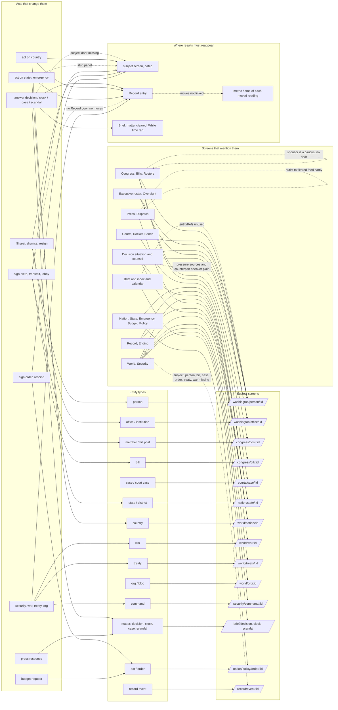

# Jobs and journeys: the universal player, entry to return

Audit date 2026-10-17. Worktree `ui-uniformity`. Scope: `apps/player`, `packages/ui`, `packages/player-core`. Read: `docs/DESIGN.md` (shared patterns, modes and screens), `docs/DECISIONS.md` §8.

## 0. Status and method (read first)

**This map comes from source, not from a live walk.** The session that wrote it had file, search and web tools but no shell, so the Playwright walk at 1440x900 and 390x844 was not run. Consequences:

- Every tap and route-change count below is **derived from the handlers and routes in source** (marked "derived"). None is a measured count. A tap that opens a native `Sheet` or a review is counted; scroll and focus are not.
- There are **no screenshots**. No defect below cites a screenshot path. Visual defects (overflow, crowding) are out of scope of this document and were not checked.
- File:line citations were read in this session. Where a known finding from the brief did not survive a source read, section 8 says so.
- Items marked **UNVERIFIED** need the live walk. Section 9 lists the exact walk to run: it is the same CUJ list, with the derived counts as expected values.

Counting rule: "tap" = one press the user must make; "route" = one change of pathname (a `?query` change through `setParams` is not a route change). Phone differs from desktop only where stated.

## 1. How entry, doors and return work today

### 1.1 There is no shared return mechanism

The brief asked for the "context-restoring Doors" mechanism in `packages/player-core/src/shell/`. **It does not exist.** What exists, named precisely so fixes reuse the right pieces:

| Piece | Where | What it does | What it does not do |
|---|---|---|---|
| Address builders | `packages/player-core/src/navigation/places.ts` (`PLACES`, `place.*`, `anchored`) | The one place a pathname is built. Includes `place.appointments(seat)`, `place.stateView`, `place.recordView`. | Nothing about where the user came from. |
| `SubjectRef` / `subjectHref` / `subjectHint` | `packages/player-core/src/shell/subject.ts` | One kind-to-href table for 18 subject kinds (person, office, nation, nationAct, state, district, bill, order, brief/policy domain, treaty, war, case, summons, metric, service, hillPost, scandal, dispatch). Gives a screen-reader noun. | Not used by screens: grep finds `place.person(` hand-called in 29 `apps/player/src` files, `subjectHref` used in `player-core` only. No kind for **member, org, command, record event, press outlet, institution**. |
| Role/institution to office doors | `shell/office-of.ts` (`officeOfRole`, `roleActionsHref`, `institutionActionsHref`, `OFFICE_ACTIONS_ANCHOR`) | Turns a role id into the office page, optionally on the Actions section. | Only offices. |
| `ObligationDoor` | `shell/obligation-doors.ts` | A dated pin's door: subject or place, `null` allowed. | Term rails only. |
| Door tests | `shell/doors.test.ts` | Asserts every Brief/Desk/counsel/clock door reaches a route that exists (reads `apps/web/src/routes`, the legacy tree). | Does not cover `apps/player` routes, receipts or back buttons. |
| **Country origin context** | `apps/player/src/world/params.ts` (`countryReturnSearch`, `countryReturnQuery`, `countryReturnHref`, `countryActHref`; `returnView`/`returnSector` query keys); `orgSearch` for `?member=` | The **only** real context-restoring return: an act workspace opened from a country file view returns to that view and sector. | Country acts only. Not available to bills, offices, persons, states, press, Record. |
| Router history | `go()` = `router.push`, defined four times: `congress/parts.tsx:9`, `decision/parts.tsx:7`, `news/story-parts.tsx:12`, `world/parts.tsx:38`; plus inline `router.push` in dozens of files | Forward navigation. The comment at `congress/parts.tsx:8` says Back returns to where the President was. | Every on-screen "Back to X" button is a **push**, not a pop. History grows; the browser Back then walks the loop. |
| `ReturnButton` | `apps/player/src/settings/parts.tsx:12` | `router.canGoBack() ? router.back() : router.replace("/")`. The one true pop. | Used only on pages outside the game frame (Settings, Administrations, Handbook, Founding "Leave", More). |
| Calendar/inbox refs | `player-core/src/notifications/refs.ts` (`refsFromHref`), `calendar/types.ts` (`EntityRef`: person, nation, state, bill, case, institution, war, order) | Rows already carry typed entity refs. | The UI never reads them: `calendar/rows.ts:50` and `shell/InboxButton.tsx:37-43` give a row one door. |
| Declared parents | none | `apps/player/app` has no `Stack`, `unstable_settings` or `initialRouteName`; the frame renders `<Slot />`. | DESIGN §1 Camera: "A cold deep link has a declared parent route for back" is **unmet**. On native, `router.back()` over a `Slot` is UNVERIFIED. |

### 1.2 Door primitives are duplicated

Five or more variants draw "a thing that opens another thing", with different labels and hit rules: `EntityLink` and `RelatedRail` (`packages/ui/src/context/EntityLink.tsx`), `Door` and `RowLink` (`congress/parts.tsx:58,81`), a second `RowLink` (`decision/parts.tsx:16`), `CardTo` and `LinkText` (`executive/parts`), `NationLink` and `NationName` (`world/parts.tsx:55,65`), `NationTrail` room links, plus raw `CardLink`/`PressRow`. `congress/parts.tsx:77-78` states a rule ("the whole row is the press target, never a name link inside it") that conflicts with the owner's "every entity name is a door". See ruling R1.

### 1.3 The receipt family (one job, nine implementations)

After any authorized act the user lands on a receipt. Doors on each:

| Receipt | File | Record door | Return door | Reading moves | Subject door |
|---|---|---|---|---|---|
| Decision | `decision/DecisionReceipt.tsx:55-66` | "Open the Record entry" | Next decision, Back to the Brief | `Moves` (Meter + tick) | none |
| Case / clock | `decision/CaseScreen.tsx:50-59` | "Open the Record entry" | Back to the Brief | none | none |
| Scandal | `decision/ScandalScreen.tsx:124-131` | "Open the Record entry" | Back to the Brief | none | none |
| Chair / person | `executive/ActReceipt.tsx:29-41` | "Open the Record entry" | Back to the office or profile, **and** Back to Washington | inline text list, third copy | none |
| Country act | `world/act/ActReceipt.tsx:81-92` | "Open the Record entry" | More options, Back to {country} (origin-aware) | `Moves` via `world/parts` | "Now under way" rows are plain |
| Security/war/treaty/org | `world/acts.tsx:61-89` | **"View the Record entry"** | `again` label | `Moves` via `world/parts` | none |
| Domestic (state, policy, emergency, order, levers, budget) | `nation/ActDone.tsx:34-62` | **"See it on the Record"** | `backLabel` | `Moves` (fourth copy) | none; `LocaleDesk.tsx:76` shows a stub "A map showing how approval changed ... isn't ready yet" |
| Congress (sign/veto, lobby, transmit, text, budget instruction, nominations desk) | `congress/ActChooser.tsx:24-47` | **none** though `congress/commit.tsx:67-73` captures `eventId` | `again` label | **none** | none |
| Press | `news/PressAct.tsx:87` | "Open the Record entry" | Back to Press | none | none |

Plus the review layer: `ReviewSheet.tsx:88-93` already offers "Open Record entry" and "Close" over every receipt (`PresidentialReview.tsx:57`). So a committed decision shows the Record door three times (sheet, receipt, and `Decision.tsx:119` when reopened) and costs one extra "Close" tap before the receipt is usable.

## 2. Mode and nav facts that bound every journey

- Desktop rail groups: Brief (+Calendar), Government (Executive, Congress, Courts, Oversight), Domestic (Nation, Policy, Budget, Economy, Emergency), World (World, Security), Press, Record; utilities Handbook, Administrations, Settings (`shell/nav.ts`).
- Phone tab bar: Brief, Government, Domestic, World, More (`nav.ts:59-67`). `NationTrail` rooms are **hidden on phone** (`nation/NationTrail.tsx:54`), so moving Nation to Budget to Economy to Emergency on a phone is More then pick, each time (2 taps, 1 route); on desktop it is 1 tap. Task parity is met, tap parity is not.
- Calendar is in the rail (`nav.ts:39`) **and** the bar (`shell/BarActions.tsx:11`): two doors, same place. `/calendar` and `/compare` are real routes with no DESIGN.md entry. `/brief/digest` is in DESIGN.md but has no route and no screen in `apps/player` (`PLACES.digest` = `/brief?view=history`, unused; the only implementation is legacy `apps/web/src/brief/BriefHistory.tsx`).
- Settings, Administrations, Handbook, Founding, Title, Ending, Legacy, Recovery sit **outside** the `(game)` frame (`apps/player/app/settings.tsx` etc.): no rail, no Continue, no bell there. `More` is inside the frame and links out.
- No global search exists in `apps/player` or `packages/ui` (grep: none outside form inputs). DESIGN §1 layer 7 and the Handbook text promise it ("Reached from ... search"). No inline glossary term links outside the Handbook.
- Theme (System/Light/Dark) is only in Settings > Appearance; DESIGN says "also discoverable in the shell". Not in `BarActions`.

## 3. Journeys

Format per CUJ: job; entries; derived steps (taps / routes, desktop then phone where different); entities and doors; where the result reappears; return; defects; TARGET.

### J1. Advance time (Continue and held states)

**Job:** Move the week forward until something needs me, without losing track of why it stopped.

**Entries:** Continue in the bar (`shell/ContinueButton.tsx`), every screen in the frame. Title "Resume" goes to /brief.

**Steps (derived):**
- Free: 1 tap, then a forced route change to /brief if not already there (`ContinueButton.tsx:64`). From any other screen that is 1 tap / 1 route and the user has lost the screen they were on.
- Held, desktop: bar shows "N waiting on you" (quiet) and a disabled Continue; tap on the former = 1 tap / 1 route to the first holding matter (`:23-28`).
- Held, phone: Continue is not drawn (`:75`); only a secondary "N waiting" button, same destination.
- Resolving the hold by putting off: on the Brief row only (`brief/Matters.tsx:21-40`): Put off, confirm = 2 taps, 0 routes.

**Entities/doors:** "While time ran" stop lines each open their matter (`brief/Clocks.tsx:96-98`). Good.

**Result reappears:** Brief "While time ran" sentence; no per-week digest, no map replay (see 2).

**Return:** none; Continue is one-way to the Brief.

**Defects:**
1. Continue from a subject screen (a bill, a country) throws the user to /brief (`ContinueButton.tsx:64`). Context lost, unasked.
2. The hold text says "handled or put off each one **on the Brief**" (`:14`), but the held button opens the matter itself (`:28`), where put-off is not offered except decisions (`Decision.tsx:35-52`) and the case tray. A user who wants to put off lands where they cannot.
3. Phone hides Continue when held (`:75`): the reason line is the button's `label` (screen reader only); a sighted phone user sees "N waiting" with no sentence on why time is paused.
4. `/brief/digest` is missing: no way to see weeks that passed during a multi-week run beyond the single stop sentence.
5. Count may double (`waiting + blocking.length`, `:74`): UNVERIFIED whether a decision is also in `presentedItems`.

**TARGET:** Continue stays where the user is when the stop is quiet or ambient; it routes to the Brief only when a held matter appeared. The held state on both sizes shows the one-line reason and two actions: Open (first holding matter) and Put off (opens the same confirm as the Brief row). Wire the digest route (or retire it, R7).

### J2. Answer a matter: decision

**Job:** Read what is asked, compare answers as changes from today, commit one, see what moved.

**Entries:** Brief priority card or queue row (whole row is a door), "While time ran" line, bell inbox item, held-Continue button, Calendar row, Record "next decision" door, Nav badge count.

**Steps (derived):** Brief to decision: 1 tap / 1 route. Pick answer 1, verb 1, confirm in review 1, "Close" on the result sheet 1 = **4 taps**, then the receipt. Receipt: Record entry 1 tap / 1 route; next decision 1 / 1; Brief 1 / 1. Phone: same, but the side rail ("Related", "Timing") stacks under the briefing (`Decision.tsx:77`) so doors sit lower; no extra taps.

**Entities and doors on the screen:**
- Office raising it, preparer, counterpart country, state, "Past changes" in `RelatedRail` (`DecisionRelated.tsx:13-17`): doors.
- The same counterpart country and state are repeated in "Who's involved" (`Situation.tsx:94,77`) and the preparer in the footer (`:135`): the same door three times on one screen.
- Pressure sources (cabinet, legislature, military, press, business, ally, adversary, court, street) are plain rows (`Situation.tsx:103-113`) although each maps to a screen or institution.
- Adviser names after picking an answer: doors (`Counsel.tsx:45`).
- Who-said-what speakers: official with person = door; **counterpart speaker without a person = plain text** (`Situation.tsx:226-227`), though the nation is known; sits behind the Background tab, default is Advisers (`Decision.tsx:98`).

**Result reappears:** receipt (readings moved, as Meters with a "before" tick, `DecisionReceipt.tsx:9-35`); Record entry; the Brief (matter gone); the subject (country/state) only if the user walks there. Readings that moved are **not doors** to their home (`place.metric(id)` exists).

**Return:** Receipt "Back to the Brief" = push. If the decision was reached from a bell or calendar row, the receipt still returns to the Brief.

**Defects:** an extra "Close" tap before the receipt (1.3); triple Record door; reading moves not linked; pressure sources and counterpart speaker not doors; `NotWaiting` (`Decision.tsx:105-125`) offers the general Record (`place.record()`), not the entry the answer made.

**TARGET:** Select answer, verb, confirm; the review result auto-lands on the receipt (no Close tap; the sheet's Record door is dropped, the receipt owns it). Receipt = one shared component: Record entry (primary), Next on your desk (if any), Back (to where the user came from, J-wide rule in section 6). Each reading move opens its metric home. Pressure rows open their institution/place; counterpart speaker opens the country.

### J3. Answer a matter: clock (statutory deadline)

**Job:** Understand what is owed by when and answer it.

**Entries:** Brief row, Deadlines card (`brief/Clocks.tsx:34`), calendar clock events, stop lines.

**Steps (derived):** Brief to clock page: 1 / 1. If answerable: press `brief.door.label` (`ClockScreen.tsx:60`) to the actual act screen: 1 / 1. Then the act (3 to 4 taps). **Minimum 2 routes before the act starts.** Not answerable: dead end with only the browser Back (no Brief button when running; `NotRunning` has one).

**Entities:** "Who's responsible" is plain text from `PLACES[owner].title` (`ClockScreen.tsx:31,41`): not a door. The law citation opens the authority sheet (good).

**Result reappears:** wherever the act is; the clock page then says "isn't running".

**Defects:** interstitial dossier that adds a route; owner not a door; no Brief button on the running clock page; "Standing" (non-answerable) clocks give nothing to do and no "what can I do to influence this".

**TARGET:** The Brief row for an answerable clock opens the act with the clock dossier (what you owe, if you don't) as the header block of the act screen, as a decision does. The non-answerable clock stays an informational page with Owner as a door and a Back.

### J4. Answer a matter: case (owed item)

**Job:** Give an answer to a case that has been raised to me, or decline or put it off.

**Entries:** Brief row (`case:` ids route to `place.clock(matter.id)`, `stop-words.ts:37-38`), stop lines, inbox.

**Steps (derived):** Brief to case: 1 / 1. Either "Open it" (`CaseScreen.tsx:100`) to the real act: 1 / 1 then act; or tray (defer/decline): button 1 + confirm 1 = 2 taps, then receipt.

**Entities:** `detail.subject` in the eyebrow and `detail.context` ("What it's about") are plain text (`:72,88-95`); "Who handles it" has no door.

**Result reappears:** receipt only offers Record + Brief (`:50-59`); no next matter, no subject.

**Return:** Brief only.

**Defects:** subject and context are not doors; receipt lacks the next-matter door the decision receipt has.

**TARGET:** Same shared receipt as J2. `context.href` already exists on `CaseContext` (`desk/family-raise.ts:21`); render it as a door.

### J5. Answer a matter: scandal (running story)

**Job:** Choose a public answer to a story, once.

**Entries:** Brief (ambient rows stay listed), stop lines, Press screen story cards (`news/RespondView.tsx:72` `story.href`), inbox.

**Steps (derived):** Brief to story 1 / 1; answer 1, verb 1, review confirm 1, Close 1 = 4; receipt: Record 1 / 1, Brief 1 / 1.

**Entities:** implicated person: door (`ScandalScreen.tsx:25-41`). Outlet keeping it alive: masthead is plain; the row beneath goes to `place.press()` (`:66`), the generic Press page, **not** the outlet's feed that `RespondView.tsx:83` reaches with `feedHref({ outlet })`. No state, office, or the story's page in the Press screen.

**Result reappears:** receipt, Record; the Press screen's story list. No door to the Press screen's "Respond" with the story selected.

**Return:** Brief only.

**Defects:** wrong destination for outlet; no `RelatedRail`; a 4th receipt variant.

**TARGET:** Outlet opens its filtered feed; add Related (the implicated person's office, the Press response desk for this story); shared receipt.

### J6. Act on a country

**Job:** Pick the best option toward a government from every goal, plan its terms, authorize.

**Entries:** Country file primary button (`world/nation/NationScreen.tsx:88`), tariff and manage buttons in the file's Economy/Diplomacy/Security views (`Economy.tsx:84`, `Diplomacy.tsx:49`, `Views.tsx:191`), Org screen (`OrgScreen.tsx:149`), World board (`world-board.ts:221,228`), Brief trade matters (`attention-trade.ts:19,106,132` anchored `act-situation`), Decision (counterpart row to the file, not the act).

**Steps (derived):** File to act: 1 / 1. Pick option 1 (scrolls to plan), set terms 0 to n, Review 1, confirm 1, Close 1 = **4 taps plus terms**. Receipt "Back to {country}" returns to the originating view and sector (`countryReturnHref`), the best return in the app. Phone: same; "Your plan" dock holds the verb.

**Entities:** Flag and country name in the header, "Open {name}'s file" button (`ActWorkspace.tsx:140`): door. "Now under way" rows in `ActReceipt.tsx:53-67` are plain text (no door to the measure on the file's Diplomacy view).

**Result reappears:** receipt; country file "Activity" (UNVERIFIED that the new entry is visible there); Record.

**Defects:** "Now under way" not doors; Record label differs from other receipts; origin context lost if the act is entered from the Brief/Org (falls back to the file root, acceptable).

**TARGET:** Keep this journey's structure as the model. Add door to the measure/finding; unify receipt labels.

### J7. Act on a state

**Job:** Respond to a state's request or send a federal power, one or many states.

**Entries:** State dossier primary button for the matter and its "Acts" section (`StateScreen.tsx:44`, `StateViews.tsx:221,240`), Nation overview batch acts (`home/BatchActs.tsx`), Emergency board (separate: `place.emergencyIncident`), Decision `Locus` row (to the state, not the act), Brief conditions.

**Steps (derived):** Nation, state: 2 taps / 2 routes (or 1 from a map/strip dot). Act button 1 / 0 routes (same path, `?act=cause`; `[id].tsx:25`), pick 1, verb 1, confirm 1, Close 1. Receipt: "Back to {state}" (push, `LocaleDesk.tsx:75`), "Back to the Brief" inside a panel whose body is a stub (`:76-81`).

**Defects:** domestic act is a query mode on the dossier route while foreign acts are a separate `/act` route: different back-stack behavior (one pops with a single Back, the other needs two). Receipt panel "Where approval changed" is unfinished copy shipping to the player. The incident door (Emergency board) and the locale-act door (state page) describe the same matter in two places with no cross-link (UNVERIFIED both surface the same `localeMatters` row).

**TARGET:** One act route shape for every subject: `{subject}/act?...` or one query contract (R9). Receipt shows the state's approval delta with the state's own lens as a door, not a stub.

### J8. Fill a seat / nominate

**Job:** Choose a nominee for an empty chair (cabinet, agency, judge) and send it.

**Entries:** Executive roster to office (Actions tab, `?fill=`), Brief "cabinet-vacant"/"executive-delivery" rows (`roleActionsHref` anchors `office-actions`), Oversight appointments desk (`place.appointments(seat)`), Courts nominations, Person page of a nominee, Record.

**Steps (derived):** Washington, office: 2 / 2; Actions tab 1 / 0 (phone: Select, 1 + pick = 2); "Fill the job" 1 / 1 (push with `fill`); pick candidate 1, verb 1, confirm 1, Close 1. Receipt "Back to the office" resets `fill`.

**Entities:** holder name in plate: door; candidates: person doors (UNVERIFIED in `ChairActs`); Senate-objectors named (UNVERIFIED as doors).

**Result reappears:** office page (nominee pending), appointments desk pipeline (`Appointments.tsx`), Courts nominations for judges, Record, Calendar (appointment events).

**Defects:** three surfaces for one job (office, appointments desk, courts) with different back labels and no cross-door from an office fill screen to the desk and vice versa (UNVERIFIED); `ActReceipt` shows both "Back to the office" and "Back to Washington" (`executive/ActReceipt.tsx:35-40`).

**TARGET:** Every seat row, wherever drawn, uses the shared seat row and opens the same inline compare; receipt returns to the surface the user started on.

### J9. Sign or veto a bill

**Job:** Decide on a bill on the desk; see its vote and the veto/override outlook.

**Entries:** Brief/stop/inbox (bill on desk), Congress "Waiting for you" (`congress/Bills.tsx:131`), Calendar.

**Steps (derived):** Brief to bill 1 / 1; `DeskActs` pick 1, verb 1, confirm 1, Close 1; receipt is in place.

**Defects:**
1. Congress receipt has no Record door although `eventId` is captured (`ActChooser.tsx:24-47`; `commit.tsx:67-73`).
2. No reading moves on the receipt; a sign/veto's national effects are only in the bill's own "Estimated cost and effects" before.
3. The bill's header "Congress" button pushes the hard-coded `/washington/congress?view=bills` (`BillScreen.tsx:101`), whatever the origin; Post goes to bare `/washington/congress` (`PostScreen.tsx:13`).
4. Sponsor is plain text in cards and header (`Bills.tsx:25,112`, `BillScreen.tsx:22,101`) (see 8: the engine models a caucus, not a person).
5. Whip-count member rows open the person profile (`BillCount.tsx:78`), not the lobbying act, which lives on the Post page or the bill's Outreach rail.

**TARGET:** Receipt: Record door, readings moved (fix the congress receipt by moving it onto the shared receipt), Back to the bill/agenda as a pop. Sponsor opens the caucus (Congress, party section) once R6 is ruled.

### J10. Lobby a member

**Job:** Move a leader's mood or a vote.

**Entries:** Congress leaders (`Record.tsx:141-155` card opens the person; "Reach out" button inside goes to the Post), Bill Outreach rail, Post page.

**Steps (derived):** Congress to leader card (opens person) or "Reach out" (Post) 1 / 1; pick approach 1, verb 1, confirm 1, Close 1. Back: `PostScreen.tsx:13` to `/washington/congress` (no bill context).

**Defects:** leader card is a CardLink with a Button nested inside (`Record.tsx:133` in `LeaderBody` inside `CardLink` at `:151`): nested interactive elements (UNVERIFIED how Tamagui web renders: anchor-in-button). The leader's name (`:129`) is plain text inside a door. Post back button loses the bill if the user came from a bill.

**TARGET:** Name opens the member profile; "Reach out" opens the Post; Back returns to the origin. A member row in a whip count offers both (profile, Reach out).

### J11. Respond to the press

**Job:** Choose how to respond to coverage: frame a decision, take the hit, answer a running story.

**Entries:** Press screen (rail "Press"), Dispatch "Respond to the press" (`Dispatch.tsx:92`), Decision "framing offers", Scandal.

**Steps (derived):** Press to Respond view 1 / 0; compare, verb, confirm, Close = 3 to 4; receipt Record + "Back to Press".

**Defects:** Dispatch "Back to Coverage" is `place.press()` (the bare Press page) (`Dispatch.tsx:111,120`), dropping the outlet/nation/week filter the user came from; the Scandal outlet door goes to the same bare page.

**TARGET:** A dispatch returns to the feed with its filters (pop). Scandal and decision link the Respond view with the story preselected.

### J12. Edit the budget

**Job:** Change allocations and request an appropriation.

**Entries:** Budget (rail/More), Brief appropriation matter (`APPROPRIATION_DOOR`), calendar funding deadline, Nation overview Levers.

**Steps (derived):** Not read in depth (`nation/budget/Draft.tsx`, `Request.tsx`). Path: Budget 1 / 1; edit lines n; Request 1; review 1; confirm 1; `ActDone` in place. UNVERIFIED end to end.

**Defects (derived):** receipt is the nation `ActDone` with "See it on the Record" and no door back to the changed line.

**TARGET:** shared receipt; the changed allocation is highlighted when returning to the draft.

### J13. Sign a policy order

**Job:** Sign an executive order against its terms and strike-down risk.

**Entries:** Policy portfolio/pipeline (`OrderPipeline.tsx`), Courts case "Read the challenged order", Record, Calendar.

**Steps (derived):** Policy to order 1 / 1; subject pick if any; sign 1, confirm 1, Close 1. The page stays and shows "What you signed" (`OrderScreen.tsx:126-150`).

**Defects:** "Back to policy" is a push (`:160`); the post-sign page carries `ActDone` with no Record door?: `ActDone` receives no `onBack`, but does render "See it on the Record" when `eventId` exists (UNVERIFIED that `OrderScreen` passes it). The court-case door (the case that will test this order) appears only on the Courts side.

**TARGET:** After signing, the order page shows a "Challenges" door to the case when one exists.

### J14. Declare an emergency

**Job:** Declare, renew or end a declaration; ask for Guard federalization.

**Entries:** Emergency (rail/More), State dossier "declare an emergency", Brief stability/standing rows (`place.metric("stability")` redirects to `/nation/emergency`).

**Steps (derived):** Emergency 1 / 1; act panel opens in place (`EmergencyScreen.tsx:215`), verb 1, confirm 1, Close 1; `ActDone` "Back to emergencies". UNVERIFIED in depth.

**TARGET:** Declaring from a state dossier returns to that state, with the declaration chip visible.

### J15. Compare the United States against a nation or benchmark

**Job:** Line the U.S. record up against another country, a past term, or a published series.

**Entries:** **Exactly one external door**: Nation overview tile "Compare it over time" (`nation/home/ConditionStrip.tsx:82`, approval only). `CompareChart.tsx:63` is inside the workspace. Not in the rail, More, the Country file, Economy, Security or Record.

**Steps (derived):** Nation to Compare 1 / 1 (approval). To compare against a nation: 1 / 1 to Compare, then the in-page subject chooser (UNVERIFIED), `router.replace` on every change (`compare/index.tsx:10`), so Back leaves the tool in one hop.

**Defects:** undiscoverable; unlinked from the Country file ("compare with the U.S."), Economy measures, Security readiness; `/compare` missing from DESIGN.md and nav.

**TARGET:** A Compare door on the Country file (country vs U.S. preselected), on every measure reading (`place.metric` homes), and a nav entry under the owning mode.

### J16. Look up a person, office, member, judge

**Job:** Find a specific named thing and read its file.

**Entries:** No search. Executive roster to office/person, Congress rosters (`Rosters.tsx`) to person, Courts bench (`Bench.tsx`) to person, Person "Connections" tab search (`network-search.ts`, scoped to one person), Record subjects, any name that happens to be a door.

**Steps (derived):** Roster route: 2 to 3 taps / 2 to 3 routes, only when the user knows which institution holds the person. A foreign leader: World, directory (search box, `worldSearch.q`), country, leader (`world/nation/Head.tsx`), person page: 4 / 4.

**Defects:** no global search or ⌘K (DESIGN §1 layer 7) and no glossary lookup from a screen; `/washington/person/:id` serves judges, members and foreign leaders but its Back copy says "Back to the Executive" (`PersonScreen.tsx:57`) and its tabs are executive-shaped (UNVERIFIED for a foreign leader).

**TARGET:** A search overlay in the bar (⌘K / search icon) over `PLACES`, the subject table (every kind in 1.1 plus member, org, command, institution) and glossary; results are the same doors. R5.

### J17. Read the Record and trace a cause

**Job:** See what happened, what it changed, what caused it, what followed.

**Entries:** Rail Record, any receipt, Decision "Past changes" (`?subject=`), Bill/Case history (no), Country "Activity".

**Steps (derived):** Receipt to entry 1 / 1. Each cause or consequence hop: 1 tap / 0 routes (it is `router.replace` on standalone, `RecordScreen.tsx:35`; and `setParams` inside `/record`). So Back after N hops leaves the whole Record in one step; you cannot retrace.

**Entities:** states and countries: doors (`RecordDetail.tsx:85-92`); institutions: seal links to `place.office(id)` for `INST-` ids else **`/washington` root** (`:32`); nothing for person, bill, case, order, treaty, org, war, command. The act's own subject is not linked from its entry.

**Result reappears:** by design the Record never authorizes; it is the destination, not the origin, of results.

**Defects:** subject of the entry not a door (the one thing a Record entry exists to link); `onClose` "All entries" replaces the page rather than popping to the receipt that opened it; chain hops use replace.

**TARGET:** Entry header: "Subject" door to the screen where the thing lives (bill, case, order, treaty, war, person), populated from the same `SubjectRef` the act used. Chain hops push; Back retraces; "All entries" pops to the origin when it came from a receipt.

### J18. Calendar and inbox (bell)

**Job:** See what is coming due and what just arrived; open the thing.

**Entries:** Bar Calendar button, nav Calendar, bell (`InboxButton.tsx`).

**Steps (derived):** Bell 1 (sheet), item 1 / 1 (closes sheet, marks read). Calendar: 1 / 1; row 1 / 1; month view: select day 1, row 1. Phone: bar buttons presumably fit (UNVERIFIED at 390); Calendar via More otherwise.

**Defects:** row = one door only; `entityRefs` (person, nation, state, bill, case, order, war) exist on both feeds and are unused. Inbox closes on open, so Back returns to the page the bell was opened on, not to the sheet. Inbox "Waiting on you" duplicates the Brief list; no link from a bell item to the Brief matter vs the underlying subject (one door chosen by the producer).

**TARGET:** Row opens its primary door; secondary subjects in the row render as `EntityLink`s from `entityRefs`. Bell item shows what it is about with the same links.

### J19. Save, load, import, settings, theme

**Job:** Keep my game safe, switch games, change how the app looks.

**Entries:** Rail utilities (Settings, Administrations), More (phone), Title, Settings > Saves link; Import in Administrations (`app/administrations.tsx:99-108`); theme only in Settings > Appearance.

**Steps (derived):** In-game to Settings: 1 / 1 (desktop), More + Settings = 2 / 2 (phone). Back: `ReturnButton` pops, good. Import: Administrations + file choose + (replace choice if full) opens the imported game and lands on /brief (per the fixture flow). Theme: 3 taps on phone from a game screen (More, Settings, choose) and a Back.

**Defects:** Settings/Administrations lose Continue, bell and nav; no "Save now" or "Export this game" from the in-game bar (commits autosave); theme not in the shell (DESIGN says it is); Settings links to `/catalog`, an internal design page (`settings.tsx:27`); Settings "Saves" group is only a link to another page.

**TARGET:** Theme toggle in the bar or More. Save/export status chip in the bar linking to the save row. Hide Catalog in release builds (R12).

### J20. Found a new administration

**Job:** Choose who I am and take the oath.

**Entries:** Title "Start a new presidency", Administrations "Start a new presidency".

**Steps (derived):** 1 / 1 to `/founding`; setup choice; 8 stages (person, record, politics, ticket, platform, staff, cabinet, oath) each Next 1; oath review 1, confirm 1; `router.replace("/brief")` (`useOath.ts:47`). "Leave" pops (`FoundingFrame.tsx:48`). Back between stages is in-flow state (`founding.goTo`), not history: a browser Back leaves the flow.

**Defects:** no door from the founding stage to the Handbook or a stage-specific explainer (UNVERIFIED); draft persistence on Leave UNVERIFIED (`draft.ts`).

**TARGET:** Stage help with Handbook chapter; stage in the URL for Back (R2).

### J21. Ending and legacy

**Job:** Understand how the term ended and what it left.

**Entries:** Continue becomes "Ended" and opens /ending (`ContinueButton.tsx:46-52`), More "How it ended"/"Legacy" (only when ended).

**Steps (derived):** Ending: states open dossiers (`Ending.tsx:37`), successor opens the person page (`:108`); buttons: Read the legacy, Open the Record, Your administrations. Legacy: How it ended, Open the Record.

**Defects:** the nav does not offer Ending/Legacy at all (only More, only after the end); after the end, Brief and the rest of the game remain open without a banner saying the term is over (UNVERIFIED).

**TARGET:** An ended game's Brief opens with a banner door to Ending; Ending/Legacy appear in the rail group "Record".

### J22. Handbook and help from a screen

**Job:** Learn a rule or a law without leaving my place.

**Entries:** `HelpButton` (`packages/ui/src/context/HelpSheet.tsx`) on screens; `LegalCitation` opening `AuthorityProvider`; rail/More Handbook; Handbook routes are outside the frame.

**Steps (derived):** "?" 1 (sheet; meaning, steps, law). Citation 1 (second sheet). Handbook proper: leaving the screen.

**Defects:**
1. `HelpContent.related` (`HelpSheet.tsx:18`) is never passed by any caller: no door from help to its Handbook chapter, which DESIGN promises ("Read the chapter" in every explainer's sheet).
2. The authority sheet (`AuthorityProvider.tsx:36-61`) offers only an external "Open the original text"; no door to the Handbook "The law" chapter; its empty state says "The Handbook doesn't explain {cite} yet" with no door.
3. Handbook pages sit outside the frame (no rail/Continue), return via `ReturnButton`; a user who opens the Handbook to read a chapter must pop back to continue.

**TARGET:** `HelpButton` takes a `chapter` and renders the door; the authority sheet links its record's Handbook page. Handbook opens in the frame (or a side sheet on desktop).

## 4. Other journeys found

- **J23. Reach a Nation sub-room on phone** (Budget, Economy, Policy, Emergency): 2 taps / 1 route each time (More), vs 1 on desktop (`NationTrail.tsx:54`). Fix: a Domestic hub on the phone tab or rooms in a select.
- **J24. Security and command acts:** in-place panel, `ActFrame` "Back to Security" (`security/ActFrame.tsx:48`), `ActsReceipt` Record door labelled differently ("View the Record entry"). Same receipt defect as 1.3.
- **J25. War, treaty, organization acts:** same `ActsReceipt`; not-found states go to `place.world()`, losing `?reading/?region/?q` (`worldSearch`).
- **J26. Notifications settings / attention policy:** `AttentionSettings` decides what holds Continue; no door from a held Continue to the setting that governs it.

## 5. Entity dependency map

Reads: an entity type is shown on the screens in the first column of each edge; a door to it must exist from each; acts change it; a result must reappear where the dashed arrows land. Dotted edges are today missing or partial.

Entity kinds with **no** subject-table entry today: member (has `hillPost`), org, command, institution, record event, press outlet/feed. Add them to `SUBJECTS` in `shell/subject.ts` (`place.organization`, `place.command`, `place.event` already exist in `places.ts`).

## 6. Rules the target set implies (for the design owners)

1. **One receipt** (`packages/ui/src/review`), taking a `SubjectRef` for the thing acted on, an `eventId`, the moved readings (each a door to its metric home), and a return target. Nine implementations collapse to one.
2. **One review close.** The result sheet either auto-hands to the receipt or carries only "Close"; the receipt owns the Record door.
3. **Back is a pop.** A screen's Back is `ReturnButton` behavior; the fallback when history is empty is the declared parent (a per-route table in `apps/player`, or Expo `unstable_settings`). Extend the country origin pattern only where the origin carries state a pop cannot restore (query filters on a fresh deep link).
4. **One door primitive** for names in running text and one for rows, with the nested-interaction rule decided once (R1). Door builders come from `subjectHref`; no `place.person(...)` inline in screens.
5. **Every `go` goes through one helper.**
6. **Acts have one route shape** per subject kind.

## 7. Prioritized fix list by owner family

P0 = breaks an entity-to-result chain; P1 = wasted step or lost context; P2 = polish or documentation.

### A. Brief, decisions, calendar, shell
- P0 Wire a global search overlay (or remove the claim from DESIGN, R5). `shell/`, new.
- P0 Continue: do not force /brief when the run stops on nothing held; show the reason on phone when held (`ContinueButton.tsx:64,75`).
- P0 Held state: Put off from the held button's destination or route the held button to the Brief list (`:14,28`).
- P1 Remove the extra "Close" tap: auto-land review results on the receipt (`PresidentialReview.tsx`, `ReviewSheet.tsx`).
- P1 Fold the clock interstitial (J3).
- P1 Case and scandal screens: subject doors, Related rail, next-matter door (`CaseScreen.tsx`, `ScandalScreen.tsx`).
- P1 Decision: dedupe the three repeated doors; make pressure sources and counterpart speaker doors (`Situation.tsx:94,103,227`).
- P1 Calendar/inbox: render `entityRefs` as links (`calendar/rows.ts`, `InboxButton.tsx`); one Calendar door.
- P1 Add theme toggle to the shell.
- P2 `PLACES.digest` and DESIGN: decide (R7). Document `/calendar`, `/compare`.

### B. Washington (executive, dossier, congress, courts, oversight, law)
- P0 Congress receipt: Record door and moved readings (`congress/ActChooser.tsx:24`, `commit.tsx:67`).
- P1 Bill Back and Post Back pop to origin, not hard-coded paths (`BillScreen.tsx:101`, `PostScreen.tsx:13`).
- P1 Member rows in whip counts: door to the Post and the profile (`BillCount.tsx:78`).
- P1 Leader card: name as door, no nested Button (`Record.tsx:129,133,151`).
- P1 `ActReceipt` (executive): drop the duplicate "Back to Washington" (`:38`).
- P1 Person page Back copy by role (member, judge, foreign leader) (`PersonScreen.tsx:57`).
- P2 Bill sponsor (R6).

### C. Nation
- P0 Replace the `LocaleDesk` stub panel (`:76-81`) with the real delta.
- P1 Unify domestic and foreign act routing (R9); pop-based Back (`LocaleDesk.tsx:48,75`, `StateScreen.tsx:131`).
- P1 Phone: Nation rooms reachable without More each time (`NationTrail.tsx:54`).
- P1 Compare door on Nation readings beyond approval (`ConditionStrip.tsx:82`).
- P2 Order page: door to the court case for a challenged order.

### D. World, Security, Compare
- P0 Compare is reachable from the Country file, Economy, Security (one door each) and nav.
- P1 Country receipt "Now under way" rows as doors (`world/act/ActReceipt.tsx:53`).
- P1 Not-found and back for war, org, treaty keep `worldSearch` (`WarScreen.tsx:310`, `OrgScreen.tsx:184`, `TreatyScreen.tsx:169`).
- P1 `world/acts.tsx:76` label to the shared one.

### E. Record, news, ending, founding, handbook, settings
- P0 Record entry: subject door (bill, case, order, treaty, war, person) and the institutions link for non-`INST-` ids (`RecordDetail.tsx:32,82-96`).
- P1 Cause hops push; "All entries" pops (`RecordScreen.tsx:35`).
- P1 `HelpButton` Handbook door; authority sheet Handbook door (`HelpSheet.tsx:18`, `AuthorityProvider.tsx:36,83`).
- P1 Dispatch Back and Scandal outlet door keep the feed filters (`Dispatch.tsx:111,120`, `ScandalScreen.tsx:66`).
- P1 Ending/Legacy in the nav after the end.
- P2 Remove `/catalog` link from release Settings (R12). Founding stage in the URL.

### Cross-family (do first, they unblock the rest)
1. One `go`/door helper and `subjectHref` adoption in screens (4 copies today).
2. One receipt component.
3. A Back policy plus a declared-parent table.
4. Extend `SUBJECTS` with member, org, command, institution, event, outlet.

## 8. Corrections to the known findings

- **Bill sponsors are unlinked** (`Bills.tsx:25,112`, `Record.tsx:112`): the text is a caucus phrase, not a person. `sponsorWords` (`player-core/src/congress/floor-schedule.ts:70`) returns "Your bill", "Written by both parties" or "The Republicans' bill"; the engine's `BillSponsor` is `administration | opposition | bipartisan` (`engine/src/legislative-acts.ts:106`). There is no person to link today. The finding stands only as "door to the caucus, or model a named sponsor" (R6).
- **Leader name unlinked** (`Record.tsx:129`): partly wrong. When `leader.personId` is set the whole card is the door (`:151`); the plain name is the case without a `personId`, or the nested-interactive problem noted in J10.
- **Speaker without a person** (`Situation.tsx:124`): that line is the "Prepared by The Situation Room" fallback, which is honest. The real gap is the counterpart speaker plate (`:227`).
- **Brief matter without href is a dead card** (`Matters.tsx:46`): latent, not live. `AttentionItem.href` is required (`attention-row.ts:89`) and decisions always get a door (`brief-matters.ts:87`). Matters can only lack `href` if a future producer omits it.
- **`?judge=` redirect** (`washington/courts/index.tsx:13`): no live caller builds `?judge=` (grep over `apps/player`, `player-core`, `ui`); only older Record entries. The redirect reaches the right place (the person). Low priority.
- **ActReceipt back to /washington** (`executive/ActReceipt.tsx:38`): confirmed, but a second back button to the office or profile is also drawn; the defect is a duplicate and a wrong default for a person who is not in the Executive.
- **Case/Scandal return only to the Brief**: confirmed (`CaseScreen.tsx:55`, `ScandalScreen.tsx:129`), also `ClockScreen.tsx:76` and the metric fallback.
- **Decision post-commit view and receipt repeat doors**: confirmed and worse (1.3).
- **Domestic vs foreign act routes**: confirmed (J7).
- **Held Continue on phone**: confirmed (J1).
- **`/calendar`, `/compare` unmentioned, `/brief/digest` without a route**: confirmed; `PLACES.digest` is `/brief?view=history`, unused, no screen.
- **Context-restoring Doors**: does not exist (1.1). The nearest, country-only, is `countryReturn*` in `apps/player/src/world/params.ts`.

## 9. The live walk still to run

Run once, at 1440x900 and 390x844, on the week-30 fixture; compare counts to those above and fill screenshots under the scratchpad:

1. J1 held and free Continue from `/brief` and from a bill page (confirm the forced route).
2. J2, J4, J5 end to end; count the "Close" tap; record the doors on each receipt.
3. J3 an answerable clock and a standing clock.
4. J6, J7 from the file and from the dossier; read back-stack depth with `history.length`.
5. J9, J10 sign/veto and lobby; confirm the missing Record door and the nested-button render.
6. J15 find Compare without a deep link.
7. J17 trace three hops and press Back.
8. J18 bell and calendar at 390 (do both bar buttons fit?).
9. J19, J22 and out-of-frame pages; the theme path on phone.
10. Native only: `router.back()` over `<Slot />` (iOS/Android), not available in this environment.

## 10. Owner rulings needed

| # | Question | Why it blocks |
|---|---|---|
| R1 | May a card that is itself a door contain a second door (a name link inside a whole-card press)? `congress/parts.tsx:77` says no. | "Every entity name is a door" cannot be met in list rows otherwise. Options: peek sheet on name press, a trailing "Open {name}" affordance, or whole-row door plus name links with their own hit area. |
| R2 | Is on-screen "Back to X" a pop of history or a link to a fixed parent? | Today it is a forward push, so history loops. A pop is right when the user came from that parent, wrong on a cold deep link. Needs a rule plus the declared-parent table. |
| R3 | After a commit from the Brief, does the receipt auto-advance to the next waiting matter, or stay and offer it? | Decides the tap count of a full Brief session. |
| R4 | Should Continue route to the Brief when it stops quietly, or stay put? | Decides whether Continue ever moves the user unasked. |
| R5 | Global search: build it (DESIGN §1) or retire the promise? | Look-up of people, offices, judges, members has no entry otherwise. |
| R6 | Bill sponsors: link the caucus only, or model a named sponsor in the engine? | Engine change, doc-sync blocking. |
| R7 | `/brief/digest`: rebuild in the universal player or drop from DESIGN.md? | `digestView` exists in player-core; the screen is legacy only. |
| R8 | Document `/calendar` and `/compare` in DESIGN.md and give Compare a nav home? | Both exist undocumented. |
| R9 | One act route shape for domestic and foreign acts (`{subject}/act` vs `?act=`)? | Different back stacks today. |
| R10 | Should Settings, Handbook and Administrations keep the game frame (rail, Continue, bell)? | They lose it today. |
| R11 | Held Continue on phone: show a disabled Continue with the reason, or only "N waiting"? | Small, but a design call. |
| R12 | Ship the `/catalog` link in release Settings? | Internal page reachable by players. |

### Rulings (owner, 2026-10-17)

| # | Ruling |
|---|---|
| R1 | A name inside a row that is itself a door opens a **peek** over the row (face or emblem, role, standing, "Open file"). The row's own door keeps working and nobody loses their place. |
| R2 | On-screen Back **pops history** when the player came from that screen (filters and scroll kept), and falls back to a **declared parent** per route on a cold deep link. One shared helper replaces the four copies of `go()`. |
| R3 | After a commit: **one merged result view** with no extra Close and no duplicate doors, carrying the moved readings, a Record door and a primary "Next waiting matter". Nothing advances on its own. |
| R5 | **Global search** is built in this pass. |
| R7 | **The digest is rebuilt** in the universal player. |
| R9 | **One act route shape** for domestic and foreign acts. |
| Glossary | `HelpButton.related` is wired: every help sheet and chart opens its Handbook term. |

Defaults the lead took (reversible; the owner may overrule):

| # | Default |
|---|---|
| R4 | Continue stays put when it stops on nothing held, and routes to the matter when one holds it. |
| R6 | Bill sponsors link the caucus filter of the member list. No engine change. |
| R8 | `/calendar` and `/compare` are documented in DESIGN.md. Compare gets doors from every reading that offers a comparison. |
| R10 | Settings, Handbook and Administrations keep the game frame when a campaign is open. |
| R11 | A held Continue on a phone shows the disabled control with its reason. |
| R12 | `/catalog` is reachable only in development builds. |
